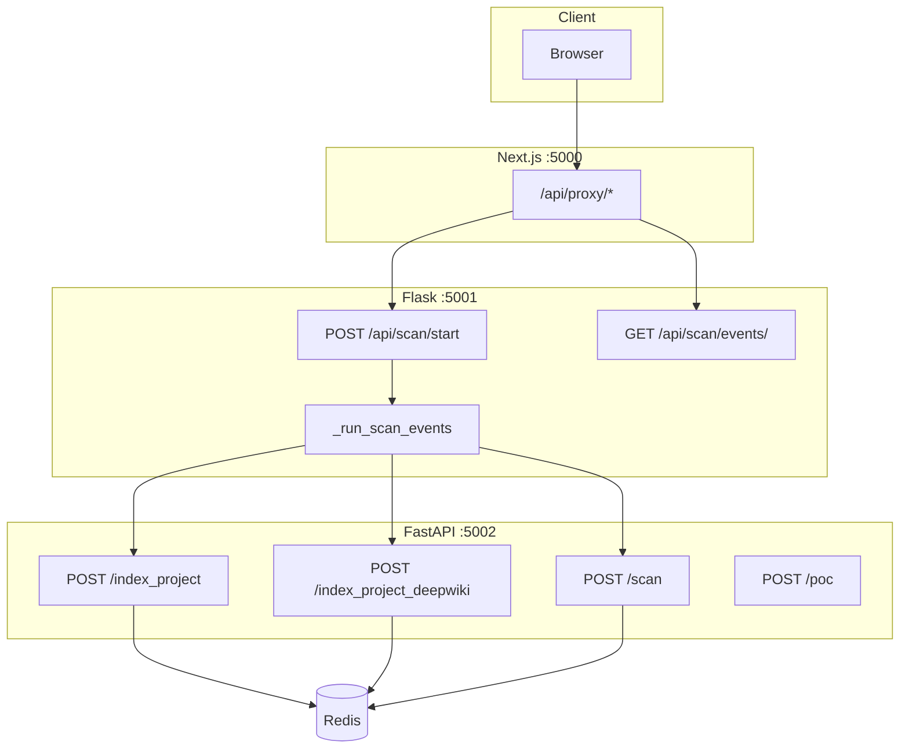
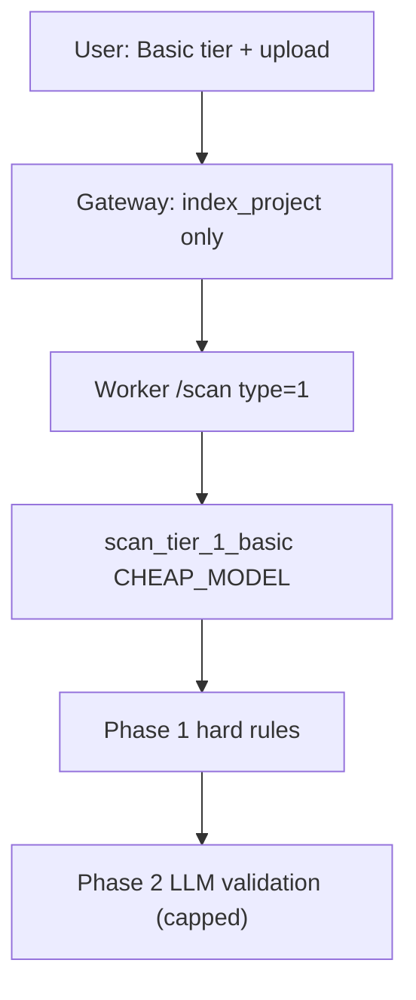
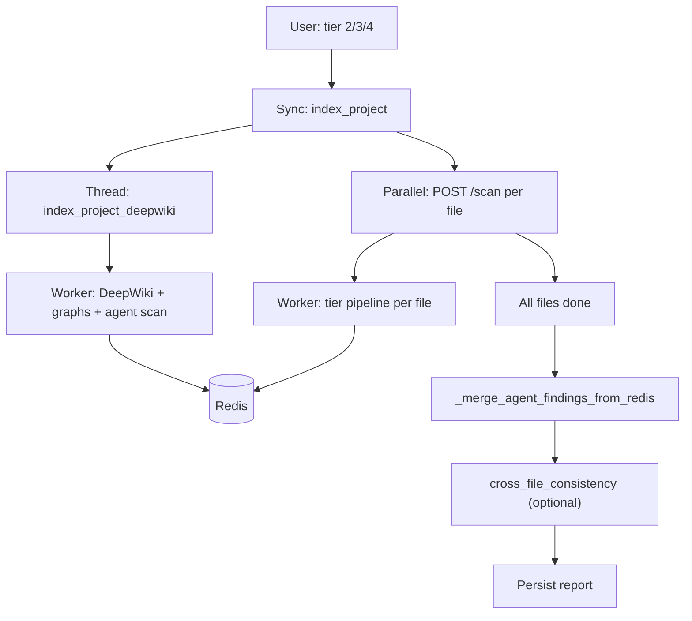

<h1 align="center">SentinAI v4</h1>

<p align="center">
  <a href="https://zread.ai/v7ren/SentinAI-Public">
    
  </a>
  <a href="https://deepwiki.com/v7ren/sentinai-public">
    
  </a>
</p>


SentinAI v4 is an **AI-powered Static Application Security Testing (SAST)** platform built to go far beyond simply scanning a file and asking an LLM whether it looks vulnerable.

Before any model analyzes a single file in depth, SentinAI builds a **project-wide intelligence briefing** of the codebase — mapping **call graphs**, **file dependencies**, **sanitizer registries**, **dead code**, and other structural signals that give the scanner real architectural context. This allows the detection pipeline to reason about vulnerabilities using the **whole project**, not just isolated snippets.

SentinAI combines **fast regex-based indexing**, **tiered LLM analysis**, and an optional **multi-agent security pipeline** to detect issues such as:

- SQL injection
- cross-site scripting
- command injection
- authentication and authorization flaws
- cryptographic weaknesses
- insecure configuration
- business logic vulnerabilities

The core philosophy is **context before detection**. Instead of treating source files as standalone text, SentinAI first understands how the application is structured, how data moves, where trust boundaries exist, and which defenses may already be in place. Findings then pass through **multiple validation layers** — including hard filtering rules, LLM-based verification, skeptic review, and confidence scoring — to reduce false positives before results are shown to the user.

Built as a **three-service architecture** — **Next.js frontend**, **Flask gateway**, and **FastAPI worker** — SentinAI supports modern multi-stage scanning workflows, project-level enrichment, report generation, and on-demand proof-of-concept generation for validated findings.

---

## Why SentinAI

Traditional SAST tools are strong at broad pattern matching, but they often generate noisy alerts because they lack rich semantic understanding of the codebase. Pure LLM-based scanning improves reasoning, but it can be expensive, inconsistent, and blind to whole-project structure when operating on isolated files.

SentinAI v4 is designed to bridge that gap.

It combines:

- **deterministic structural indexing**
- **cost-aware tiered LLM escalation**
- **project-level multi-agent security analysis**
- **layered adversarial validation**
- **final report reconciliation for consistency**

The result is a scanner that aims to preserve the recall benefits of AI-assisted analysis while improving precision through structure, context, and validation.

---

## Key Capabilities

### Project-wide intelligence briefing

Before deep analysis, SentinAI can build a shared context layer for the project, including:

- regex/symbol index
- DeepWiki project IR
- file dependency map
- function call graph
- API surface hints
- sanitizer registry
- dead-code hints
- file content store for tool-using validators
- project-level agent findings

### Tiered analysis engine

SentinAI supports four scan tiers so users can trade off:

- speed
- cost
- depth
- reasoning complexity

### Multi-agent project scan

For higher scan tiers, the worker can run a project-level multi-agent pipeline that includes:

- reconnaissance
- pattern extraction
- threat modeling
- specialist security agents
- deduplication
- consensus scoring
- skeptical adversarial review
- optional attack chain and remediation generation

### Layered validation

Findings are not accepted at face value. They can be passed through:

- deterministic exclusion rules
- phase-2 LLM validation
- optional tool-using agentic validation
- SkepticPass
- multi-signal confidence scoring

### Operational overlap with final consistency repair

DeepWiki and project-level agent scanning can overlap with per-file scans for latency reasons. SentinAI compensates for that with a gateway-side reconciliation step that merges delayed project-level findings into the final report.

---

## Architecture Overview

SentinAI is a **three-service system**:

1. **Frontend** — Next.js
2. **Gateway** — Flask
3. **Worker** — FastAPI

The browser never talks directly to the worker.



### Service responsibilities

| Service | Main path | Responsibility |
|---------|-----------|----------------|
| Frontend | `src/` | Dashboard, upload UI, SSE progress, result viewing |
| Gateway | `backend/mainflask.py` | Sessions, CSRF, uploads, scan orchestration, persistence |
| Worker | `backend/worker/core/main.py` | Indexing, DeepWiki, tiered scanning, validation, PoC generation |
| Redis | external | Per-scan shared context and ephemeral state |
| SQLite / JSON | `sentinel.db`, `scan_results/` | Durable scan history and reports |

---

## How a Scan Works

At a high level, a scan follows this lifecycle:

1. The user uploads a project and selects a scan tier.
2. The frontend calls the gateway through proxy routes.
3. The gateway allocates a `scan_id` and returns immediately.
4. The browser opens an SSE connection for progress updates.
5. The gateway runs **regex indexing** first.
6. For tiers 2–4, the gateway kicks off **DeepWiki indexing** in a background thread.
7. The gateway immediately starts submitting **per-file `/scan` jobs**.
8. The worker scans files using the selected tier pipeline and available project context.
9. The DeepWiki pipeline may finish later and write agent findings to Redis.
10. After all files finish, the gateway performs a final merge of agent findings.
11. The gateway may call cross-file consistency validation.
12. Results are saved to the database and `scan_results/`.

### Critical timeline

This ordering matters:

1. **Regex indexing blocks until completion**
2. **DeepWiki starts asynchronously for tiers 2–4**
3. **Per-file scans begin while DeepWiki is still running**
4. **Per-file worker-side merge of agent findings only happens if `deepwiki_complete` exists**
5. **Gateway-side `_merge_agent_findings_from_redis` ensures final report completeness**

This is an intentional tradeoff:

- **lower end-to-end latency**
- **eventual consistency at final report time**

---

## Scan Tiers

| Tier | `scan_type` | Summary |
|------|-------------|---------|
| **1 — Basic** | `"1"` | Tier 1 triage only, plus two-phase false-positive filtering |
| **2 — Standard** | `"2"` | Tier 1 triage, then Tier 2 escalation if suspicious |
| **3 — Advanced** | `"3"` | Tier 1 triage, then Tier 3 deep analysis with CVSS/remediation paths |
| **4 — Intelligence** | `"4"` | LLM-centric primary analysis with Tier 1 fallback |

### Tier 1 — Basic

- regex index only
- per-file `CHEAP_MODEL` triage
- two-phase false-positive filter
- no normal DeepWiki / project-level agent scan in the standard gateway flow

### Tier 2 — Standard

- Tier 1 triage first
- escalates to Tier 2 when findings warrant deeper review
- uses project context from indexing when available

### Tier 3 — Advanced

- Tier 1 triage first
- deeper `SMART_MODEL` analysis
- supports richer severity/remediation output
- can use agentic validation paths on configured routes

### Tier 4 — Intelligence

- `llm_centric_detector.py` is the primary path
- Tier 1 acts as a fallback if the LLM-centric detector returns no findings
- gateway-side merge is important because some worker-side merge paths can be bypassed by early return behavior

---

## Multi-Agent Pipeline

The multi-agent scan is **project-level**. It runs once per successful DeepWiki indexing pass for higher scan tiers when enabled.

### When it runs

The worker runs the multi-agent pipeline only if:

- `AGENT_SCAN_ENABLED=true`
- `OPENROUTER_API_KEY` is configured

### Coordinator phases

#### 1. Pre-scan context agents

Execution order:

- **ReconAgent** and **PatternAgent** run in parallel
- **ThreatModelAgent** runs after both complete

These populate shared context such as:

- `entry_points`
- `architecture_patterns`
- `threat_model`

#### 2. Specialist agents

Default specialists run in parallel:

- Injection
- Auth
- Crypto
- Cipher Design
- Logic
- Config

Optional:

- `LLMSecurityAgent`

#### 3. Synthesis and adversarial review

Post-specialist processing includes:

- `DeduplicationEngine`
- `ConsensusScorer`
- `SkepticAgent`

Optional extensions include:

- `ChainCombiner`
- `AttackPathSimulator`
- `RemediationAgent`

### Agent findings lifecycle

Agent outputs are written to Redis under keys such as:

- `{scan_id}:agent_findings`
- `{scan_id}:agent_chains`
- `{scan_id}:agent_attack_paths`
- `{scan_id}:agent_remediations`

They are later merged:

- into per-file worker responses when timing allows
- into the final gateway report regardless of per-file race conditions

---

## Validation and False-Positive Reduction

SentinAI uses multiple layers of validation to reduce noise while preserving recall.

### Hard detection rules

Deterministic rules run early and can emit findings or filter known-noisy cases.

Main module:

- `findings_filter.py`

### Two-phase validation

Main module:

- `findings_validator.py`

#### Phase 1

- hard exclusions
- comment/test noise reduction
- fast deterministic checks

#### Phase 2

Each remaining finding can be reviewed by an LLM validator.

Validation modes include:

- **static validation**
- **agentic validation**, where the validator can call tools such as:
  - `fetch_file`
  - `fetch_function`
  - `trace_callers`
  - `trace_callees`
  - `lookup_sanitizers`
  - `check_dead_code`
  - `fetch_context_slice`

### SkepticPass

High-severity findings can be passed through a skeptical re-review that asks:

- is the severity justified?
- is required authentication being ignored?
- is there a framework defense or sanitizer being missed?
- is the finding only present in dead code?

SkepticPass is designed to **fail open** on internal errors.

### MultiSignalConfidenceScorer

The final confidence can incorporate:

- tier outputs
- validator decisions
- skeptic results
- file risk ranking
- sanitizer presence
- dead-code hints

### Cross-file consistency

Before final save, the gateway can send aggregated findings to the worker for cross-file consistency checks.

---

## Outputs

A scan can generate multiple outputs.

### JSON

Primary machine-readable report.

Typical path:

- `backend/scan_results/<scan_id>/result.json`

### SARIF 2.1

For CI/CD and external security tooling.

Typical path:

- `backend/scan_results/<scan_id>/result.sarif`

### Findings Markdown

Human-readable summary for review and sharing.

Typical path:

- `backend/scan_results/<scan_id>/findings.md`

### DeepWiki documentation

Generated project documentation and merged markdown under:

- `backend/worker/core/deepwiki_docs/<scan_id>/`

### Proof-of-concept generation

On-demand PoC generation is exposed through the worker `/poc` endpoint and gateway batch routes.

---

## Repository Structure

## High-level map

| Area | Path | Purpose |
|------|------|---------|
| Frontend | `src/` | Next.js dashboard, proxy routes, report UI |
| Gateway | `backend/mainflask.py` | Orchestration, SSE, session and persistence logic |
| Worker | `backend/worker/core/main.py` | Main analysis engine |
| Agents | `backend/worker/core/agents/` | Multi-agent pipeline |
| Indexers | `backend/worker/core/indexers/` | Dependency, call graph, sanitizer, dead-code extraction |
| Enrichment | `backend/worker/core/enrichment/` | Dataflow, risk scoring, context slicing |
| Validation | `backend/worker/core/validation/` | SkepticPass, scoring, consistency |
| Output | `backend/worker/core/output/` | SARIF and reporting |
| Benchmarks | `benchmark/`, `backend/worker/tests/benchmarks/` | Evaluation harness |
### Important worker modules

| Area | Files |
|------|-------|
| Tier scans | `ai_tier1.py`, `ai_tier2.py`, `ai_tier3.py`, `llm_centric_detector.py` |
| Indexing | `LLMindexer.py`, `project_indexer.py`, `indexers/*` |
| Enrichment | `enrichment/dataflow_hints.py`, `file_risk_ranker.py`, `context_slicer.py` |
| Validation | `findings_filter.py`, `findings_validator.py`, `validation/*` |
| Agents | `agents/coordinator.py`, `agents/base_agent.py`, `agents/openrouter_agentic.py`, `agents/pipeline_tools.py`, `agents/specialists/*` |

---

## Services

### Frontend

- Next.js application
- dashboard and upload flow
- SSE consumption
- report visualization
- authentication integration
- backend proxy routes under `src/app/api/proxy/*`

### Gateway

- Flask service
- upload handling
- `scan_id` allocation
- CSRF and session management
- worker dispatch
- scan result persistence
- SSE progress stream
- final report assembly

### Worker

- FastAPI service
- `/scan`
- `/index_project`
- `/index_project_deepwiki`
- `/poc`
- `/cross_file_consistency`

---

## API Endpoints

### Gateway endpoints

| Method | Path | Description |
|--------|------|-------------|
| GET | `/api/csrf-token` | Return CSRF token |
| POST | `/api/scan/start` | Start a scan |
| POST | `/api/scan/stream` | Upload + SSE mode |
| POST | `/api/scan` | Upload + JSON response mode |
| GET | `/api/scan/events/<scan_id>` | SSE progress |
| GET | `/api/scan/status/<scan_id>` | Polling status |
| POST | `/api/scan/pocs` | PoC generation |
| GET | `/api/health` | Health endpoint |

### Worker endpoints

| Method | Path | Description |
|--------|------|-------------|
| POST | `/scan` | Per-file scan |
| POST | `/index_project` | Regex and symbol indexing |
| POST | `/index_project_deepwiki` | DeepWiki, graphs, agent scan |
| POST | `/poc` | PoC generation |
| POST | `/cross_file_consistency` | Aggregated final consistency check |
| GET | `/health` | Health endpoint |

### Worker request headers

| Header | Purpose |
|--------|---------|
| `x-secret` | Shared `WORKER_SECRET` |
| `x-scan-id` | Active scan ID |
| `x-scan-type` | Tier selection |

---

## Redis Keys

These are the main per-scan Redis keys.

| Key suffix | Content |
|------------|---------|
| `deepwiki_index` | Project IR JSON |
| `file_deps` | File dependency map |
| `call_graph` | Function call graph |
| `sanitizer_registry` | Sanitizer candidates |
| `dead_code_map` | Dead/unreachable hints |
| `api_surface` | Entry-point-like functions |
| `file_store` | Filename → content map for validators / agentic tooling |
| `agent_findings` | Project-level agent findings |
| `agent_chains` | Optional chain artifacts |
| `agent_attack_paths` | Optional attack path artifacts |
| `agent_remediations` | Optional remediation artifacts |
| `deepwiki_complete` | Completion flag for extended indexing + agents |
| `indexing_meta` | Indexing metadata, including incremental reuse info |

### TTLs

- `SCAN_TTL` controls scan-scoped key lifetime
- `PROJECT_CACHE_TTL` controls longer-lived project-scoped cache lifetime

---

## Environment Variables

Below is a practical summary of the most important worker-side configuration.

### LLM routing

| Variable | Default | Purpose |
|----------|---------|---------|
| `OPENROUTER_API_KEY` | unset | Required for advanced scanning, indexing, and agents |
| `AGENT_MODEL` | `MINIMAX_MODEL` | Agent model |
| `MINIMAX_MODEL` | `minimax/minimax-m2.7` | Default agent model |
| `INDEXER_MODEL` | `openai/gpt-oss-120b` | DeepWiki / indexer |
| `CHEAP_MODEL` | `qwen/qwen3.5-9b` | Tier 1 triage |
| `SMART_MODEL` | `z-ai/glm-5` | Tier 3, PoC, skeptic, smart paths |
| `OPENROUTER_TIER2_MODEL` | aliases to smart model | Tier 2 |
| `COMPACTION_CHEAP_MODEL` | `CHEAP_MODEL` | Context compaction arbitration |

### Agents

| Variable | Default | Purpose |
|----------|---------|---------|
| `AGENT_SCAN_ENABLED` | `true` | Enable project-level multi-agent scan |
| `AGENT_AGENTIC_ENABLED` | `true` | Enable tool-using agent loops |
| `AGENT_AGENTIC_MAX_ROUNDS` | `10` | Max rounds per specialist |
| `AGENT_OPENROUTER_TIMEOUT_SECONDS` | `240` | Agent timeout budget |
| `AGENT_MAX_FILE_TOKENS` | `50000` | Max file text injected into agent context |
| `AGENT_LLM_SECURITY_ENABLED` | `true` | Enable LLM security specialist |
| `AGENT_CHAIN_COMBINER_ENABLED` | `true` | Enable chain building |
| `AGENT_ATTACK_PATH_SIMULATOR_ENABLED` | `true` | Enable attack path simulation |
| `AGENT_REMEDIATION_ENABLED` | `true` | Enable remediation generation |

### Validation and scan behavior

| Variable | Default | Purpose |
|----------|---------|---------|
| `PHASE1_CONFIDENCE_THRESHOLD` | `6.0` | Threshold for Phase 1 |
| `PHASE2_CONFIDENCE_THRESHOLD` | `6.0` | Threshold for Phase 2 |
| `FREE_TIER_PHASE2_MAX_FINDINGS` | `8` | Cap for Tier 1 Phase 2 |
| `SKEPTIC_PASS_ENABLED` | `true` | Enable SkepticPass |
| `SKEPTIC_CVSS_THRESHOLD` | `7.0` | SkepticPass trigger threshold |
| `SCAN_DIFF_ENABLED` | `true` | Incremental scan support |
| `DEPENDENCY_SCANNER_ENABLED` | `true` | Dependency/CVE correlation |
| `GIT_CONTEXT_ENABLED` | `true` | Git churn / recency signals |
| `HIGH_RECALL_MODE` | `false` | Keep more low-confidence items |
| `FP_FILTER_STRICTNESS` | `strict` | FP filter mode |
| `LOG_SERVER_URL` | unset | Optional live agent logging target |

### Infrastructure

| Variable | Default | Purpose |
|----------|---------|---------|
| `WORKER_SECRET` | unset | Gateway ↔ worker authentication |
| `REDIS_HOST` | `localhost` | Redis host |
| `REDIS_PORT` | `6379` | Redis port |
| `REDIS_OPTIONAL` | `0` | Allow in-memory fallback when set to `1` |

---

## Getting Started

### Prerequisites

You will typically need:

- Python for backend services
- Node.js for the frontend
- Redis
- OpenRouter API access for advanced features
- configured environment variables

### Install backend dependencies

```bash
cd backend
pip install -r requirements.txt
```

### Install frontend dependencies

```bash
npm install
```

---

## Running Locally

### 1. Start Redis

```bash
redis-server
```

### 2. Start the worker

```bash
cd backend/worker
uvicorn core.main:app --port 5002
```

### 3. Start the gateway

```bash
cd backend
python mainflask.py
```

### 4. Start the frontend

```bash
npm run dev
```

### Default local topology

| Service | Default port |
|---------|--------------|
| Frontend | `5000` |
| Gateway | `5001` |
| Worker | `5002` |
| Redis | `6379` |

---

## Typical End-to-End Flow

### User-side flow

1. User uploads files or a project folder
2. User selects a scan tier
3. Frontend sends request to the gateway
4. Gateway returns a `scan_id`
5. Browser opens SSE stream for live progress
6. Gateway indexes project and dispatches worker jobs
7. Worker returns per-file findings
8. Gateway compiles, reconciles, and persists the final report

### Tier 1 flow



### Tier 2–4 flow



---

## Benchmarks and Testing

### Benchmark runner

```bash
python benchmark/run_benchmark.py
```

Optional streaming mode:

```bash
USE_STREAMING=1 python benchmark/run_benchmark.py
```

### General tests

```bash
python test.py
python test_vulnerabilities.py
```

### Worker tests

```bash
cd backend/worker/core
python -m pytest ../tests/
```

### Benchmark assets

Useful locations:

- `benchmark/`
- `backend/worker/tests/benchmarks/`
- vulnerable demo projects and ground-truth manifests in the repository

---

## Research / Thesis Positioning

SentinAI v4 can be framed as a hybrid architecture that addresses several gaps in modern static analysis:

1. **Structured project context before LLM reasoning**
2. **Cost-aware tiered escalation**
3. **Project-level multi-agent specialization**
4. **Layered false-positive reduction**
5. **Latency-optimized orchestration with final consistency repair**

### Candidate evaluation directions

- precision / recall on benchmark projects
- ablation of agent scan
- ablation of DeepWiki and graph indexers
- effect of SkepticPass
- latency to first finding vs total scan completion time
- token and cost analysis by tier
- sensitivity to filter thresholds and high-recall settings

---

## Known Limitations

### Race windows between DeepWiki and per-file scans

Per-file scans may finish before `deepwiki_complete` is set, so worker-side agent merges can be skipped for those files.

**Mitigation:** gateway-side final merge.

### Duplicate project-level findings in per-file outputs

Agent findings may be appended to every result row by design.

**Reason:** report-level completeness and symmetric downstream handling.

### Model drift and reproducibility

Behavior depends on third-party LLMs and model versions.

**Recommendation:** pin models and log prompts/responses where operationally acceptable.

### Tier 4 early-return behavior

Some worker-side merge paths can be bypassed.

**Mitigation:** gateway-side agent reconciliation remains important.

### Third-party service dependency

Advanced features depend on external LLM provider availability and behavior.

---

## Security and Ethics Notes

### Proof-of-concept generation

PoC generation is a powerful feature and should only be used:

- with authorization
- in controlled environments
- for validation, remediation, and research purposes

### User code handling

Advanced scan tiers may send source code or code excerpts to third-party LLM providers.

This should be addressed explicitly in:

- privacy policy
- deployment guidance
- internal compliance documentation

### Intentionally vulnerable test apps

Some benchmark targets in the repository are intentionally vulnerable.

Do **not** deploy them publicly.

---

## Glossary

| Term | Meaning |
|------|---------|
| **SAST** | Static Application Security Testing |
| **DAST** | Dynamic Application Security Testing |
| **DeepWiki** | LLM-generated project summaries and markdown docs |
| **Project IR** | Structured intermediate representation of the codebase |
| **Sanitizer** | A function or mechanism that validates or cleans input |
| **Dead code** | Code that appears unreachable or non-exploitable |
| **Tier** | Selected scan depth (`1`–`4`) |
| **Agent findings** | Project-level findings discovered by the multi-agent pipeline |
| **SkepticAgent** | Adversarial reviewer inside the agent pipeline |
| **SkepticPass** | Post-scan skeptical review on high-severity findings |
| **Fail open** | Keep findings on internal validation failures rather than silently dropping them |
| **SSE** | Server-Sent Events |
| **PoC** | Proof of concept exploit or exploit sketch |

---

## Summary

SentinAI v4 is a **context-first, tiered, multi-agent static security scanner** designed to combine the best parts of structured analysis and LLM reasoning.

Its design can be summarized in three ideas:

- **build project intelligence first**
- **escalate expensive reasoning only when needed**
- **validate and reconcile findings aggressively before reporting**

## Credits

The name **DeepWiki** used in SentinAI was inspired by **Devin AI**. Credit to the Devin team for the naming inspiration.
