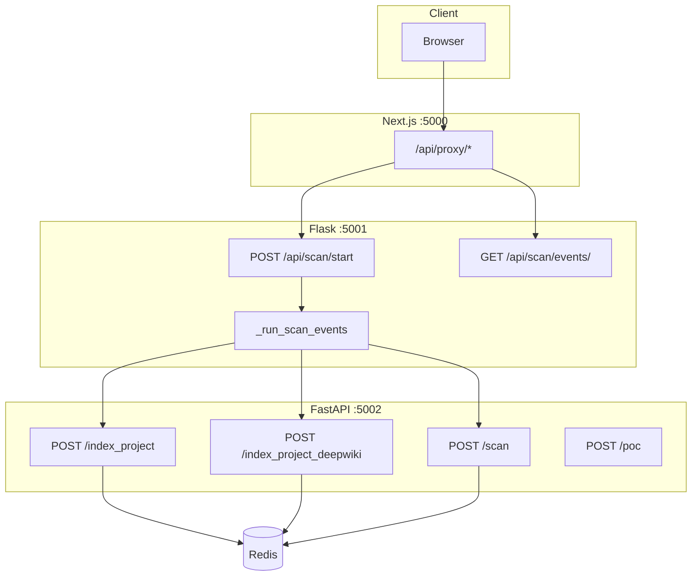
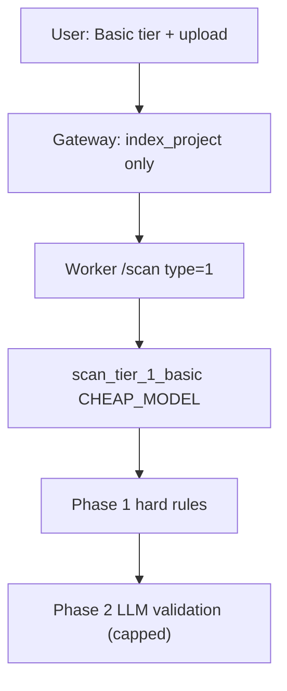
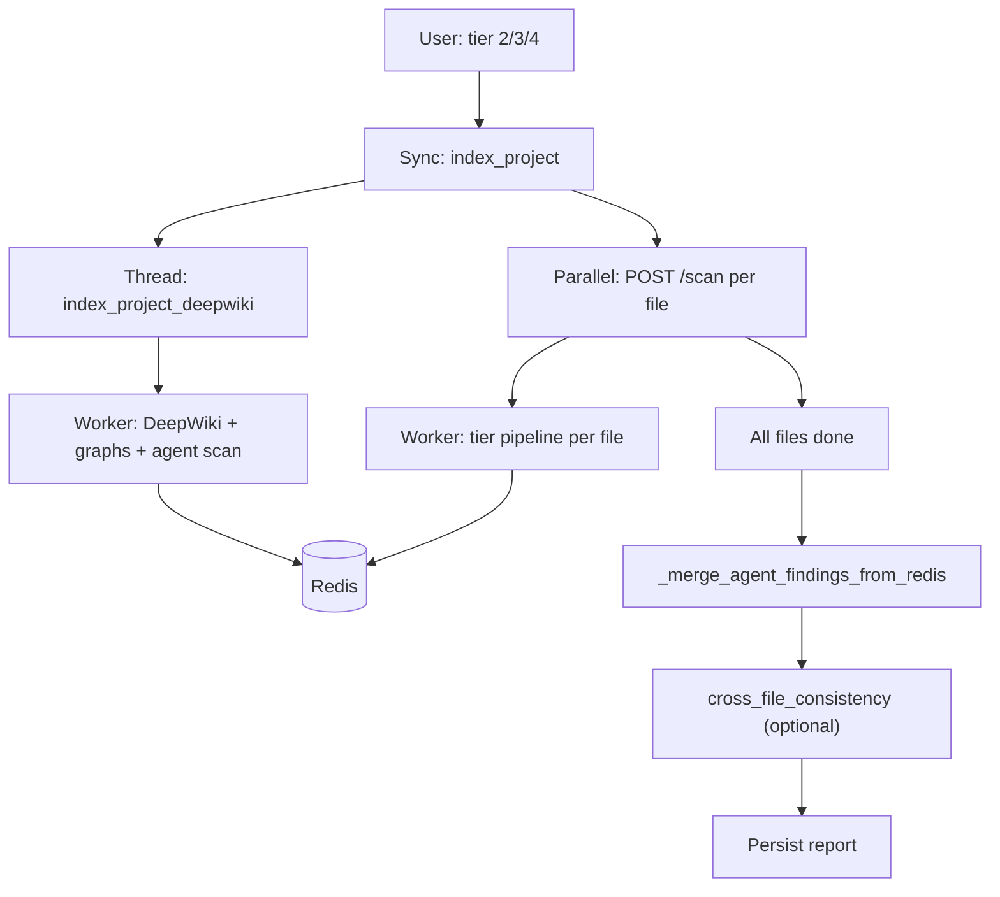
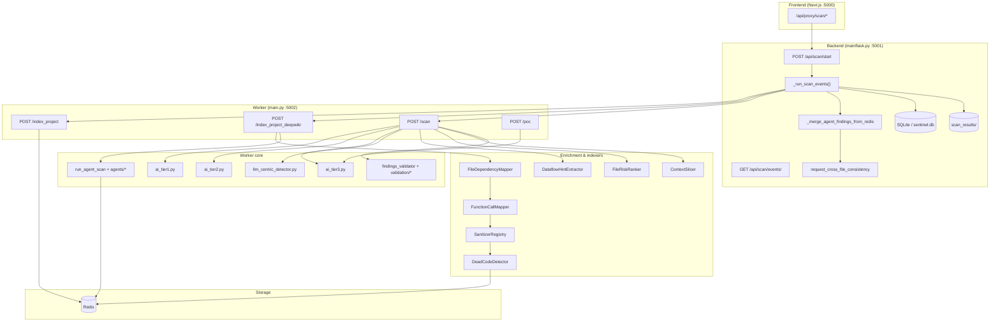

# SentinAI v4 — Architecture & user flows

**Last aligned with codebase:** worker `backend/worker/core/main.py`, gateway `backend/mainflask.py`, config `backend/worker/core/config.py`, agents `backend/worker/core/agents/`.

This file is the **main narrative**: mental model, end-to-end timeline, tier flows, and diagrams. For thesis work, pair it with the split references below (tables, keys, agent internals).

---

## How to read this documentation

| If you need… | Open… |
|--------------|--------|
| **Quick lookups** (Redis keys, env vars, module paths) | [`docs/ARCHITECTURE_REFERENCE.md`](docs/ARCHITECTURE_REFERENCE.md) |
| **Multi-agent pipeline** (coordinator order, specialists, tool loop, merge behavior) | [`docs/MULTI_AGENT_PIPELINE.md`](docs/MULTI_AGENT_PIPELINE.md) |
| **Thesis framing** (contributions, evaluation hooks, chapter sketch) | [`docs/THESIS_RESEARCH_NOTES.md`](docs/THESIS_RESEARCH_NOTES.md) |

---

## At a glance

- **Three processes:** Next.js frontend → Flask gateway → FastAPI worker. The browser never calls the worker directly.
- **Tier 1:** Regex index only; per-file `CHEAP_MODEL` triage + two-phase false-positive filter. No DeepWiki / no project-level agent scan in the normal gateway flow.
- **Tiers 2–4:** Regex index **blocks until done**, then DeepWiki + extended indexers + optional **multi-agent scan** run on the worker via a **gateway background thread** while **per-file `/scan` already runs in parallel** (see [Critical timeline](#critical-timeline-deepwiki-vs-per-file-scans)).
- **Six core specialists** (+ optional LLM-security agent): Injection, Auth, Crypto, **Cipher design**, Logic, Config. Agent model defaults to **`AGENT_MODEL`** (→ `MINIMAX_MODEL`, default `minimax/minimax-m2.7`) on OpenRouter.
- **Findings are validated in layers:** hard rules → LLM Phase 2 (static or agentic on some paths) → SkepticPass (tier findings) → multi-signal scoring; agent pipeline has its own dedup → consensus → SkepticAgent.

---

## Start here: the mental model

v4 is not “one LLM reads one file.” It is closer to **building a project briefing** (symbols, DeepWiki IR, dependency graph, call graph, sanitizer registry, dead-code hints, optional multi-agent findings), then **per-file tiered analysis** that consumes that context, then **reconciling** project-level findings into the report the user sees.

The **multi-agent scan** is **project-wide**: it runs once per successful DeepWiki indexing pass (when enabled), stores results in Redis, and those findings are **merged** into per-file worker responses when safe, and **again** at the gateway when compiling the final report (to handle timing races).

---

## Part 1 — Three services (architecture)

```
Browser (Next.js :5000)
  →  /api/proxy/*  →  Flask gateway (:5001)  →  FastAPI worker (:5002)  →  OpenRouter (LLMs)
```

| Layer | Path | Role |
|-------|------|------|
| **Frontend** | `src/` | Dashboard, upload, SSE progress, results, Clerk auth |
| **Gateway** | `backend/mainflask.py` | Sessions, CSRF, uploads, `scan_id`, worker dispatch, SSE, DB / `scan_results/` |
| **Worker** | `backend/worker/core/main.py` | Indexing, DeepWiki, graphs, agents, `/scan`, `/poc`, validation |



---

## Critical timeline: DeepWiki vs per-file scans

This is the detail most architecture sketches get wrong.

1. Gateway runs **regex indexing** (`index_project_on_workers` → `/index_project`) **synchronously** with progress events. **No per-file scan starts until this finishes.**
2. For `scan_type` in `2`, `3`, `4`, the gateway starts **`index_project_deepwiki_on_workers` in a daemon thread** (HTTP kick to `/index_project_deepwiki` with a short client timeout). The gateway **immediately** begins submitting **per-file** `POST /scan` jobs.
3. The worker’s DeepWiki handler may run for a long time (LLM IR, wiki sections, `FileDependencyMapper`, `FunctionCallMapper`, `SanitizerRegistry`, `DeadCodeDetector`, then **`run_agent_scan`**). While it runs, individual files may already be scanned.
4. The worker sets **`{scan_id}:deepwiki_complete`** only when the DeepWiki path finishes. Per-file merge of **`agent_findings`** checks this flag; if it is missing, merge is **skipped** for that file (race), with a warning in logs.
5. When **all files** complete, the gateway calls **`_merge_agent_findings_from_redis`**: it polls Redis for up to **120 seconds** for `agent_findings`, then **appends the mapped agent findings to every result row** so the compiled report includes project-level issues even when step 4 missed them.

**Implication for a thesis:** you can describe this as **deliberate overlap for latency**, with **eventual consistency** at report time via gateway reconciliation.

---

## Part 2 — User flow from “Start scan”

1. User selects tier and uploads files; frontend calls the proxy → gateway **`/api/scan/start`** (or stream variant).
2. Gateway writes uploads to a temp tree, allocates **`scan_id`**, returns immediately; SSE stream opens for progress.
3. **Indexing:** regex index (all tiers that scan); DeepWiki kick (tiers 2–4 only, parallel as above).
4. **Per file:** gateway reads text (size / extension checks), submits **`send_to_worker`** → worker **`/scan`** with headers `x-scan-type`, `x-scan-id`.
5. Worker returns JSON per file; gateway streams `vuln_found` / `file_safe` events.
6. **Compile report:** merge agent findings from Redis → **optional** `request_cross_file_consistency` → `save_scan_result` / `save_scan_result_to_file`.

---

## Part 3 — Indexing stages

### Stage A — Regex / symbol index (`/index_project`)

Fast structural pass; stored in Redis under the scan id. Used for cross-references during per-file scans.

### Stage B — DeepWiki + extended indexers (`/index_project_deepwiki`)

1. **LLMProjectIndexer** builds a **project IR**; stored as `{scan_id}:deepwiki_index`. **WikiGenerator** writes section markdown under `backend/worker/core/deepwiki_docs/<scan_id>/` and a merged `<scan_id>.md`.
2. **FileDependencyMapper** → `{scan_id}:file_deps`
3. **FunctionCallMapper** → `{scan_id}:call_graph` and **`{scan_id}:api_surface`** (entry-point-like nodes)
4. **SanitizerRegistry** → `{scan_id}:sanitizer_registry`
5. **DeadCodeDetector** → `{scan_id}:dead_code_map`
6. **`file_store`** — content map for tool-using validation / agentic tooling
7. Optional **incremental reuse** via `project_key` and file digest keys (see reference doc).

**Multi-agent scan:** If `AGENT_SCAN_ENABLED` and `OPENROUTER_API_KEY`, **`run_agent_scan`** executes (see [`docs/MULTI_AGENT_PIPELINE.md`](docs/MULTI_AGENT_PIPELINE.md)), then **`{scan_id}:agent_findings`** is written.

---

## Part 4 — Multi-agent scan (summary)

**Pre-scan agents:** Recon and Pattern **in parallel**; Threat Model **after**. **Specialists:** six by default (Injection, Auth, Crypto, **CipherDesign**, Logic, Config) **in parallel**; optional **LLMSecurityAgent**. **Post-coordinator (in `main.run_agent_scan`):** Dedup → Consensus → SkepticAgent → optional ChainCombiner / AttackPathSimulator / RemediationAgent → Redis artifacts.

Agent findings are merged into tier findings **after** tier enrichment for Tier 2/3 vulnerable paths **when `deepwiki_complete` is set**, then pass through the same two-phase FP filter as other findings. Gateway **post-merge** ensures report-level completeness.

---

## Part 5 — Pre-scan enrichment (per file on `/scan`)

Before tier models run (tiers 2–4), the worker typically runs:

- **Hard detection rules** (`findings_filter.apply_hard_detection_rules`) — deterministic findings merged early.
- **DataflowHintExtractor** — taint / entry hints.
- **FileRiskRanker** — risk score; may influence tier escalation.
- **ContextSlicer** — function-focused chunks; large files may use **`compact_security_context`** (`context_compactor.py`, optional cheap LLM arbitration).

DeepWiki text and Redis graphs are combined into **`combined_context`** for tier 2/3.

---

## Part 6 — Scan tiers (behavior)

| Tier | `scan_type` | Pipeline (simplified) | Primary modules |
|------|-------------|------------------------|-----------------|
| **1** Basic | `"1"` | Tier 1 triage only + two-phase FP filter (Phase 2 capped) | `ai_tier1.py` |
| **2** Standard | `"2"` | Tier 1 → if vulnerable, Tier 2 (`TIER2_MODEL`) | `ai_tier1.py`, `ai_tier2.py` |
| **3** Advanced | `"3"` | Tier 1 → if vulnerable, Tier 3 (`SMART_MODEL`, CVSS/remediation) + optional **agentic** Phase 2 validation | `ai_tier1.py`, `ai_tier3.py`, `findings_validator.py` |
| **4** Intelligence | `"4"` | **LLM-centric** primary (`llm_centric_detector.py`); Tier 1 fallback if zero findings; agentic validation for borderline Tier 4 findings | `llm_centric_detector.py`, `ai_tier1.py` |

**Models (defaults from `config.py`):** `CHEAP_MODEL` (e.g. `qwen/qwen3.5-9b`), `TIER2_MODEL` / `SMART_MODEL` (e.g. `z-ai/glm-5`), `INDEXER_MODEL` for DeepWiki, **`AGENT_MODEL`** for agents.

---

## Part 7 — Validation and scoring

- **Two-phase validation** (`findings_validator.apply_two_phase_validation`): Phase 1 hard exclusions; Phase 2 per-finding LLM validation. **Agentic mode** (`AgenticFindingsValidator`) can call tools (`fetch_file`, `trace_callers`, `lookup_sanitizers`, etc.) — used on configured paths (e.g. Tier 3 Phase 2, Tier 4 borderline set).
- **SkepticPass** (`validation/skeptic_pass.py`) — extra pass on high-severity tier findings (CVSS threshold); **fails open** on errors. Agent findings pre-reviewed by **`SkepticAgent`** can be skipped when configured in the worker.
- **MultiSignalConfidenceScorer** — combines tier signals, skeptic outcome, risk rank, sanitizers, dead code.
- **Cross-file consistency** — gateway calls worker **`POST /cross_file_consistency`** with aggregated vulnerabilities before save (when worker responds successfully).

---

## Part 8 — PoC generation (on demand)

User selects findings → frontend → gateway → worker **`POST /poc`** → `poc.py` uses **`SMART_MODEL`** (OpenRouter) to attach PoC payloads to findings.

---

## Part 9 — Optional Phase 4 / 5 extensions (worker)

Implemented modules (toggle via env — see reference doc):

| Feature | Module | Purpose |
|---------|--------|---------|
| Scan diff | `scan_diff.py` | Incremental sets using graphs |
| Dependency scanner | `dependency_scanner.py` | OSV CVE correlation |
| Git context | `git_context.py` | Churn / recency boosting |
| Fuzzing hints | `fuzzing_hint_generator.py` | Hints from paths / findings |
| LLM security agent | `agents/specialists/llm_security_agent.py` | Prompt/tooling abuse |

Benchmarks: `benchmark/run_benchmark.py`, `backend/worker/tests/benchmarks/`.

---

## Tier 1 flow (diagram)



---

## Tier 2–4 gateway + worker (diagram)



---

## Tier 3 call chain (concise)

```
Dashboard scan_type=3
  → POST /api/scan/start
  → _run_scan_events: analyze_project_structure (layout)
  → index_project_on_workers (await)
  → thread: index_project_deepwiki_on_workers
  → for each file: send_to_worker → POST {worker}/scan x-scan-type: 3
  → Worker: enrichment + Tier 1 + Tier 3 + merge agent_findings if deepwiki_complete
  → two-phase FP filter + SkepticPass + scoring
  → compile: merge agent_findings from Redis (120s) + cross_file_consistency
  → save_scan_result
```

---

## Tier 4 call chain (concise)

```
scan_type=4
  → same indexing pattern as Tier 3
  → Worker: Tier 1 triage for fallback + llm_centric_scan primary
  → If LLM-centric returns findings early, response may omit worker-side agent merge
  → Gateway _merge_agent_findings_from_redis still attaches agent findings to all rows
```

---

## API endpoints (summary)

### Flask (`mainflask.py`)

| Method | Path | Description |
|--------|------|-------------|
| GET | `/api/csrf-token` | CSRF token for mutating requests |
| POST | `/api/scan/start` | Start scan |
| POST | `/api/scan/stream` | Upload + SSE |
| POST | `/api/scan` | Upload + single JSON |
| GET | `/api/scan/events/<scan_id>` | SSE |
| GET | `/api/scan/status/<scan_id>` | Poll |
| POST | `/api/scan/pocs` | PoC batch |
| GET | `/api/health` | Health |

### Worker (`main.py`)

| Method | Path | Description |
|--------|------|-------------|
| POST | `/scan` | Per-file scan |
| POST | `/index_project` | Regex index |
| POST | `/index_project_deepwiki` | DeepWiki + graphs + agent scan |
| POST | `/poc` | PoC |
| POST | `/cross_file_consistency` | Cross-file aggregation pass |
| GET | `/health` | Health |

---

## Full architecture map (mermaid)



---

## What makes v4 different (short summary)

- **Rich project context** before and during per-file analysis (graphs, sanitizers, dead code, DeepWiki, optional agents).
- **Cost-aware tiering** (cheap triage before smart escalation; Tier 4 reverses priority).
- **Multi-agent project pass** with deduplication, consensus, and skeptic review, plus optional chains / paths / remediation.
- **Layered validation** and **explicit reconciliation** of agent output at the gateway.
- **Operational parallelism** between DeepWiki and per-file scans, documented and compensated for in reporting.

---

## Honest limitations (useful for a thesis “threats to validity” section)

- **Race windows** between DeepWiki completion and per-file merges; mitigated but not eliminated.
- **Duplicate agent findings** across files by design (full list merged per file / row); deduplication for display may be a UI concern.
- **Third-party LLM behavior** varies with model/version; reproducibility requires pinning models and logging prompts/responses (optional debug flags exist for some subsystems).
- **Tier 4 early return** bypasses some worker-side merge paths; gateway merge is load-bearing for agent visibility.

For env defaults and Redis key names, always verify `backend/worker/core/config.py` and [`docs/ARCHITECTURE_REFERENCE.md`](docs/ARCHITECTURE_REFERENCE.md).
