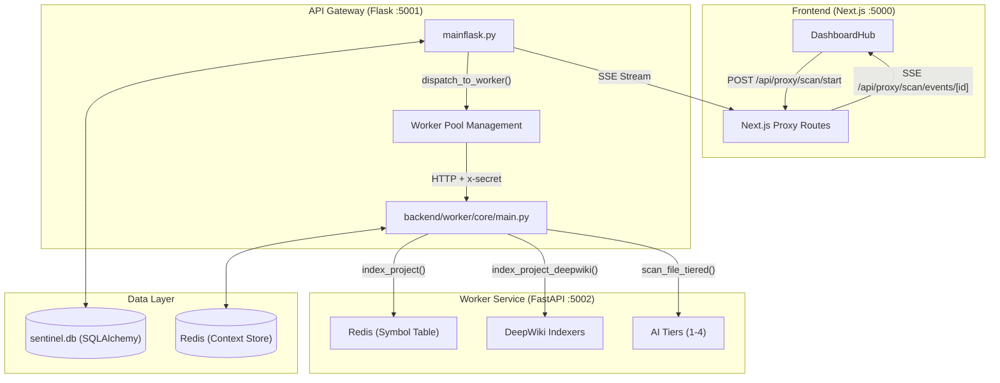
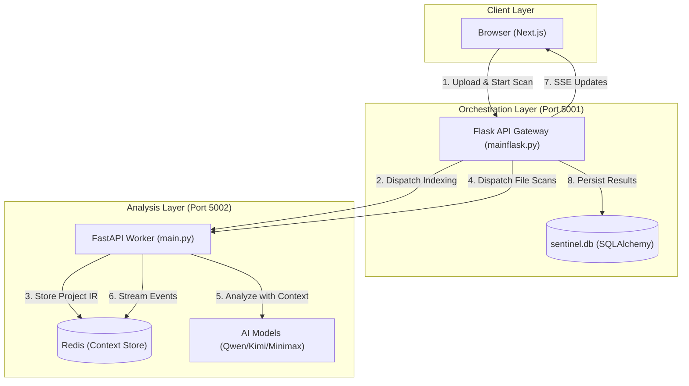
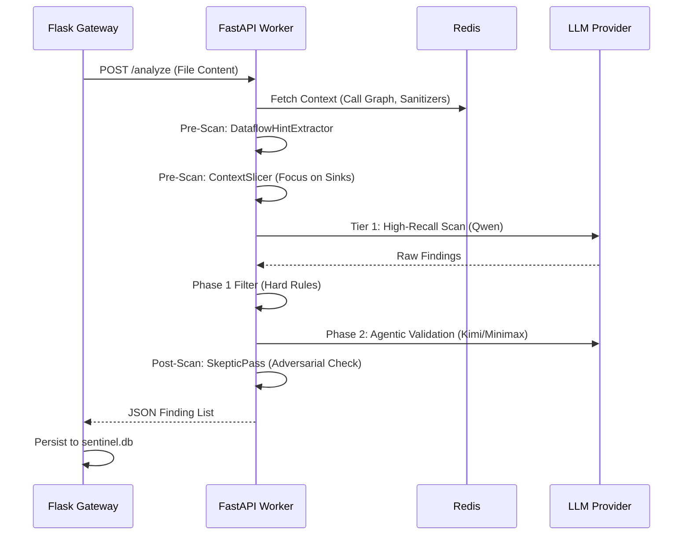
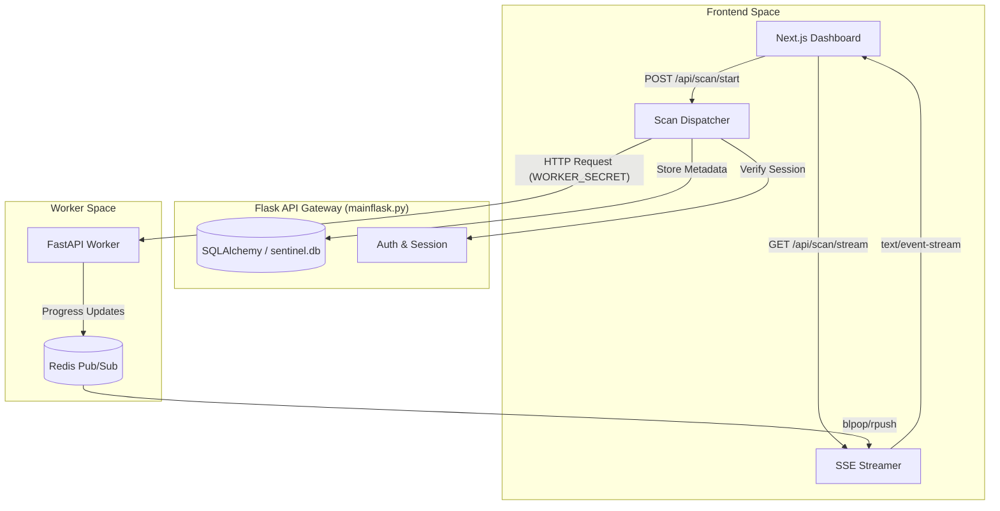
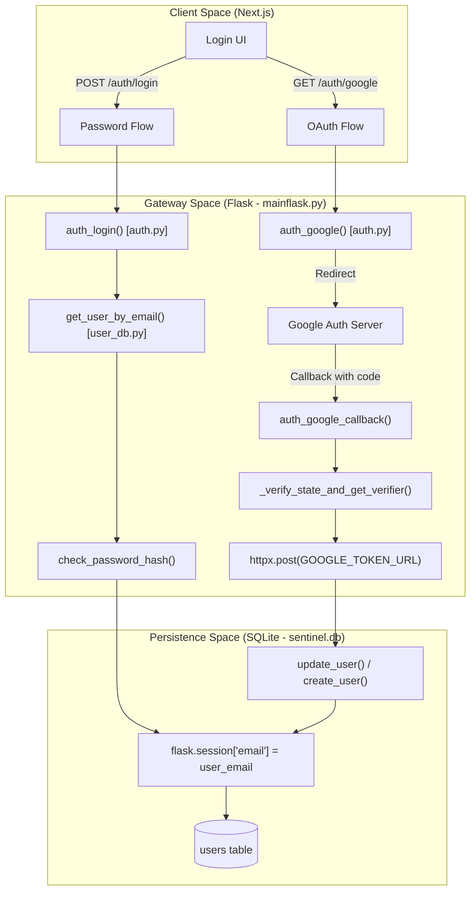
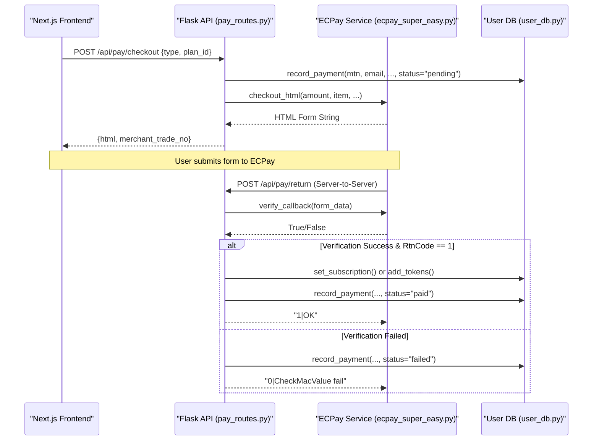
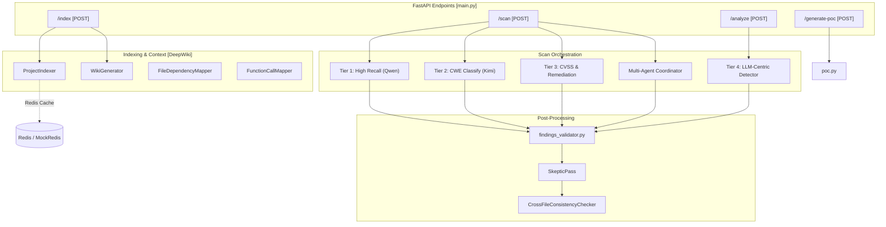

# SentinAI Wiki - Complete Dump

## Table of Contents

- 1: SentinAI Overview
- 1.1: Getting Started & Configuration
- 1.2: System Architecture & Data Flows
- 2: Flask API Gateway
- 2.1: Authentication & Session Management
- 2.2: Security Middleware (CORS & CSRF)
- 2.3: Subscriptions & Payments
- 3: FastAPI Worker & Scan Engine
- 3.1: Tiered AI Scan Modules
- 3.2: Indexing Pipeline (DeepWiki)
- 3.3: Pre-Scan Enrichment
- 3.4: Findings Validation & Filtering
- 3.5: Output & Reporting
- 4: Multi-Agent Pipeline
- 4.1: Pre-Scan Agents (Recon, Pattern, Threat Model)
- 4.2: Specialist Agents
- 4.3: Synthesis & Adversarial Validation
- 5: Database Layer
- 5.1: SQLAlchemy Schema & Models
- 5.2: Database Operations & User Store
- 6: Next.js Frontend
- 6.1: Dashboard & Scan UI
- 6.2: API Proxy Routes
- 7: Benchmarking & Testing
- 7.1: Benchmark Runner & Vulnerable Servers
- 7.2: Agent Unit Tests
- 8: Defrails: Autonomous Black-Box Pentest Agent
- 8.1: Defrails Architecture & Execution Loop
- 8.2: Defrails Recon, Exploit & Output
- 9: Glossary

---

# 1. SentinAI Overview

SentinAI v4 is a high-performance, AI-powered Static Application Security Testing (SAST) platform. Unlike traditional "single-pass" AI scanners, SentinAI employs a sophisticated multi-stage pipeline that combines project-wide indexing, a multi-agent specialist swarm, and a tiered LLM analysis engine to provide deep security insights with high precision and low false-positive rates.

The core philosophy of v4 is that the AI should be the **last** step in the process, not the first. Before an AI model ever reads a line of code, the system builds a comprehensive "intelligence briefing" including call graphs, dependency maps, and sanitizer registries.

## System Architecture

SentinAI is composed of three primary services that communicate over HTTP. This decoupled architecture allows for independent scaling of the frontend, the orchestration gateway, and the heavy-compute worker nodes.

### Service Interaction Map



## Key Capabilities

### 1. Multi-Agent Security Pipeline
For advanced scan tiers, SentinAI dispatches a swarm of specialized agents. This pipeline moves from high-level reconnaissance to specialist detection and finally to adversarial validation.
*   **Pre-scan Agents:** `ReconAgent`, `PatternAgent`, and `ThreatModelAgent` build the initial project context.
*   **Specialist Agents:** Five parallel specialists (`Injection`, `Auth`, `Crypto`, `Logic`, `Config`) scan for specific vulnerability classes.
*   **Synthesis:** Findings are refined via a `DeduplicationEngine`, `ConsensusScorer`, and a `SkepticAgent` for adversarial review.

### 2. Tiered Analysis Engine
The system supports four distinct scanning tiers to balance speed and depth.
*   **Tier 1 (Basic):** High-recall triage using `ai_tier1.py` (Qwen).
*   **Tier 2/3 (Standard/Advanced):** Escalates findings from Tier 1 to `ai_tier2.py` or `ai_tier3.py` (Kimi) for CWE classification or CVSS scoring.
*   **Tier 4 (Intelligence):** An LLM-centric single pass using `llm_centric_detector.py`.

### 3. DeepWiki Indexing & Enrichment
The "Briefing Phase" transforms raw source code into a structured internal representation (Project IR).
*   **FileDependencyMapper:** Maps the "blast radius" of vulnerabilities.
*   **FunctionCallMapper:** Builds inter-procedural call graphs.
*   **SanitizerRegistry:** Identifies custom validation logic to prevent false positives.
*   **DeadCodeDetector:** Flags unreachable code that cannot be exploited.

## Code Entity Space: The Scan Lifecycle

```mermaid
flowchart LR
    subgraph "Phase 1: Indexing"
        direction TB
        IDX1["project_indexer.py"]
        IDX2["indexers/FileDependencyMapper"]
        IDX3["indexers/SanitizerRegistry"]
    end

    subgraph "Phase 2: Multi-Agent Swarm"
        direction TB
        AG1["agents/ReconAgent"]
        AG2["agents/SpecialistAgents"]
        AG3["agents/SkepticAgent"]
    end

    subgraph "Phase 3: Tiered AI"
        direction TB
        T1["ai_tier1.py (Triage)"]
        T2["ai_tier3.py (Deep Audit)"]
    end

    subgraph "Phase 4: Validation"
        direction TB
        V1["findings_filter.py"]
        V2["validation/SkepticPass"]
        V3["validation/MultiSignalConfidenceScorer"]
    end

    IDX1 --> IDX2 --> IDX3
    IDX3 --> AG1 --> AG2 --> AG3
    AG3 --> T1 --> T2
    T2 --> V1 --> V2 --> V3
```



---

# 1.1 Getting Started & Configuration

## System Prerequisites

SentinAI is composed of three primary services that must be configured to communicate with each other:
1.  **Frontend**: Next.js (TypeScript)
2.  **API Gateway**: Flask (Python)
3.  **Worker Service**: FastAPI (Python)

### Dependency Installation

The backend services share a set of Python requirements located in `backend/requirements.txt`. Key dependencies include:
*   **Web Frameworks**: `flask`, `flask-cors`, and `werkzeug` for the gateway.
*   **Database**: `sqlalchemy` for ORM persistence.
*   **State Management**: `redis` is mandatory for the worker's enrichment pipeline.
*   **Security**: `bcrypt` for password hashing.

### Local Infrastructure Diagram

```mermaid
graph TD
    subgraph "Local Environment"
        "NextJS_Frontend"["Next.js Frontend (Port 3000)"]
        "Flask_Gateway"["Flask API Gateway (Port 5001)"]
        "FastAPI_Worker"["FastAPI Worker (Port 8000)"]
        "Redis_Server"["Redis Server (Port 6379)"]
        "SQLite_DB"["sentinel.db / user_db.py"]
    end

    subgraph "External APIs"
        "DeepInfra"["DeepInfra (Qwen 72B)"]
        "OpenRouter"["OpenRouter (Kimi/Minimax)"]
        "OSV_API"["OSV.dev API (Vulnerabilities)"]
    end

    "NextJS_Frontend" -- "Proxy Requests" --> "Flask_Gateway"
    "Flask_Gateway" -- "Orchestration" --> "FastAPI_Worker"
    "Flask_Gateway" -- "Persistence" --> "SQLite_DB"
    "FastAPI_Worker" -- "Context/State" --> "Redis_Server"
    "FastAPI_Worker" -- "AI Tier 1" --> "DeepInfra"
    "FastAPI_Worker" -- "AI Tier 2/3/4" --> "OpenRouter"
    "FastAPI_Worker" -- "SCA Scanning" --> "OSV_API"
```

## Environment Configuration

### Global & Gateway Settings
*   `FLASK_ENV`: Set to `development` for local work to enable debug headers.
*   `FRONTEND_URL`: The origin of the Next.js app (usually `http://localhost:3000`).
*   `BACKEND_URL`: The origin of the Flask gateway (defaults to `http://localhost:5001`).

### Worker & AI Settings
*   **API Keys**: `DEEPINFRA_API_KEY` and `OPENROUTER_API_KEY` are required for the multi-tier scan engine.
*   **Model Mapping**:
    *   `CHEAP_MODEL`: `Qwen/Qwen2.5-72B-Instruct` (used for Tier 1 high-recall scans).
    *   `SMART_MODEL`: `moonshotai/kimi-k2.5` (used for Tier 2 classification and Tier 3 remediation).
    *   `MINIMAX_MODEL`: Used specifically for agentic coordination.
*   **Redis Configuration**:
    *   `REDIS_HOST` / `REDIS_PORT`: Connection details for the enrichment cache.
    *   `REDIS_OPTIONAL`: Set to `1` to use `MockRedis` for unit testing without a live instance.

### Confidence Thresholds
*   `DETECTOR_MIN_CONFIDENCE`: The baseline score (0-10) for a finding to be considered.
*   `PHASE1_CONFIDENCE_THRESHOLD`: Threshold for initial AI detection.
*   `PHASE2_CONFIDENCE_THRESHOLD`: Threshold for agentic validation.

## Local Setup Procedure

1.  **Initialize Databases**: The system uses SQLite. The gateway will automatically initialize `sentinel.db` and the user store via `user_db.py` upon first run.
2.  **Start Redis**: Ensure Redis is running on `localhost:6379`.
3.  **Launch Worker (FastAPI)**:
    ```bash
    cd backend/worker
    uvicorn core.main:app --port 8000
    ```
4.  **Launch Gateway (Flask)**:
    ```bash
    cd backend
    python mainflask.py
    ```
5.  **Launch Frontend (Next.js)**:
    ```bash
    cd frontend
    npm install
    npm run dev
    ```

---

# 1.2 System Architecture & Data Flows

The SentinAI v4 architecture is a distributed, three-tier system designed for high-concurrency security analysis.

## High-Level Service Topology



## End-to-End Request Lifecycle

### 1. Initiation & Gateway Handshake
*   **Scan ID Generation:** The gateway generates a unique `scan_id` (e.g., `scan_user_12345`).
*   **Immediate Response:** The gateway returns the `scan_id` immediately.
*   **SSE Connection:** The browser opens an EventSource connection to `/api/scan/events/<scan_id>`.

### 2. The Indexing Lifecycle (The Briefing Phase)

| Phase | Function | Output | Storage Key (Redis) |
| :--- | :--- | :--- | :--- |
| **Basic Indexing** | `ProjectIndexer.index_files` | Symbol table, imports, exports | `{scan_id}:index` |
| **Dependency Mapping** | `FileDependencyMapper` | File-to-file import graph | `{scan_id}:file_deps` |
| **Call Graph** | `FunctionCallMapper` | Inter-procedural call paths | `{scan_id}:call_graph` |
| **Sanitizers** | `SanitizerRegistry` | List of validation/cleaning functions | `{scan_id}:sanitizer_registry` |
| **Dead Code** | `DeadCodeDetector` | Unreachable functions/branches | `{scan_id}:dead_code_map` |

### 3. Per-File Scan Pipeline



## Fail-Open & Resilience Semantics

1.  **Redis Fallback:** If Redis is unavailable, the worker initializes a `MockRedis` in-memory store.
2.  **Database Fallback:** If the SQLAlchemy `sentinel.db` fails to initialize, the gateway falls back to a flat-file `sentinel_db.json`.
3.  **Worker Retries:** The gateway implements a retry mechanism with backoff for 429/5xx responses.
4.  **Model Escalation:** If a Tier 1 scan fails or returns low confidence, the system can escalate to Tier 2/3.

---

# 2. Flask API Gateway

The Flask API Gateway (`mainflask.py`) serves as the central orchestration layer for the SentinAI ecosystem.

## Core Responsibilities

*   **Scan Orchestration:** Receives file uploads, performs initial project indexing, and dispatches scan tasks to available FastAPI worker nodes.
*   **Real-time Feedback:** Utilizes Redis-backed Server-Sent Events (SSE) to stream live progress from workers back to the frontend.
*   **Security & Identity:** Enforces session-based authentication and protects state-changing operations via CSRF validation.
*   **Subscription Enforcement:** Validates user tiers (Free, Pro, Team) against `TIER_CAPS`.



## Scan Management & Dispatch

| Feature | Implementation |
| :--- | :--- |
| **Worker Discovery** | Loaded from `WORKER_NODES` environment variable. |
| **Authentication** | Workers require a `WORKER_SECRET` for all incoming requests. |
| **Concurrency** | Managed via `ThreadPoolExecutor` for parallel worker dispatch. |
| **Data Persistence** | Uses SQLAlchemy by default, falling back to JSON if the DB is unavailable. |

---

# 2.1 Authentication & Session Management

SentinAI employs a multi-layered authentication system designed to support both modern OAuth 2.0 flows and traditional email/password credentials.

## Authentication Data Flow



## The `users` Table

| Column | Type | Description |
| :--- | :--- | :--- |
| `email` | TEXT (PK) | Primary identifier, normalized to lowercase. |
| `password_hash` | TEXT | Scrypt hash generated via `werkzeug.security`. |
| `auth_methods` | TEXT | JSON list of linked providers (e.g., `["google", "password"]`). |
| `tier` | TEXT | Subscription level (`free`, `pro`, `team`). |
| `token_balance` | INTEGER | Remaining AI scan credits. |

## Google OAuth 2.0 with PKCE

1.  **State Signing**: Cryptographically signed `state` parameter using `FLASK_SECRET_KEY`.
2.  **PKCE Challenge**: A `code_verifier` is generated and hashed using S256.
3.  **Callback Validation**: `_verify_state_and_get_verifier` validates the signature.

## Admin & Session Management

| Function | File | Purpose |
| :--- | :--- | :--- |
| `get_current_user_email()` | `auth_helpers.py` | Safely retrieves and normalizes the email from the server-side session. |
| `require_user()` | `auth_helpers.py` | Decorator-like helper that returns a 401 if no session exists. |
| `is_admin_session()` | `auth_helpers.py` | Boolean check for the administrative override flag. |

---

# 2.2 Security Middleware (CORS & CSRF)

## CORS Origin Resolution Pipeline

The function `get_cors_origin` in `backend/cors_helpers.py` determines the value for the `Access-Control-Allow-Origin` header:
1. If the incoming `Origin` header matches an entry in the allowed list, that specific origin is returned.
2. If no match is found but an allowed list exists, the first entry is returned.
3. Fallback to the request origin or `*`.

| Header | Value / Logic |
| :--- | :--- |
| `Access-Control-Allow-Origin` | Resolved via `get_cors_origin` |
| `Access-Control-Allow-Methods` | `GET, POST, PUT, PATCH, DELETE, OPTIONS` |
| `Access-Control-Allow-Headers` | `Content-Type, Authorization, X-CSRF-Token` |
| `Access-Control-Allow-Credentials` | `"true"` if origin is not `*`, else `"false"` |
| `Vary` | `Origin` |

## CSRF Protection (Double-Submit Cookie)

- **Token Generation**: `ensure_csrf_token_in_session` generates a 32-byte hex token using `secrets.token_hex`.
- **Validation**: `validate_csrf` compares the `X-CSRF-Token` header against the token stored in the server-side session.
- **Comparison**: Tokens are compared using `secrets.compare_digest` to prevent timing attacks.

### Trusted Proxy & Exemptions
1. **Trusted Proxy**: If the request includes an `X-Proxy-Secret` header matching `PROXY_SECRET`, it bypasses validation.
2. **Exempt Paths**: `/api/pay/return` (ECPay callbacks) and `/auth/oauth/google/callback` (OAuth redirects).

## Rate Limiting

Uses `flask_limiter` with the remote address as the key. Default limit: `200 per day`.

---

# 2.3 Subscriptions & Payments

SentinAI utilizes a tiered subscription model and a token-based credit system. The system integrates with **ECPay** for payment processing.

## Payment Lifecycle



## Subscription Tiers & Caps

| Tier | Monthly Cap (Consultations) | Description |
| :--- | :--- | :--- |
| `free` | 10 (Default) | Entry-level access with limited scan volume. |
| `pro` | 100 | Professional use with higher throughput. |
| `team` | Unlimited | Enterprise-grade access for large teams. |

## Security Considerations

1.  **MAC Verification**: Every callback from ECPay is validated using `verify_callback()`.
2.  **Pending State**: Transactions are first recorded as `pending`. Credits are only granted if the current status is not already `paid`.
3.  **Amount Validation**: The callback amount is cross-referenced against the amount stored in the local database.

---

# 3. FastAPI Worker & Scan Engine

The FastAPI Worker is the core analytical engine of SentinAI.

## Service Overview

The worker follows a "Pipeline" pattern:
1.  **Indexing**: Extracting symbols, dependencies, and project structure.
2.  **Enrichment**: Calculating risk scores and tracing data flows.
3.  **Detection**: Running tiered AI models (Tier 1-4) or the Multi-Agent pipeline.
4.  **Validation**: Filtering false positives and verifying cross-file consistency.
5.  **Reporting**: Generating SARIF, Markdown, and PoC scripts.



---

# 3.1 Tiered AI Scan Modules

| Tier | File | Model | Primary Objective | Key Characteristics |
| :--- | :--- | :--- | :--- | :--- |
| **Tier 1** | `ai_tier1.py` | Qwen-2.5-72B (Cheap) | High Recall / Surface Scan | Chunks large files; identifies suspicious patterns. |
| **Tier 2** | `ai_tier2.py` | Kimi-K2.5 (Smart) | CWE Classification | Independent verification of Tier 1; maps to CWE IDs. |
| **Tier 3** | `ai_tier3.py` | Kimi-K2.5 (Smart) | CVSS & Remediation | Streaming output; generates exploit proofs and fixes. |
| **Tier 4** | `llm_centric_detector.py` | Smart Model | Single-Pass Analysis | Autonomous reasoning; bypasses standard pipeline filters. |

## Tier 1: High-Recall Pattern Detection

- **Chunking Strategy**: Splits files into overlapping segments of 32,000 characters with a 1,000-character overlap.
- **Context Awareness**: Switches rulesets based on whether a file is frontend or backend.
- **Frontend/Backend Distinction**: Explicitly forbids reporting SQL Injection in frontend files (`.tsx`, `.jsx`).

## Tier 2: Accurate CWE Classification

- **Focused Bundling**: Sends only the code surrounding Tier 1's findings via `build_focused_code_bundle`.
- **Adversarial Validation**: The system prompt treats Tier 1 as a "high false positive" source.
- **Confidence Thresholding**: Findings below `DETECTOR_MIN_CONFIDENCE` are dropped.

## Tier 3: Advanced CVSS & Remediation

- **Exploit Proof Requirement**: Every finding must include an `exploit_proof`.
- **Reasoning Protocol**: The model follows Trace -> Exploit -> Reject -> Score -> Output.
- **Streaming & Repair**: Utilizes `repair_or_complete_tier3_json` to handle truncated LLM outputs.

## Tier 4: LLM-Centric Single Pass

- **Autonomous Reasoning**: Bypasses hard-coded regex filters in favor of LLM reasoning.
- **Self-Filtering**: The model provides `analysis_reasoning` and self-filters false positives.
- **Fail-Open Semantics**: If all findings score below threshold, they are kept for human review.

## Keyword-Driven Recall

`CRITICAL_KEYWORDS_DICT` in `keywords.py` contains hundreds of patterns for SQLi, NoSQLi, Command Injection, and more. `find_keywords_with_lines` is called during Tier 2/3 bundle creation.

---

# 3.2 Indexing Pipeline (DeepWiki)

## Phase 1: Basic Regex & Symbol Indexing

- **Symbol Extraction**: Uses language-specific regex patterns across Python, JavaScript, Java, Go, and PHP.
- **Context Retrieval**: `get_context_for_code` performs a BFS on the call graph (default depth of 2).
- **Persistence**: Supports serialization to JSON.

## Phase 2: DeepWiki Extended Indexers

### FileDependencyMapper
| Feature | Description |
| :--- | :--- |
| **Language Support** | Python, JS/TS, Java, Go |
| **Resolution Logic** | Resolves relative and absolute dot-notation imports to physical files |
| **External Detection** | Marks non-project imports as `EXTERNAL:` |

### FunctionCallMapper
Builds a comprehensive call graph. Flags "Entry Points" using `ENTRY_POINT_PATTERNS`.

### SanitizerRegistry
- **Custom Sanitizers**: Functions starting with `sanitize_`, `validate_`, `clean_`, etc.
- **Auth Guards**: Decorators like `@login_required` or `@permission_required`.
- **Framework Helpers**: Known safe-sinks like `bleach.clean`, `markupsafe.escape`, `bcrypt.hashpw`.

### DeadCodeDetector
- **Dead Functions**: Functions with 0 inbound calls.
- **Test-Only Code**: Functions called exclusively from test files.

## LLM-Augmented Indexing

The `LLMProjectIndexer` uses Qwen2.5-72B to generate semantic summaries of files and code chunks (120-line segments).

## Indexing Orchestration

```mermaid
graph LR
    subgraph "Input"
        SRC["Source Code Files"]
    end

    subgraph "Indexers"
        FDM["FileDependencyMapper"]
        FCM["FunctionCallMapper"]
        SR["SanitizerRegistry"]
        DCD["DeadCodeDetector"]
    end

    subgraph "Storage"
        Redis[("Redis (scan_id:*)")]
    end

    SRC --> FDM & FCM & SR
    FCM --> DCD
    
    FDM -- "file_deps" --> Redis
    FCM -- "call_graph" --> Redis
    SR -- "sanitizer_map" --> Redis
    DCD -- "dead_code_map" --> Redis

Here are the remaining wiki pages, continuing from section 3.2:

---

# 3.3 Pre-Scan Enrichment

After indexing is done, files start getting sent to the worker for scanning. But before the AI reads a file, **hard detection rules** and **pre-scan enrichment** run.

**Hard detection rules** (`apply_hard_detection_rules` in `findings_filter.py`): Deterministic, rule-based checks (e.g. hardcoded secrets, known dangerous patterns) run first. Any findings are merged into the final result for the file alongside tier/agent findings.

Then three enrichment tools run on the file:

## DataflowHintExtractor

`backend/worker/core/enrichment/dataflow_hint_extractor.py`

This tool reads the file and traces how data flows through it. It's specifically looking for taint sources and entry points.

A taint source is anywhere that untrusted user input enters your code — HTTP request parameters, form fields, URL query strings, file uploads, environment variables read from user-controlled sources. The DataflowHintExtractor finds all of these in the file.

It then tries to trace where that input flows. Does it go into a database query? A shell command? A file write? An HTTP response?

This gives the AI a pre-built map of the dangerous data flows in the file before it even starts reading.

## FileRiskRanker

`backend/worker/core/enrichment/file_risk_ranker.py`

This tool gives the file a risk score before the AI sees it. It looks at the file name, directory, keywords, functions, and imports.

Files named `auth.py`, `payment.py`, `crypto.py`, `admin.py` get higher risk scores. Files that import database, cryptography, or network libraries get higher scores.

The risk score does two things:
1. Tells the AI upfront that this is a high-risk file.
2. **Risk-based tier override**: if the risk score is high enough, the worker automatically escalates the file to a deeper scan tier.

## ContextSlicer

`backend/worker/core/enrichment/context_slicer.py`

This tool cuts the file into function-level slices with cross-file taint propagation. Instead of handing the AI a 2000-line file, it carves out individual functions and their immediate context.

For files over 20,000 characters, `compact_security_context()` uses the ContextSlicer output to build a focused bundle of only the suspicious-looking functions rather than the whole file.

| Enricher | Location | Purpose |
|----------|----------|---------|
| **DataflowHintExtractor** | `enrichment/dataflow_hint_extractor.py` | Taint sources, entry points |
| **FileRiskRanker** | `enrichment/file_risk_ranker.py` | Risk score, tier override |
| **ContextSlicer** | `enrichment/context_slicer.py` | Function-level code chunks |

---

# 3.4 Findings Validation & Filtering

Findings go through **multiple** layers of scrutiny:

## Two-Phase Validator (Static + Agentic)

The core validation lives in `backend/worker/core/findings_validator.py` via `apply_two_phase_validation()`:

- **Phase 1 — Hard rules:** Fast exclusions implemented in `FindingsFilter` (comments, tests, known noisy patterns).
- **Phase 2 — LLM validator:** Each remaining finding gets its own validation sub-task with a 1–10 confidence score.

Phase 2 can run in two modes:

- **Static mode** (`FindingsValidator`): A single JSON-constrained LLM call that returns `{ keep_finding, confidence_score, justification, exclusion_reason }`. Used today for Tier 1–3.
- **Agentic mode** (`AgenticFindingsValidator`): A ReAct-style validator that can call tools before deciding:
  - `fetch_file(path)` — load full source for a project file.
  - `fetch_function(path, function_name)` — load just one function.
  - `trace_callers(function_name)` / `trace_callees(function_name)` — walk the call graph from Redis.
  - `lookup_sanitizers()` — inspect the sanitizer registry.
  - `check_dead_code(path, function_name)` — see if a function is marked unreachable.
  - `fetch_context_slice(path, line, window)` — pull a wider context window around a line.

If the model response is malformed or tooling fails, the validator **fails open** (keeps the finding but downgrades confidence).

## SkepticPass

`backend/worker/core/validation/skeptic_pass.py`

Takes each high-severity finding (CVSS >= threshold) and runs it through a skeptical re-examination. Checks:
1. Is the CVSS score justified?
2. Is attack complexity correctly assessed?
3. Does exploiting this require authentication not accounted for?
4. Is there a framework-level protection missed?
5. Does the sanitizer registry contain anything that covers this input?

Safety overrides:
- If Skeptic downgrades but admits `insufficient_context=true`, the downgrade is reversed.
- If Skeptic downgrades by >= 3.0 CVSS points but only had a snippet (no full file), the downgrade is reversed.
- If SkepticPass crashes, findings are marked `unvalidated` but kept (fail-open).

## MultiSignalConfidenceScorer

`backend/worker/core/validation/confidence_scorer.py`

Combines all signals from the entire pipeline into a final confidence score:
- Tier 1 triage result
- Tier 2/3 model confidence
- SkepticPass result
- Risk score from FileRiskRanker
- Whether the code is dead code
- Whether sanitizers are present in the call path

## CrossFileConsistencyChecker

`backend/worker/core/validation/cross_file_consistency.py`

Validates cross-file taint chains. Exists for future cross-file passes but is not yet wired into the main worker pipeline.

---

# 3.5 Output & Reporting

SentinAI generates three output formats per scan:

## 1. JSON (`result.json`)
The primary output. Contains the full scan result including all findings, stats, project analysis, and metadata. Saved to `backend/scan_results/<scan_id>/result.json`.

## 2. SARIF 2.1 (`result.sarif`)

`backend/worker/core/output/sarif_emitter.py`

The `SARIFEmitter` converts findings to SARIF 2.1 format for CI/CD integration. Compatible with GitHub Advanced Security, VS Code, Azure DevOps.

| Feature | Implementation |
|---------|---------------|
| **Severity Mapping** | CRITICAL/HIGH → `error`, MEDIUM → `warning`, LOW → `note` |
| **CWE Taxonomy** | 15 CWE IDs mapped with precision levels |
| **Confidence Rank** | Confidence score (0-1) mapped to SARIF rank (0-100) |
| **Validation Status** | Uncertain findings (`unvalidated`, `parse_failed`) downgraded to `note` |

## 3. Findings Markdown (`findings.md`)

`backend/findings_md_generator.py`

Human-readable findings report including:
- Severity breakdown table
- Validation status badges
- Per-file findings with code snippets, remediation guidance, and PoC references
- Skipped files section (cost/risk optimization)

## 4. PoC Generation (On Demand)

`backend/worker/core/poc.py`

After the scan, users can request PoC scripts for any finding via `POST /api/scan/pocs`. Kimi writes an actual proof-of-concept exploit script demonstrating how an attacker would abuse the vulnerability.

## 5. PR Comment Formatter

`temp/worker_core/pr_formatter.py`

Generates GitHub-flavored markdown for PR comments with severity emojis, code snippets, and remediation steps.

---

# 4. Multi-Agent Pipeline

For **Tier 2, 3, or 4**, after indexing (DeepWiki + extended indexers), the worker can run a **multi-agent security scan** once per scan.

```
PRE-SCAN (sequential — each enriches context)
├── ReconAgent           → populates entry_points
├── PatternAgent         → populates architecture_patterns
└── ThreatModelAgent     → populates threat_model

DETECTION (parallel — all receive same enriched context)
├── InjectionSpecialist
├── AuthSpecialist
├── CryptoSpecialist
├── LogicAnalyst
└── ConfigHunter

SYNTHESIS (sequential — order is mandatory)
├── DeduplicationEngine  → clean finding set
├── ChainCombiner        → build chains from findings
├── AttackPathSimulator  → simulate paths from validated chains
└── ConsensusScorer      → adjust confidence based on agent agreement

VALIDATION + OUTPUT (sequential)
├── SkepticAgent         → adversarial review
├── RemediationAgent     → fix + test generation
└── Final Report         → attack narratives + prioritized findings
```

**Orchestration:** `AgentCoordinator` in `backend/worker/core/agents/coordinator.py` manages the entire pipeline.

**LLM Selection:** Agents use Minimax M2.5 via OpenRouter (`MINIMAX_MODEL`). Requires `AGENT_SCAN_ENABLED=true` and `OPENROUTER_API_KEY`.

**Where agent findings go:** Stored in Redis at `{scan_id}:agent_findings`, then **merged** into each file's result before the two-phase false positive filter.

---

# 4.1 Pre-Scan Agents (Recon, Pattern, Threat Model)

Pre-scan agents run **sequentially** because each enriches the context for downstream agents.

## ReconAgent (`agents/recon_agent.py`)
Maps every entry point where untrusted data enters the application:
- HTTP routes, API endpoints, CLI parsers
- Message queue consumers, file readers, environment variables
- Webhook handlers, IPC handlers

**Output:** `entry_points` list in `AgentContext`

## PatternAgent (`agents/pattern_agent.py`)
Identifies architectural patterns:
- MVC, microservice, monolith patterns
- Middleware chains and execution order
- ORM usage (SQLAlchemy, Prisma, etc.)
- Template engines, DI containers, service/repo layers

**Output:** `architecture_patterns` in `AgentContext`

## ThreatModelAgent (`agents/threat_model_agent.py`)
Generates framework-specific threat models:
- Stack summary (e.g., "Python/Flask")
- High-priority threat scenarios with weights
- Framework-specific dangerous sinks and sources
- Known CVE patterns for the stack

**Output:** `threat_model` in `AgentContext`

---

# 4.2 Specialist Agents

Five specialist agents run **in parallel** over the same enriched context:

| Agent | File | Purpose |
|-------|------|---------|
| **InjectionSpecialist** | `agents/specialists/injection_specialist.py` | SQLi, NoSQLi, XSS, Command Injection |
| **AuthSpecialist** | `agents/specialists/auth_specialist.py` | Auth bypass, session issues, JWT weaknesses |
| **CryptoSpecialist** | `agents/specialists/crypto_specialist.py` | Weak crypto, hardcoded secrets, TLS issues |
| **LogicAnalyst** | `agents/specialists/logic_analyst.py` | IDOR, race conditions, business logic flaws |
| **ConfigHunter** | `agents/specialists/config_hunter.py` | Misconfigurations, secrets in config files |

### Optional: LLMSecurityAgent
`agents/specialists/llm_security_agent.py` — When `AGENT_LLM_SECURITY_ENABLED=true`, runs as a sixth specialist. Detects direct/indirect prompt injection, insecure LLM output handling, sensitive data in prompts, insecure tool use.

All specialists inherit from `BaseAgent` (`agents/base_agent.py`) which provides shared execution logic (retries, timeouts, token tracking) and abstract methods: `build_prompt()`, `parse_response()`.

---

# 4.3 Synthesis & Adversarial Validation

After specialist agents complete, findings go through synthesis:

## DeduplicationEngine (`agents/deduplication_engine.py`)
Merges findings that refer to the same vulnerability (same file + overlapping lines + same vuln class; or same `taint_sink`). Produces `DeduplicatedFinding` with `contributing_agents` and `duplicate_count`.

## ConsensusScorer (`agents/consensus_scorer.py`)
Adjusts confidence by multi-agent agreement:
- 1 agent → 1.0× multiplier
- 2 agents → 1.25×
- 3 agents → 1.5×
- 4+ agents → 1.75×
- Chain membership → +0.15
- Dead-code penalty → −0.40
- Score capped at 1.0

## SkepticAgent (`agents/skeptic_agent.py`)
Adversarial review per finding (sanitization, dead code, framework protection, auth, type/context). Verdicts:
- **confirmed** — confidence +0.1
- **downgraded** — severity reduced one level
- **rejected** — removed

High rejection rate (>20%) logs a warning.

## Optional Phase 3 (Configurable)

| Component | Env Flag | Redis Key | Purpose |
|-----------|----------|-----------|---------|
| **ChainCombiner** | `AGENT_CHAIN_COMBINER_ENABLED` | `{scan_id}:agent_chains` | Links findings into multi-hop attack chains |
| **AttackPathSimulator** | `AGENT_ATTACK_PATH_SIMULATOR_ENABLED` | `{scan_id}:agent_attack_paths` | Step-by-step attack paths with prerequisites |
| **RemediationAgent** | `AGENT_REMEDIATION_ENABLED` | `{scan_id}:agent_remediations` | Fix description, code snippet, unit test |

## LearningAgent (`agents/learning_agent.py`)
Append-only feedback in `backend/worker/data/learning/feedback_records.jsonl`. Opt-in `rebuild_patterns()` to refresh suppression patterns and confidence calibration. Never auto-modifies scan behavior.

---

# 5. Database Layer

SentinAI uses SQLite via SQLAlchemy for persistence, with a JSON fallback if the DB is unavailable.

## Storage Overview

| Store | Purpose |
|-------|---------|
| **`sentinel.db`** (SQLite) | Scan tables, auth users, project history |
| **Redis** | Per-scan index, DeepWiki, extended indexers, agent data. TTL 3600s |
| **`scan_results/`** | Per-scan result dirs (`result.json`, `result.sarif`, `findings.md`) |

---

# 5.1 SQLAlchemy Schema & Models

`backend/database/models.py`

## Entity Relationship

```
User (scan_users)
  └── Project
        └── Scan
              ├── Vulnerability
              │     └── Issue
              │           ├── KeywordDetected
              │           └── PoCScript
              └── ProjectAnalysis
                    ├── ExternalApi
                    └── TopConcern
```

## Key Tables

| Table | Purpose |
|-------|---------|
| `scan_users` | Scan ownership (referenced by scan_id) |
| `projects` | Projects belonging to users |
| `scans` | Individual scan records with `result_json`, `deepwiki_doc` |
| `vulnerabilities` | Files with security issues |
| `issues` | Individual security findings |
| `poc_scripts` | Generated PoC scripts per issue |
| `users` | Authentication users (password, OAuth) — managed by `user_db.py` |

## Scan Model

```python
class Scan(Base):
    __tablename__ = 'scans'
    id = Column(String(100), primary_key=True)
    project_id = Column(String(50), ForeignKey('projects.id'))
    scan_type = Column(String(10))  # "1", "2", "3", "4"
    timestamp = Column(DateTime)
    result_json = Column(Text)      # Full scan result as JSON
    deepwiki_doc = Column(Text)     # DeepWiki markdown
    files_scanned = Column(Integer)
    vulnerabilities_count = Column(Integer)
    elapsed_seconds = Column(Float)
```

---

# 5.2 Database Operations & User Store

## Database Operations (`backend/database/operations.py`)

The `Database` class provides the main CRUD interface. On initialization it:
1. Calls `init_db()` to create all tables
2. Runs `_ensure_result_json_column()` — migration for existing DBs
3. Runs `_ensure_deepwiki_doc_column()` — migration for existing DBs
4. Runs `_migrate_sentinai_users_to_scan_users()` — one-time rename of old `users` table

## User Store (`backend/user_db.py`)

Auth users are stored in the same `sentinel.db` file via raw SQLite (`sqlite3` module, not SQLAlchemy). The `users` table schema:

| Column | Type | Description |
|--------|------|-------------|
| `email` | TEXT (PK) | Primary identifier, normalized to lowercase |
| `password_hash` | TEXT | Scrypt hash via `werkzeug.security` |
| `auth_methods` | TEXT | JSON list of linked providers (e.g., `["google", "password"]`) |
| `tier` | TEXT | Subscription level (`free`, `pro`, `team`) |
| `token_balance` | INTEGER | Remaining AI scan credits |

---

# 6. Next.js Frontend

The frontend is a Next.js (TypeScript) application in `src/`. It provides the dashboard, scan upload, real-time progress via SSE, and scan result viewing.

## Key Pages

| Page | File | Purpose |
|------|------|---------|
| **Dashboard** | `src/app/dashboard/page.tsx` | Project list, upload, scan initiation |
| **Scan Report** | `src/app/dashboard/[username]/[scanId]/page.tsx` | Findings viewer, PoC generation |
| **Login** | `src/app/login/page.tsx` | Authentication |
| **Admin** | `src/app/admin/page.tsx` | Worker health monitoring |

---

# 6.1 Dashboard & Scan UI

`src/app/dashboard/page.tsx` — The `DashboardHub` component.

## Features
- **Tier Selection**: Users pick from Tier 1–4 with descriptions and estimated times.
- **Folder Upload**: Uses `webkitdirectory` for full project upload.
- **Smart Filter**: Auto-excludes files that waste scan time (minified JS, lock files, binary assets, config files).
- **SSE Progress**: Opens an EventSource to `/api/proxy/scan/events/<scanId>` for real-time updates.
- **Project History**: Lists past scans with vulnerability counts and tier info.

## Scan Report Page

`src/app/dashboard/[username]/[scanId]/page.tsx` — The `ScanReportPage` component.

- **Overview Dashboard**: Stat cards (total issues, critical, files scanned, scan time), risk distribution pie chart, security context.
- **File Tree Sidebar**: Expandable file list with severity badges per issue.
- **Finding Detail Panel**: Code context, remediation, validation status badges.
- **PoC Generation**: On-demand via `POST /api/scan/pocs`.
- **DeepWiki Docs**: Expandable section showing project documentation generated during indexing.

---

# 6.2 API Proxy Routes

The Next.js app proxies requests to the Flask backend via `src/app/api/proxy/` routes. This avoids CORS issues and keeps the Flask URL server-side.

| Proxy Route | Forwards To |
|-------------|-------------|
| `POST /api/proxy/scan/start` | `POST /api/scan/start` |
| `GET /api/proxy/scan/events/[id]` | `GET /api/scan/events/<id>` (SSE) |
| `GET /api/proxy/scan/status/[id]` | `GET /api/scan/status/<id>` |

The proxy uses `SENTINEL_API_URL` (env var) to locate the Flask backend.

---

# 7. Benchmarking & Testing

## Running Benchmarks

```bash
# From project root; uses mainflask.py, SENTINEL_EMAIL, SENTINEL_PASSWORD
python benchmark/run_benchmark.py
# Optional: USE_STREAMING=1 for POST /api/scan/stream (SSE)
# Writes benchmark/results.json (true/false positive rates)
```

## Running Tests

```bash
python test.py
python test_vulnerabilities.py
# Worker tests
cd backend/worker/core && python -m pytest ../tests/
```

---

# 7.1 Benchmark Runner & Vulnerable Servers

## Benchmark Infrastructure

`backend/worker/tests/benchmarks/` contains:
- **BenchmarkRunner** — Orchestrates scans against test targets
- **BaselineRecorder** — Records baseline results for regression tracking
- **Ground truth manifests** under `ground_truth/` (e.g., `juice_shop.json`, `dvga.json`, `vampi.json`, `webgoat.json`, `cloudgoat.json`)
- **Success criteria** in `success_criteria.md`

## Vulnerable Test Servers

| Server | Location | Stack | Purpose |
|--------|----------|-------|---------|
| **vulnerable-server** | `vulnerable-server/` | Python | Basic vulnerable app |
| **vulnerable-server-bank** | `vulnerable-server-bank/` | Flask + Next.js | Fullstack vulnerable app |
| **vulnerable-server-sast-test** | `vulnerable-server-sast-test/` | FastAPI + React/Vite | SAST-specific test target with 40+ planted vulnerabilities |

The SAST test server has a detailed ground truth manifest in `temp/VULNERABILITIES.md` covering 40 vulnerabilities across backend (28) and frontend (12), including SQLi, SSTI, command injection, SSRF, XSS, deserialization, and more.

**Warning:** These servers are intentionally vulnerable. Use only for local scanner testing. Do not deploy them.

---

# 7.2 Agent Unit Tests

Agent tests live in `backend/worker/tests/agents/`. They test:
- Individual agent prompt building and response parsing
- Coordinator orchestration flow
- Deduplication logic
- Consensus scoring calculations
- Skeptic agent verdict handling

Additional test files:
- `backend/worker/tests/test_llm_client.py` — LLM client tests
- `backend/test_scan.py` — End-to-end scan test
- `backend/test_vulnerabilities.py` — Vulnerability detection test

---

# 8. Defrails: Autonomous Black-Box Pentest Agent

Defrails is a separate tool within the SentinAI repository (`defrails/`) that performs **autonomous black-box penetration testing** against live web applications.

Unlike SentinAI's SAST (static analysis), Defrails is a **DAST** tool — it sends real HTTP requests to a running application and observes responses to confirm vulnerabilities.

## Key Features

- Authorization gate and scope enforcer
- SAST ingest from existing `result.json` schema (SAST-assisted mode)
- Recon (fingerprinting, crawler, auth map, param mining)
- Campaign planner (LLM-assisted with fallback)
- Exploit generator (LLM-first, safety validator, mutator)
- HTTP execution loop with baseline/probe/interpret/chain
- Multi-round scanning (default 3 rounds)

## Canonical Outputs

- `result.json` — Structured findings
- `findings.md` — Human-readable report
- `result.sarif` — SARIF 2.1 for CI/CD
- `report.html` — HTML report
- `audit.log` — Full audit trail

---

# 8.1 Defrails Architecture & Execution Loop

## Running Defrails

```bash
# Pure Black-Box
python main.py \
  --target-url https://example.com \
  --auth-store ./auth_store \
  --auth-document-id demo-auth \
  --operator-id operator@example.com \
  --project-name my-target

# SAST-Assisted (uses SentinAI findings as hints)
python main.py \
  --target-url https://example.com \
  --auth-store ./auth_store \
  --auth-document-id demo-auth \
  --operator-id operator@example.com \
  --findings-json ./result.json \
  --project-name my-target
```

## Execution Loop

For each round (default 3):

1. **Recon** — `run_recon(target_url)`: Fingerprinting, crawling, auth mapping, parameter mining
2. **Plan** — `plan_campaign(recon, hints)`: LLM-assisted campaign planning with fallback. Capped at `max_campaign_items_per_round` (default 15).
3. **Execute** — `agent.run(campaign)`: The `ExecutionAgent` fires HTTP requests via `HttpClient` (scope-enforced), interprets responses, chains findings.
4. **Merge** — Results from each round are merged via `_merge_scan_results()`.
5. **Update hints** — `hints_from_scan_result(merged_scan)` feeds findings back as hints for the next round.

State is written to `state.json` and `_current_state.json` throughout for live monitoring.

---

# 8.2 Defrails Recon, Exploit & Output

## Recon Phase
- Fingerprints the target technology stack
- Crawls for endpoints and forms
- Maps authentication flows
- Mines parameters from responses

## Exploit Phase
- LLM generates exploit payloads
- Safety validator checks payloads before sending
- Mutator creates variations
- HTTP execution: baseline → probe → interpret → chain
- Timing-based detection (`TIMING_THRESHOLD_MS`)

## Output Generation

After all rounds complete:
1. `result.json` — Full structured scan result
2. `findings.md` — Generated via `generate_findings_md(scan)`
3. `result.sarif` — Generated via `write_sarif(path, scan)`
4. `report.html` — Generated via `render_report_html(summary, findings_md)`

## Configuration (`.env`)

| Variable | Default | Purpose |
|----------|---------|---------|
| `OPENROUTER_API_KEY` | — | Required for LLM-assisted planning/exploitation |
| `OPENROUTER_MODEL` | `moonshotai/kimi-k2.5` | LLM model for campaign planning |
| `REQUEST_TIMEOUT_MS` | `10000` | HTTP request timeout |
| `MIN_REQUEST_DELAY_MS` | `500` | Minimum delay between requests |
| `TIMING_THRESHOLD_MS` | `4000` | Threshold for timing-based detection |

---

# 9. Glossary

| Term | Definition |
|------|-----------|
| **SAST** | Static Application Security Testing — analyzing source code without executing it |
| **DAST** | Dynamic Application Security Testing — testing a running application |
| **CWE** | Common Weakness Enumeration — standardized vulnerability classification |
| **CVSS** | Common Vulnerability Scoring System — severity rating (0-10) |
| **SARIF** | Static Analysis Results Interchange Format — standard output format for security tools |
| **SSE** | Server-Sent Events — one-way real-time streaming from server to browser |
| **Taint Source** | Where untrusted user input enters the code |
| **Sink** | A dangerous function where tainted data could cause harm (e.g., `eval()`, `execute()`) |
| **Sanitizer** | A function that cleans/validates input before it reaches a sink |
| **Dead Code** | Code that is defined but never reachable from any entry point |
| **Project IR** | Project Intermediate Representation — structured index of the codebase |
| **DeepWiki** | LLM-augmented indexing that generates semantic summaries of code |
| **SkepticPass** | Post-scan adversarial validation of high-severity findings |
| **Fail-Open** | Design pattern where failures default to keeping findings rather than discarding them |
| **PKCE** | Proof Key for Code Exchange — OAuth 2.0 extension for public clients |
| **Tier Override** | Automatic escalation of a file to a deeper scan tier based on risk score |
| **Agent Findings** | Vulnerabilities discovered by the multi-agent pipeline, stored in Redis |
| **Consensus Score** | Confidence adjustment based on how many agents independently found the same issue |
| **Defrails** | Autonomous black-box pentest agent within the SentinAI repository |

---
