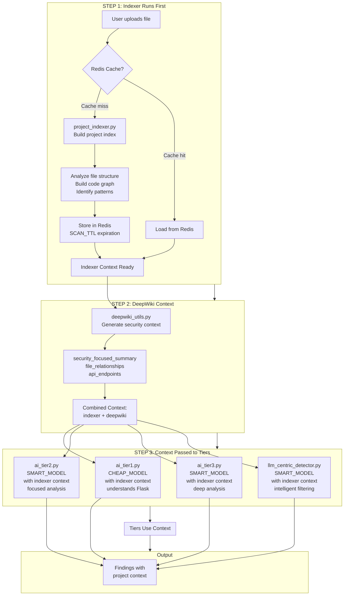
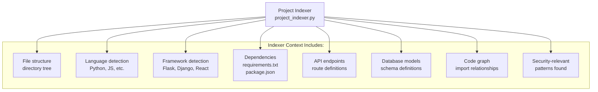
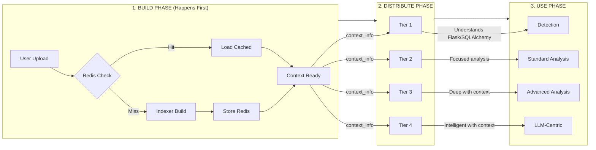
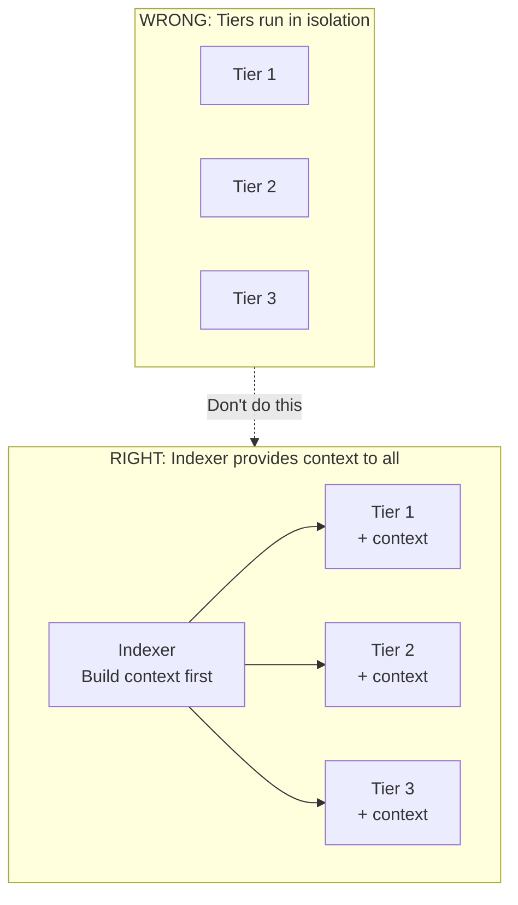

# Indexer-First Architecture

## Key Insight

The **Project Indexer** runs **FIRST** (or loads from cache) and builds a comprehensive understanding of the codebase. This context is then **fed to all tiers** so the LLM understands what it's working with.

## Corrected Flow



## Sequence Diagram - Context First

```mermaid
sequenceDiagram
    participant User as User
    participant Main as main.py
    participant Redis as Redis Cache
    participant Indexer as project_indexer.py
    participant DeepWiki as deepwiki_utils.py
    participant Tier1 as ai_tier1.py
    participant Tier3 as ai_tier3.py
    participant ORouter as OpenRouter

    User->>Main: POST /scan (file: app.py)

    Note over Main: STEP 1: Build Context FIRST

    Main->>Redis: GET x_scan_id:deepwiki_index
    
    alt Cache Miss
        Redis-->>Main: null
        Main->>Indexer: ProjectIndexer(tmpdir, client)
        Indexer->>Indexer: build_index()
        Indexer->>Indexer: analyze file structure
        Indexer->>Indexer: build code graph
        Indexer->>Indexer: identify frameworks
        Indexer-->>Main: project_ir (indexer context)
        Main->>Redis: SET x_scan_id:deepwiki_index (SCAN_TTL)
    else Cache Hit
        Redis-->>Main: cached project_ir
    end

    Note over Main: STEP 2: Enrich Context

    Main->>Indexer: indexer.get_context_for_code(content)
    Indexer-->>Main: external_context

    Main->>DeepWiki: build_security_context(project_ir)
    DeepWiki-->>Main: deepwiki_context
    
    Main->>Main: combined_context =
    external_context + deepwiki_context

    Note over Main: STEP 3: Pass Context to ALL Tiers

    Main->>Tier1: scan_tier_1_basic(..., context_info=combined_context)
    
    Note right of Tier1: Tier 1 now knows:
    - This is a Flask app
    - Uses SQLAlchemy ORM
    - Has admin routes
    - Previous vulnerabilities found

    Tier1->>ORouter: API call WITH context
    ORouter-->>Tier1: Initial findings

    Tier1-->>Main: triage_result

    alt Status == VULNERABLE
        Main->>Tier3: scan_tier_3_advanced(..., context_info=combined_context, tier1_result)
        
        Note right of Tier3: Tier 3 knows:
        - Same context as Tier 1
        - PLUS Tier 1's initial findings
        - Can do deeper analysis
        
        Tier3->>ORouter: API call WITH context + tier1_result
        ORouter-->>Tier3: Detailed analysis
        Tier3-->>Main: final_result
    end
```

## What the Indexer Provides



## How Tiers Use Context

### Tier 1 (ai_tier1.py) - Quick Triage

**Without Context:**
```
"Analyze this code for vulnerabilities"
- Sees: cursor.execute(f"SELECT * FROM users WHERE id = {user_id}")
- Might flag: "Possible SQL injection"
```

**With Context:**
```
"You are analyzing a Flask backend using SQLAlchemy.
The project has authentication routes and uses SQLite.
Analyze this code for vulnerabilities."

Context: This is Flask + SQLAlchemy app with auth system

- Sees: cursor.execute(f"SELECT * FROM users WHERE id = {user_id}")
- Knows: This is Flask, should use ORM not raw SQL
- Flags: "SQL Injection - f-string interpolation in raw SQL query"
- Confidence: 9/10
```

### Tier 3 (ai_tier3.py) - Deep Analysis

**Without Context:**
```
"Deep analysis of vulnerabilities"
- Finds: SQL injection
- Provides: Generic remediation
```

**With Context:**
```
"Deep analysis of Flask + SQLAlchemy application
with authentication system and user management.
Previous scan found: SQL injection in user lookup

Context: 
- Framework: Flask 2.x
- ORM: SQLAlchemy
- Database: SQLite
- Pattern: Raw SQL in user.py

- Analyzes: SQL injection in user lookup function
- Explains: Bypasses SQLAlchemy ORM, allows auth bypass
- Provides: Flask-SQLAlchemy specific remediation
- CVSS: 8.1 (Critical for auth system)
```

## Context Flow Architecture



## Code Example - Context Passing

### In main.py:

```python
# STEP 1: Get or build indexer context (FIRST!)
external_context = ""
if x_scan_id:
    raw_data = redis_client.get(x_scan_id)
    if raw_data:
        indexer = ProjectIndexer.from_json(raw_data)
        external_context = indexer.get_context_for_code(scan_req.content)

# STEP 2: Get DeepWiki context
deepwiki_context = ""
if x_scan_id:
    deepwiki_context = build_security_context(indexer.project_ir)

# STEP 3: Combine
combined_context = ""
if deepwiki_context:
    combined_context += "Project-wide security context:\n" + deepwiki_context + "\n\n"
if external_context:
    combined_context += "Local code graph context:\n" + external_context

# STEP 4: Pass to ALL tiers
# Tier 1 gets context
triage_result = await scan_tier_1_basic(
    session, filename, content, 
    context_info=combined_context  # <-- CONTEXT PASSED
)

# Tier 3 gets context + tier1 result
final_result = await scan_tier_3_advanced(
    session, filename, content,
    context_info=combined_context,  # <-- SAME CONTEXT PASSED
    tier1_result=triage_result
)
```

### In ai_tier1.py:

```python
async def scan_tier_1_basic(session, filename, content, context_info=""):
    # Context is used in the prompt!
    user_content = (
        f"Context (project + code graph):\n{context_info[:2000]}\n\n"  # <-- USED HERE
        f"File: {filename}\n\n"
        f"Code:\n{numbered_code}"
    )
    
    # LLM now understands the project context!
```

### In ai_tier3.py:

```python
async def scan_tier_3_advanced(session, filename, content, 
                               context_info="", tier1_result=None):
    # Context used again for deep analysis
    user_content = (
        f"High-level context (project + code graph):\n{context_info[:4000]}\n\n"  # <-- USED HERE
        f"File: {filename}\n\n"
        f"FOCUSED CODE SNIPPETS:\n{focused_code}"
    )
```

## Why This Matters

### Without Indexer Context:
- LLM sees isolated code snippets
- No understanding of project structure
- Generic vulnerability detection
- Lower confidence scores
- More false positives

### With Indexer Context:
- LLM understands project architecture
- Knows framework (Flask/Django/React)
- Understands data flow
- Can trace vulnerabilities across files
- Higher confidence, fewer false positives
- Specific remediation advice

## Summary



**Key Point**: The indexer is the **foundation** that enables all tiers to work intelligently. Without it, tiers are just pattern matching. With it, they understand the codebase.
