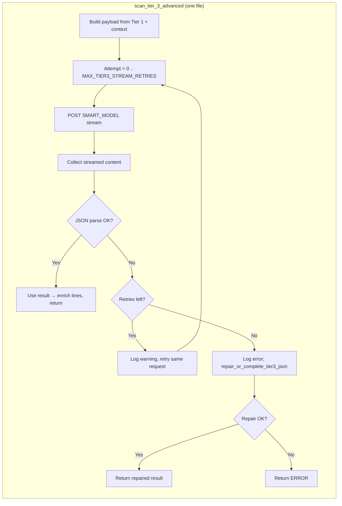
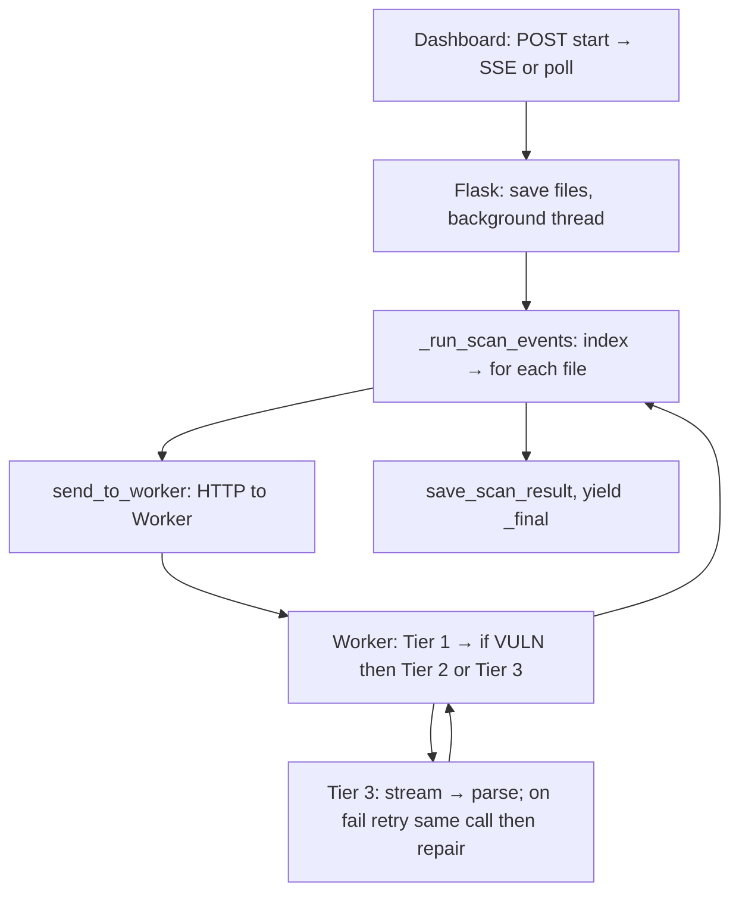

# Sentinel AI – Current scan flow (Mermaid)

## 1. Frontend → Backend (start + live updates)

```mermaid
sequenceDiagram
    participant U as User
    participant D as Dashboard (Next.js)
    participant P as Next.js API (proxy)
    participant F as Flask (main4)
    participant W as Worker (FastAPI)

    U->>D: Confirm scan (tier 1/2/3)
    D->>P: POST /api/proxy/scan/start (FormData)
    P->>F: POST /api/scan/start
    F->>F: Save files, create event_queue, start background thread
    F-->>P: { scan_id }
    P-->>D: { scan_id }

    alt SSE path
        D->>P: EventSource GET /api/proxy/scan/events?scan_id=...
        P->>F: GET /api/scan/events/<scan_id>
        loop Stream events
            F-->>P: SSE data: { type, ... }
            P-->>D: event (progress, vuln_found, log, complete, …)
        end
        F-->>P: queue empty (None)
        D->>D: finish() → redirect to /dashboard/.../scan_id
    else SSE fails or closes (onerror)
        D->>D: pollUntilDone()
        loop Every 500ms
            D->>P: GET /api/proxy/scan/status/<scan_id>
            P->>F: GET /api/scan/status/<scan_id>
            F-->>D: status, message, progress_pct, vuln_count
        end
        D->>D: When status=done → finish(); status=error → fail()
    end
```

## 2. Backend scan pipeline (Flask)

```mermaid
flowchart TB
    subgraph Start["POST /api/scan/start"]
        A1[Save uploaded files to temp_dir]
        A2[Create scan_id, event_queue]
        A3[Start thread: _run_scan_background]
        A4[Return scan_id]
    end

    subgraph Background["_run_scan_background (thread)"]
        B1[_run_scan_events generator]
        B2[For each event: push to event_queue + _scan_progress]
        B3[On _final: set status=done/error, result]
    end

    subgraph Events["_run_scan_events"]
        E1["Yield: start (Initializing Tier N...)"]
        E2{Tier 2/3?}
        E3[Analyze project structure]
        E4[Index project on workers]
        E5[Index DeepWiki on workers]
        E6[Yield: log (Scanning files...)]
        E7[ThreadPoolExecutor: for each file → send_to_worker]
        E8[As each future completes: yield progress / vuln_found / file_safe]
        E9[Compile final report, save_scan_result]
        E10["Yield: complete, _final"]
        E1 --> E2
        E2 -->|Yes| E3
        E2 -->|No| E4
        E3 --> E4
        E4 --> E5
        E5 --> E6
        E6 --> E7
        E7 --> E8
        E8 --> E9
        E9 --> E10
    end

    Start --> Background
    Background --> Events
```

## 3. Worker: per-file scan (Tier 1 → 2 or 3)

```mermaid
flowchart TB
    subgraph Worker["Worker POST /scan (one file)"]
        W1[Load index / DeepWiki context]
        W2["Tier 1: scan_tier_1_basic (CHEAP_MODEL)"]
        W3{scan_type?}
        W4["Return Tier 1 result"]
        W5{Status SAFE?}
        W6["Return Tier 1 (optimized)"]
        W7{scan_type 2 or 3?}
        W8["Tier 2: scan_tier_2_standard (TIER2_MODEL, non-stream)"]
        W9["Tier 3: scan_tier_3_advanced (SMART_MODEL, stream)"]
        W10[Enrichment, findings filter, optional PoC]
        W11[Return final result]
    end

    W1 --> W2
    W2 --> W3
    W3 -->|"1"| W4
    W3 -->|"2" or "3"| W5
    W5 -->|Yes| W6
    W5 -->|No| W7
    W7 -->|"2"| W8
    W7 -->|"3"| W9
    W8 --> W10
    W9 --> W10
    W10 --> W11
```

## 4. Tier 3 only: retry (same file, same request)



## 5. End-to-end (simplified)



- **Retries** happen only inside **Tier 3** for that **one file**: the same streaming request is retried up to 2 times; if still invalid JSON, one repair request is sent. No full-scan or multi-file retry.

---

## 6. Parallel workers (faster scans)

- **Flask** uses a `ThreadPoolExecutor` with **MAX_WORKERS** (default **12**) so up to that many files are sent to workers **at the same time**.
- **WORKER_NODES** can list multiple URLs (e.g. `http://127.0.0.1:5002,http://127.0.0.1:5003`). Each `send_to_worker` call picks the next node in **round-robin** order so load spreads across workers.
- To run multiple workers on one machine:
  - Start worker 1: `python -m uvicorn backend.worker.core.main:app --host 0.0.0.0 --port 5002`
  - Start worker 2: same command with `--port 5003`, etc.
  - Set `WORKER_NODES=http://127.0.0.1:5002,http://127.0.0.1:5003` and optionally `MAX_WORKERS=16` when starting the Flask backend.
- **Single worker**: one async FastAPI process can still handle many concurrent requests, so increasing **MAX_WORKERS** (e.g. 12) already speeds up scans by sending more files in parallel to that one process.

