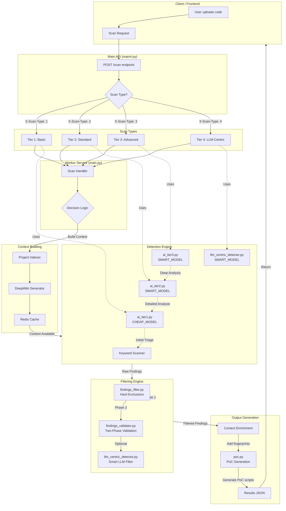
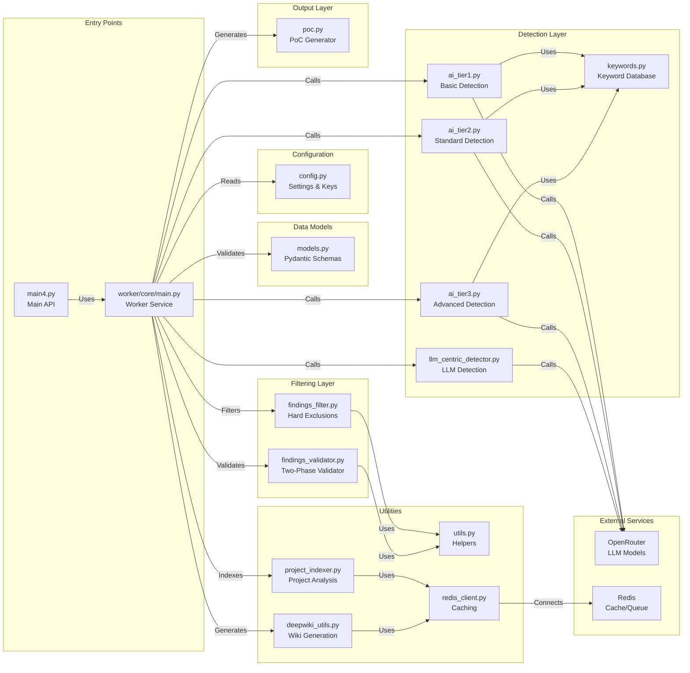
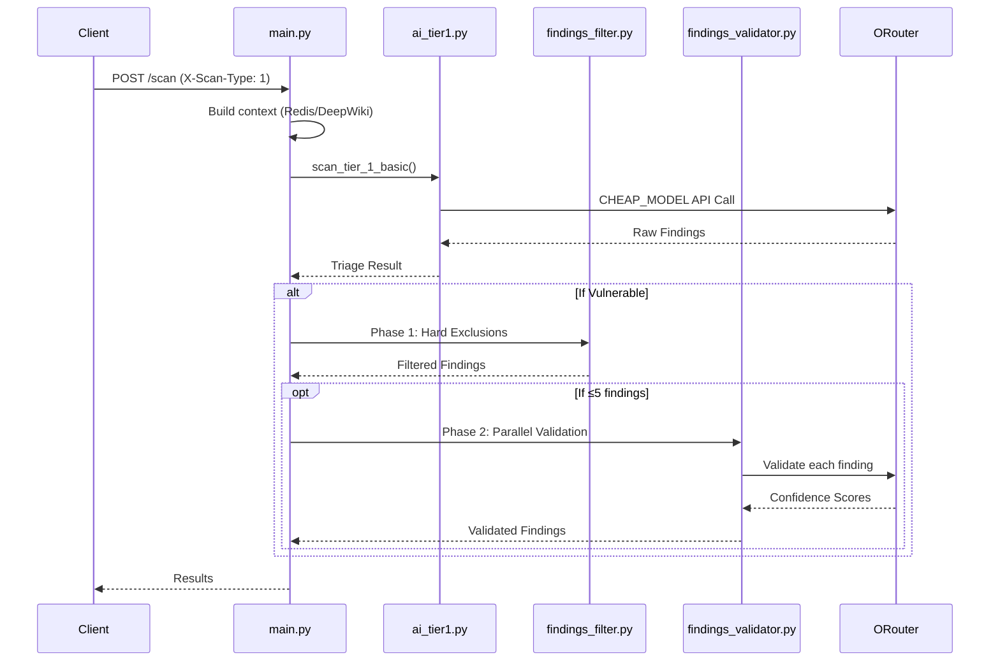
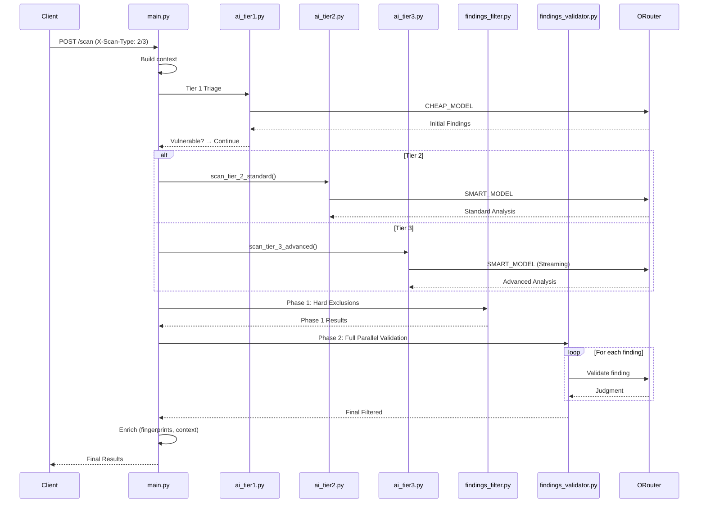
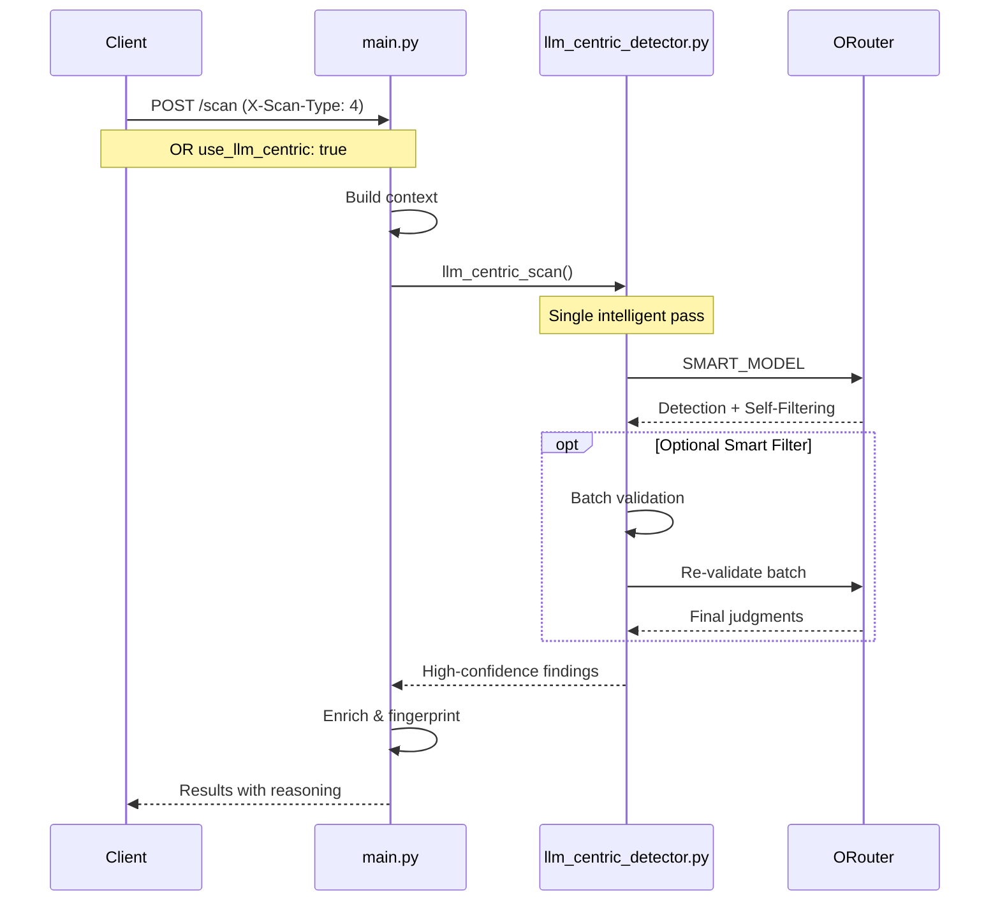
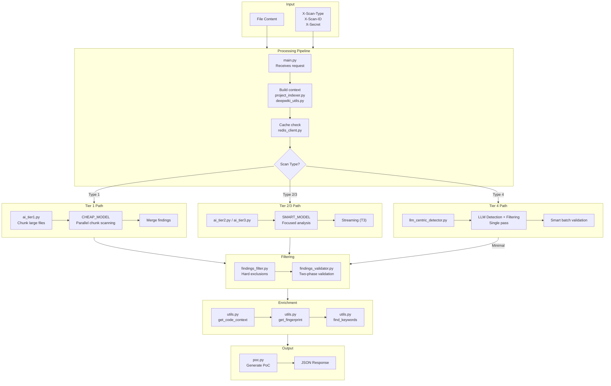
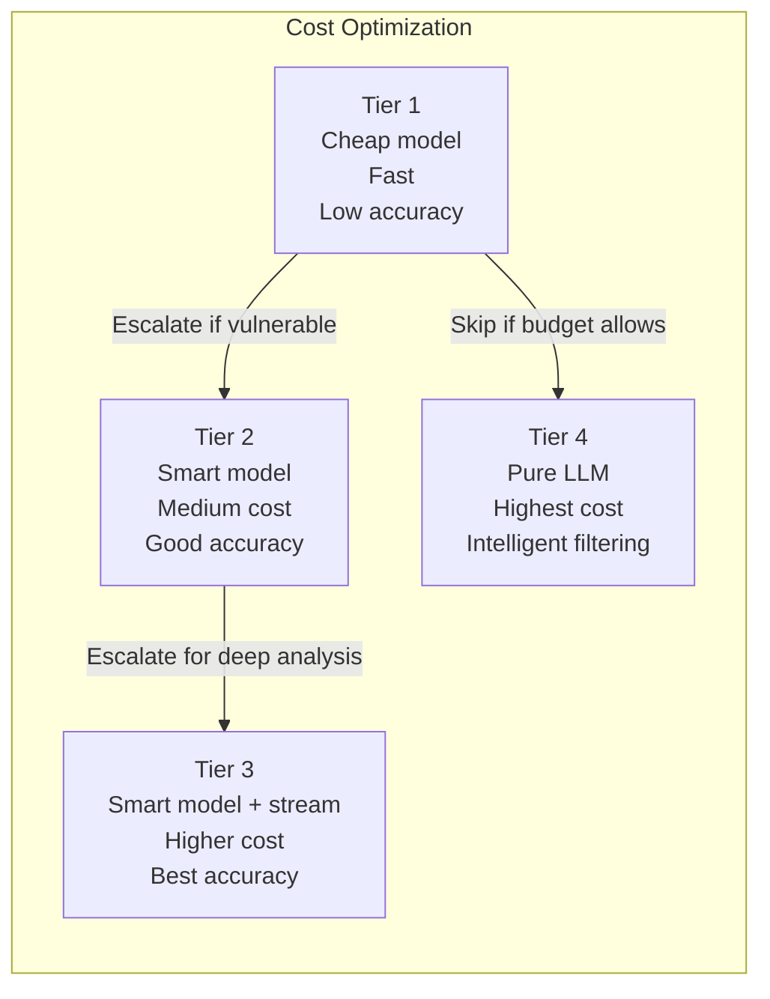
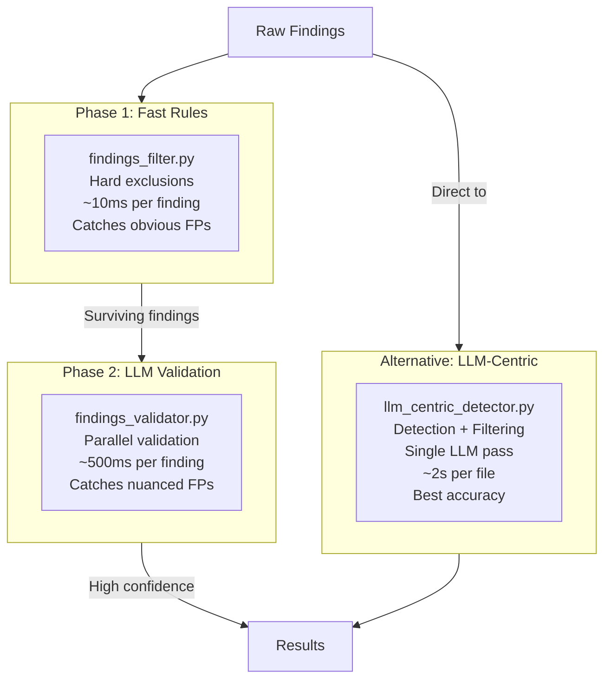

# SentinAI SAST System Architecture

## Overview

This document shows how all components work together in the SentinAI vulnerability scanning system.

## System Flow Diagram



## File Interaction Diagram



## Detailed Scan Type Flows

### Tier 1 Flow (Basic)



### Tier 2/3 Flow (Standard/Advanced)



### Tier 4 Flow (LLM-Centric)



## Data Flow Through Files



## Component Responsibilities

### Core Detection Files

| File | Responsibility | Model Used |
|------|---------------|------------|
| `ai_tier1.py` | Initial triage, file chunking, quick detection | CHEAP_MODEL |
| `ai_tier2.py` | Standard analysis with context | SMART_MODEL |
| `ai_tier3.py` | Deep analysis with streaming, CVSS, remediation | SMART_MODEL |
| `llm_centric_detector.py` | Intelligent detection + filtering | SMART_MODEL |

### Filtering Files

| File | Responsibility | Approach |
|------|---------------|----------|
| `findings_filter.py` | Hard exclusion rules | Regex patterns |
| `findings_validator.py` | Two-phase validation | LLM per-finding |
| `llm_centric_detector.py` | Smart batch filtering | LLM batch judge |

### Utility Files

| File | Responsibility |
|------|---------------|
| `utils.py` | Code context, fingerprints, line finding |
| `keywords.py` | Vulnerability keyword database |
| `config.py` | API keys, model settings |
| `redis_client.py` | Caching and queue management |
| `project_indexer.py` | Project structure analysis |
| `deepwiki_utils.py` | Wiki generation and context |
| `poc.py` | Proof-of-concept generation |

## Request Lifecycle

```mermaid
flowchart LR
    subgraph Request["1. Request"]
        A[Client sends file<br/>+ Scan Type header]
    end

    subgraph Context["2. Context Building"]
        B[Load from Redis<br/>if cached]
        C[Generate DeepWiki<br/>if new]
        D[Build security<br/>context graph]
    end

    subgraph Detection["3. Detection"]
        E{Scan Type?}
        F[T1: Quick triage]
        G[T2: Standard]
        H[T3: Deep analysis]
        I[T4: LLM-centric]
    end

    subgraph Validation["4. Validation"]
        J[Hard exclusions]
        K[LLM validation<br/>if needed]
        L[Confidence<br/>threshold]
    end

    subgraph Enrich["5. Enrichment"]
        M[Add fingerprints]
        N[Code context]
        O[Keyword matches]
    end

    subgraph Response["6. Response"]
        P[Generate PoC<br/>if requested]
        Q[Return JSON<br/>with metadata]
    end

    Request --> Context --> Detection --> Validation --> Enrich --> Response

    E -->|1| F
    E -->|2| G
    E -->|3| H
    E -->|4| I
```



## Key Design Decisions

### Why Multiple Tiers?



### Two-Phase Filtering Strategy



## File Call Graph

```
main.py (entry point)
├── ai_tier1.py
│   └── config.py (OPENROUTER_API_KEY, CHEAP_MODEL)
│   └── utils.py (find_line_number, clean_json_response)
│   └── OpenRouter
├── ai_tier2.py
│   └── config.py (OPENROUTER_API_KEY, SMART_MODEL)
│   └── utils.py (build_focused_code_bundle, etc.)
│   └── OpenRouter
├── ai_tier3.py
│   └── config.py (OPENROUTER_API_KEY, SMART_MODEL)
│   └── utils.py (streaming helpers)
│   └── OpenRouter
├── llm_centric_detector.py (NEW)
│   └── config.py (OPENROUTER_API_KEY, SMART_MODEL)
│   └── OpenRouter
├── findings_filter.py
│   └── (self-contained, regex patterns)
├── findings_validator.py
│   └── config.py (OPENROUTER_API_KEY, SMART_MODEL)
│   └── OpenRouter
├── project_indexer.py
│   └── redis_client.py
├── deepwiki_utils.py
│   └── redis_client.py
├── poc.py
│   └── config.py
│   └── OpenRouter
└── utils.py (shared utilities)
    └── (line finding, fingerprinting, snippets)
```

## Summary

The system is designed as a **modular pipeline**:

1. **Entry**: `main.py` receives requests
2. **Context**: Redis + DeepWiki provide project context
3. **Detection**: Multiple tiers for cost/accuracy trade-off
4. **Filtering**: Two-phase (rules + LLM) or pure LLM
5. **Enrichment**: Add fingerprints and context
6. **Output**: JSON with findings and metadata

The **LLM-centric approach** (Tier 4) simplifies this by doing detection and filtering in a single intelligent LLM pass, trading cost for accuracy.
