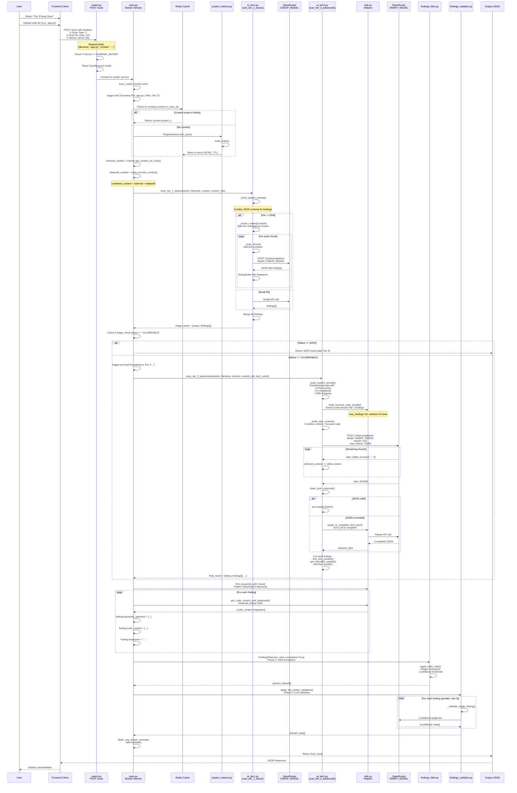
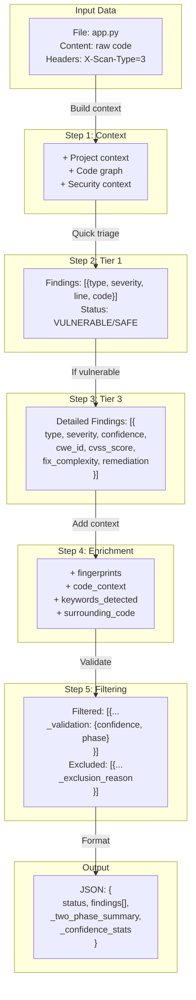
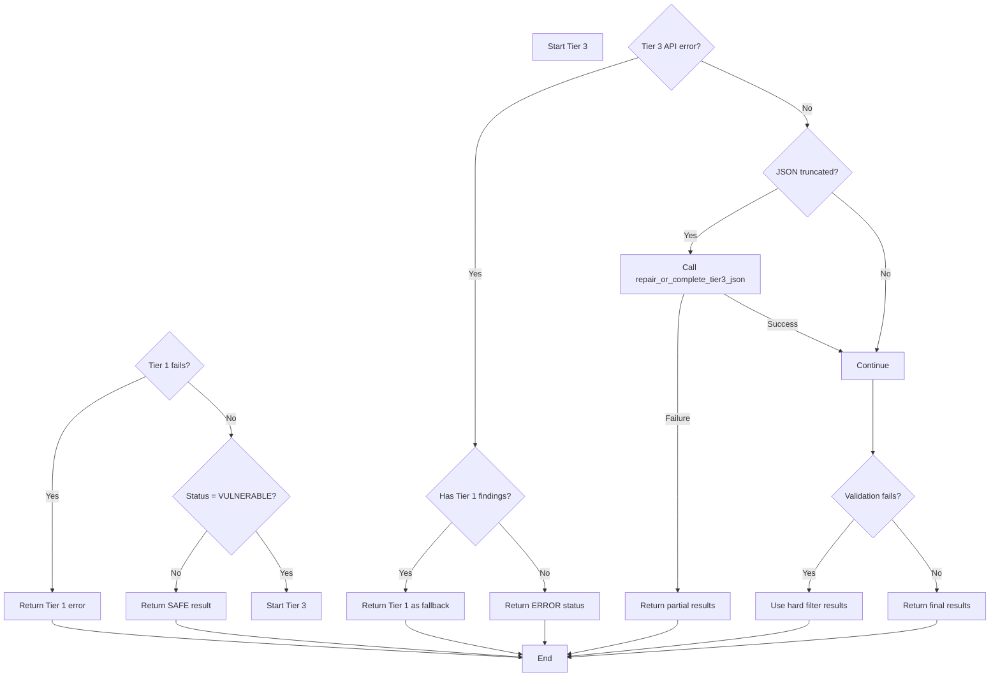

# Tier 3 Scan - Detailed Flow

## Overview

This document shows the complete flow of a Tier 3 scan, from user input to final output, including which files are called at each step.

## High-Level Flow

```mermaid
flowchart TB
    subgraph UserInput["1. User Input"]
        A[User selects Tier 3 scan]
        B[Uploads code file]
    end

    subgraph API["2. Main API (main4.py)"]
        C[POST /scan endpoint]
        D{Validate headers}
        E[Queue scan job]
    end

    subgraph Worker["3. Worker Service (main.py)"]
        F[scan_code() function]
        G[Build context]
        H{Decision Logic}
    end

    subgraph Tier1["4. Tier 1 Triage (ai_tier1.py)"]
        I[scan_tier_1_basic()]
        J[CHEAP_MODEL]
    end

    subgraph Tier3["5. Tier 3 Deep Analysis (ai_tier3.py)"]
        K[scan_tier_3_advanced()]
        L[Build focused code bundle]
        M[Streaming LLM call]
        N[Parse JSON stream]
        O[Repair if truncated]
    end

    subgraph Filtering["6. Two-Phase Filtering"]
        P[findings_filter.py<br/>Hard exclusions]
        Q[findings_validator.py<br/>Parallel LLM validation]
    end

    subgraph Enrich["7. Enrichment (utils.py)"]
        R[find_line_number()]
        S[get_bounded_snippet()]
        T[get_code_context_and_fingerprint()]
        U[find_keywords_with_lines()]
    end

    subgraph Output["8. Output Generation"]
        V[Format results]
        W[Return JSON]
    end

    A --> B --> C
    C --> D --> E --> F
    F --> G --> H
    H -->|X-Scan-Type: 3| Tier1
    Tier1 -->|Vulnerable| K
    K --> L --> M --> N --> O
    O --> P --> Q
    Q --> R --> S --> T --> U --> V --> W
```

## Detailed Step-by-Step Flow



## File Call Chain for Tier 3

```mermaid
flowchart LR
    subgraph Entry["Entry Point"]
        A[main4.py<br/>POST /scan]
    end

    subgraph Worker["Worker"]
        B[main.py<br/>scan_code()]
        C[models.py<br/>ScanRequest]
    end

    subgraph Context["Context Building"]
        D[redis_client.py<br/>Cache check]
        E[project_indexer.py<br/>Build index]
        F[deepwiki_utils.py<br/>Security context]
    end

    subgraph Detection["Detection Layer"]
        G[ai_tier1.py<br/>Quick triage]
        H[ai_tier3.py<br/>Deep analysis]
    end

    subgraph Utils["Utility Functions"]
        I[utils.py<br/>build_focused_code_bundle]
        J[utils.py<br/>find_line_number]
        K[utils.py<br/>get_bounded_snippet]
        L[utils.py<br/>get_code_context_and_fingerprint]
        M[utils.py<br/>find_keywords_with_lines]
        N[utils.py<br/>clean_json_response]
        O[utils.py<br/>repair_or_complete_tier3_json]
    end

    subgraph Filtering["Filtering Layer"]
        P[findings_filter.py<br/>Hard exclusions]
        Q[findings_validator.py<br/>LLM validation]
    end

    subgraph External["External Services"]
        R[OpenRouter<br/>CHEAP_MODEL]
        S[OpenRouter<br/>SMART_MODEL]
        T[Redis Server]
    end

    A -->|HTTP POST| B
    B -->|Validates| C

    B -->|Checks| D
    D -->|If miss| E
    E -->|Stores| D
    D -->|Connects| T
    E -->|Generates| F

    B -->|Calls| G
    G -->|Uses| N
    G -->|Chunks via| I
    G -->|API calls| R

    B -->|If vulnerable| H
    H -->|Uses| I
    H -->|Uses| N
    H -->|On failure| O
    H -->|API calls| S

    H -->|Line finding| J
    H -->|Snippet| K

    B -->|Filtering| P
    P -->|Validates| Q
    Q -->|API calls| S

    B -->|Enrichment| L
    B -->|Keywords| M
    M -->|Uses| keywords.py

    L -->|Helpers| I
    L -->|Helpers| J
    L -->|Helpers| K
```

## Function Call Hierarchy

```
main4.py
└── POST /scan endpoint
    └── Forwards to Worker Service

main.py
└── scan_code()
    ├── Step 1: Context Building
    │   ├── redis_client.get(x_scan_id)
    │   ├── ProjectIndexer.from_json()
    │   ├── indexer.get_context_for_code()
    │   └── build_security_context()
    │
    ├── Step 2: Tier 1 Triage (Always runs)
    │   └── ai_tier1.scan_tier_1_basic()
    │       ├── _build_system_prompt()
    │       ├── _chunk_content() [if large file]
    │       ├── _scan_chunk() [for each chunk]
    │       │   ├── _build_numbered_content()
    │       │   └── OpenRouter Call (CHEAP_MODEL)
    │       ├── find_line_number()
    │       └── Merge findings
    │
    ├── Step 3: Decision Logic
    │   └── If Vulnerable → Continue to Tier 3
    │
    ├── Step 4: Tier 3 Deep Analysis
    │   └── ai_tier3.scan_tier_3_advanced()
    │       ├── _build_system_prompt()
    │       ├── build_focused_code_bundle()
    │       │   └── utils.get_function_or_window()
    │       ├── _build_user_content()
    │       ├── OpenRouter Call (SMART_MODEL, streaming)
    │       ├── clean_json_response()
    │       ├── json.loads() [or repair]
    │       ├── repair_or_complete_tier3_json() [if needed]
    │       ├── find_line_number()
    │       ├── get_bounded_snippet()
    │       └── Return detailed findings
    │
    ├── Step 5: Enrichment
    │   ├── find_keywords_with_lines()
    │   │   └── keywords.py (ALL_KEYWORDS)
    │   └── For each finding:
    │       ├── get_code_context_and_fingerprint()
    │       │   ├── get_bounded_snippet()
    │       │   └── get_function_or_window()
    │       └── Add to finding object
    │
    ├── Step 6: Two-Phase Filtering
    │   ├── Phase 1: findings_filter.py
    │   │   └── FindingsFilter.filter_findings()
    │   │       └── _apply_hard_rules()
    │   └── Phase 2: findings_validator.py
    │       └── apply_two_phase_validation()
    │           └── _validate_single_finding() [parallel]
    │               └── OpenRouter Call (SMART_MODEL)
    │
    └── Step 7: Output
        └── Return JSON with metadata
```

## Data Transformations at Each Step



## API Calls Made During Tier 3 Scan

| Step | File | API Call | Model | Purpose |
|------|------|----------|-------|---------|
| 1 | ai_tier1.py | OpenRouter /chat/completions | CHEAP_MODEL | Quick triage |
| 2 | ai_tier3.py | DeepInfra /chat/completions (stream) | SMART_MODEL | Deep analysis |
| 3 | utils.py (repair) | OpenRouter /chat/completions | SMART_MODEL | JSON repair (if truncated) |
| 4 | findings_validator.py | OpenRouter /chat/completions | SMART_MODEL | Per-finding validation (parallel) |

## Time Estimates

| Step | Duration | File(s) |
|------|----------|---------|
| Context building | 50-100ms | main.py, redis_client.py |
| Tier 1 scan | 2-5 seconds | ai_tier1.py |
| Tier 3 scan | 5-15 seconds | ai_tier3.py (streaming) |
| JSON repair (if needed) | +2-5 seconds | utils.py |
| Enrichment | 10-50ms | utils.py |
| Two-phase filtering | 2-10 seconds | findings_filter.py + findings_validator.py |
| **Total** | **10-35 seconds** | All files |

## Error Handling Flow



## Summary

**Tier 3 scan uses these files in order:**

1. **main4.py** - Entry point, validates request
2. **main.py** - Orchestrates the flow
3. **models.py** - Validates ScanRequest
4. **redis_client.py** - Checks cache
5. **project_indexer.py** - Builds project context
6. **deepwiki_utils.py** - Security context
7. **ai_tier1.py** - Quick triage (always runs)
8. **ai_tier3.py** - Deep analysis (if vulnerable)
9. **utils.py** - Code context, line finding, snippets, JSON repair
10. **keywords.py** - Pattern matching
11. **findings_filter.py** - Phase 1 hard exclusions
12. **findings_validator.py** - Phase 2 LLM validation
13. **config.py** - API keys, model settings

**External calls:**
- OpenRouter (CHEAP_MODEL for Tier 1)
- OpenRouter (SMART_MODEL for Tier 3 and validation)
- Redis (caching)
