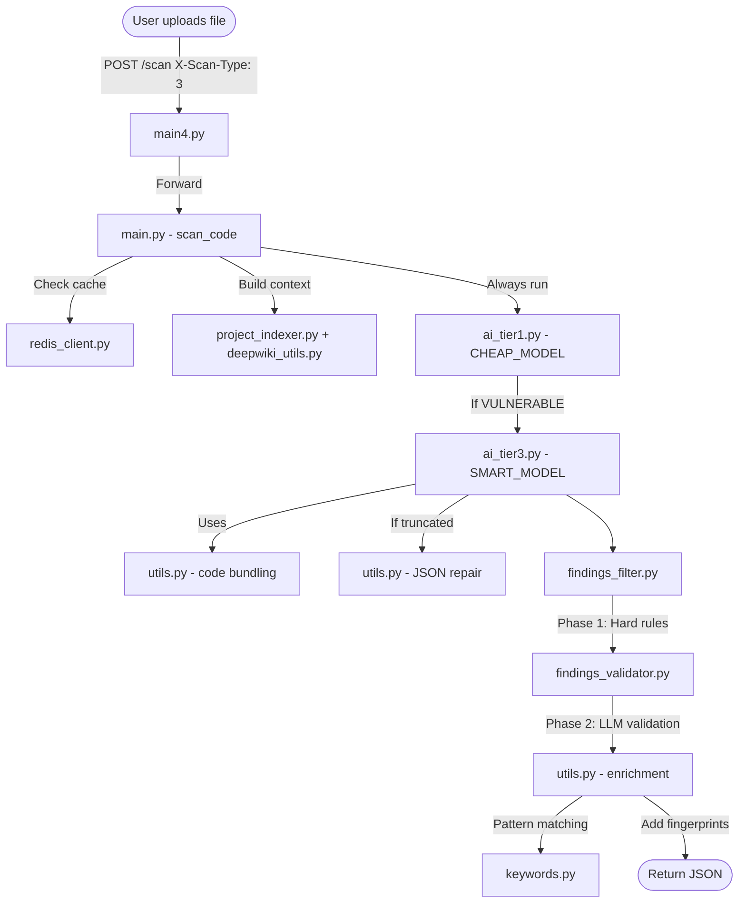
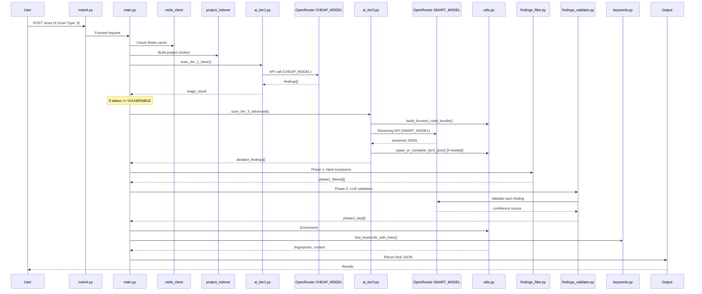
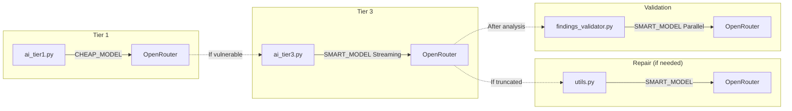
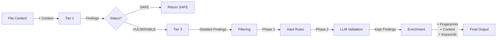

# Tier 3 Quick Flow

## Simple Flow Diagram



## File Call Order



## Files Used in Order

| Step | File | Key Function | Purpose |
|------|------|--------------|---------|
| 1 | **main4.py** | POST /scan | Entry point, validate headers |
| 2 | **main.py** | scan_code() | Orchestrate the flow |
| 3 | **models.py** | ScanRequest | Validate input |
| 4 | **redis_client.py** | get() | Check cached context |
| 5 | **project_indexer.py** | build_index() | Build project structure |
| 6 | **deepwiki_utils.py** | build_security_context() | Security context |
| 7 | **ai_tier1.py** | scan_tier_1_basic() | Quick triage (CHEAP_MODEL) |
| 8 | **ai_tier3.py** | scan_tier_3_advanced() | Deep analysis (SMART_MODEL) |
| 9 | **utils.py** | build_focused_code_bundle() | Extract code snippets |
| 10 | **utils.py** | repair_or_complete_tier3_json() | Fix truncated JSON |
| 11 | **findings_filter.py** | filter_findings() | Phase 1: Hard rules |
| 12 | **findings_validator.py** | validate_findings_parallel() | Phase 2: LLM validation |
| 13 | **utils.py** | find_keywords_with_lines() | Pattern matching |
| 14 | **utils.py** | get_code_context_and_fingerprint() | Add context |
| 15 | **keywords.py** | ALL_KEYWORDS | Keyword database |

## API Calls



## Data Flow



## Visual Summary

```
┌──────────────┐     ┌──────────────┐     ┌──────────────┐
│   main4.py   │────▶│   main.py    │────▶│    Redis     │
│   (Entry)    │     │ (Orchestrate)│     │    Cache     │
└──────────────┘     └──────────────┘     └──────────────┘
                             │
                             ▼
┌──────────────┐     ┌──────────────┐     ┌──────────────┐
│  ai_tier1.py │────▶│  ai_tier3.py │────▶│ findings_    │
│  (CHEAP_MODEL -     │     │ (SMART_MODEL -      │     │ filter.py    │
│   Triage)    │     │  Deep)       │     │ (Hard Rules) │
└──────────────┘     └──────────────┘     └──────────────┘
                             │                    │
                             ▼                    ▼
┌──────────────┐     ┌──────────────┐     ┌──────────────┐
│   utils.py   │◀────│ findings_    │◀────│  utils.py    │
│ (Bundling)   │     │ validator.py │     │ (Keywords)   │
└──────────────┘     │(LLM Filter)  │     └──────────────┘
                             │
                             ▼
┌──────────────┐
│  keywords.py │
│(Pattern Match)│
└──────────────┘
```
