# SentinAI v4 Multi-Agent Architecture

This document provides a comprehensive deep-dive into the multi-agent security analysis framework, including detailed mermaid diagrams of the agentic loop and how all components work together.

---

## Table of Contents

1. [Executive Summary](#executive-summary)
2. [Architecture Overview](#architecture-overview)
3. [The Agentic Loop](#the-agentic-loop)
4. [Phase 1: Pre-Scan Agents](#phase-1-pre-scan-agents)
5. [Phase 2: Specialist Detection](#phase-2-specialist-detection)
6. [Phase 3: Synthesis Pipeline](#phase-3-synthesis-pipeline)
7. [Phase 4: Validation & Output](#phase-4-validation--output)
8. [Data Models & Interface Contracts](#data-models--interface-contracts)
9. [Logging & Observability](#logging--observability)
10. [Learning & Feedback](#learning--feedback)

---

## Executive Summary

SentinAI v4 implements a **multi-agent security analysis pipeline** that combines:

- **Context Building**: Pre-scan agents (Recon, Pattern, ThreatModel) enrich context before detection
- **Parallel Detection**: Five specialist agents run concurrently for different vulnerability classes
- **Chain Synthesis**: Findings are linked into multi-hop attack chains
- **Adversarial Validation**: SkepticAgent plays devil's advocate to reduce false positives
- **Remediation**: Concrete fixes with unit tests for confirmed vulnerabilities

The key innovation is the **sequential context enrichment** pattern: each pre-scan agent adds intelligence that downstream agents use, enabling framework-specific detection rather than generic rules.

---

## Architecture Overview

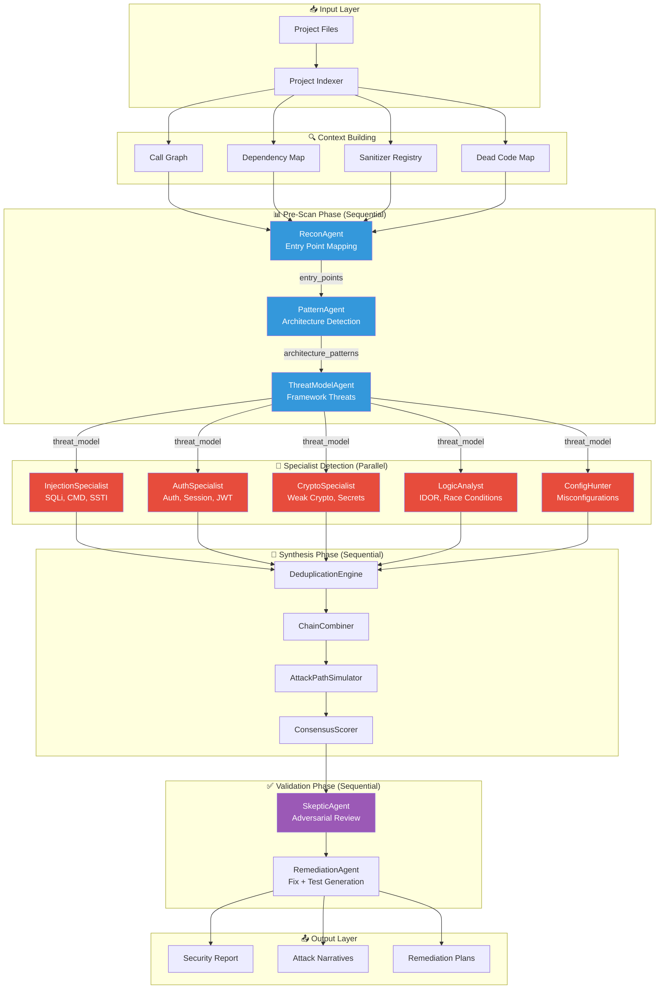

---

## The Agentic Loop

The core "agentic loop" refers to how each agent processes input through the LLM and produces structured output. This is the fundamental building block of the entire system.

### Single Agent Execution Flow

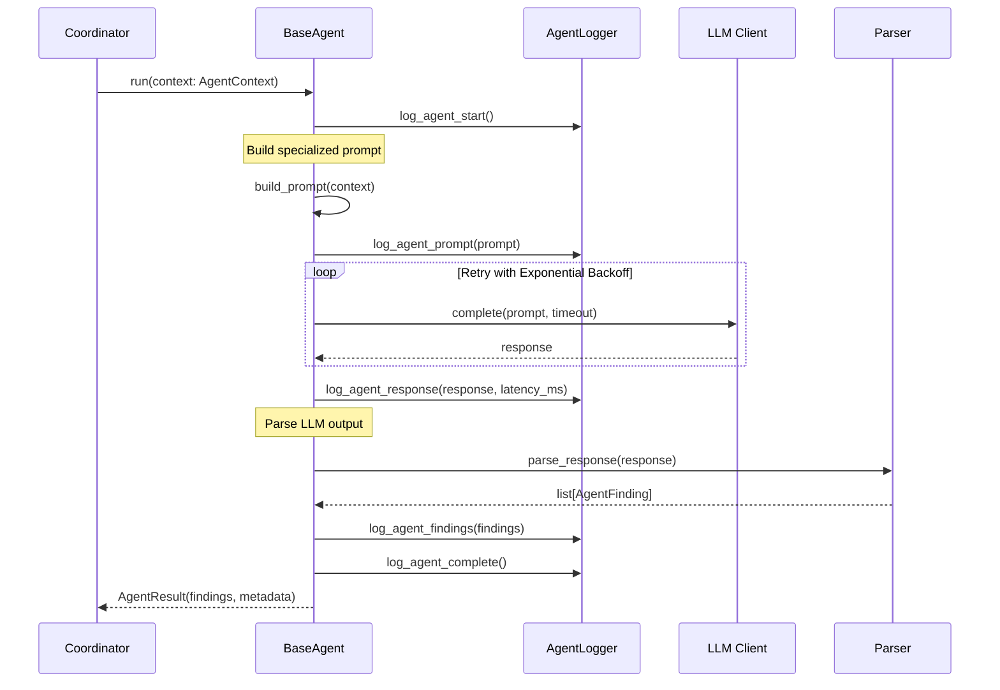

### Agent Execution State Machine

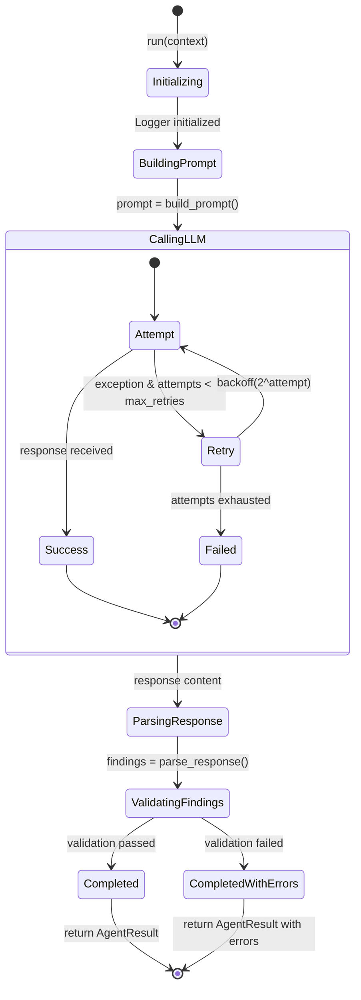

### BaseAgent Class Diagram

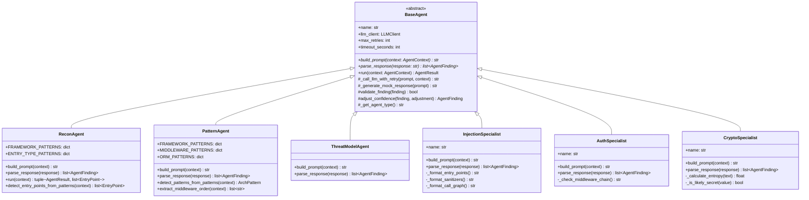

---

## Phase 1: Pre-Scan Agents

Pre-scan agents run **sequentially** because each one enriches the context for downstream agents. The order is mandatory.

### Execution Order & Data Flow

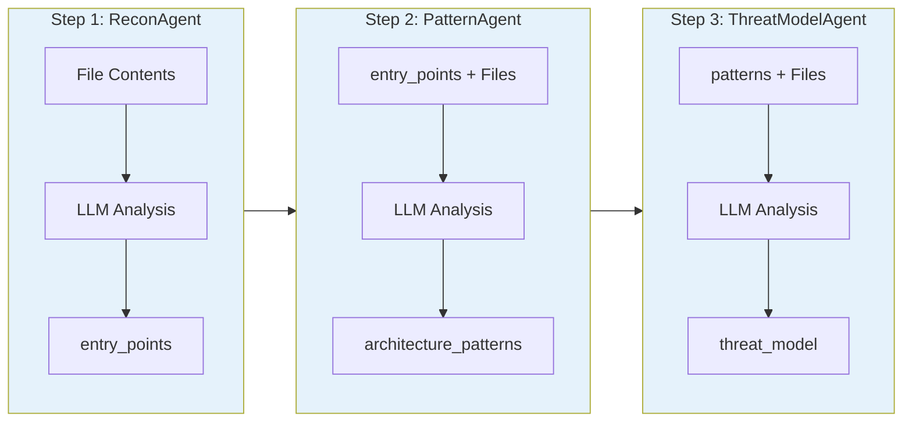

### ReconAgent: Entry Point Mapping

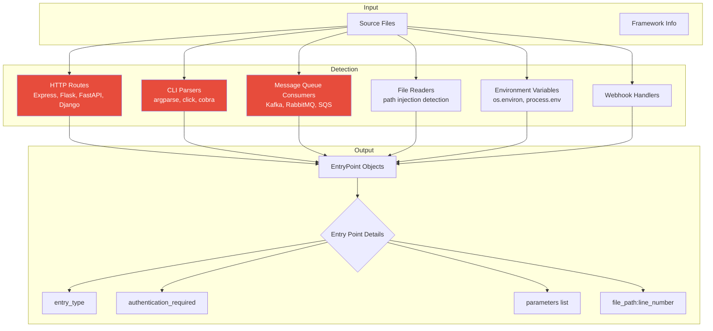

**What ReconAgent Detects:**

| Entry Type | Examples | Security Relevance |
|------------|----------|-------------------|
| HTTP | `@app.route('/api/users')`, `app.get('/users')` | Unauthenticated routes are high priority |
| CLI | `argparse.ArgumentParser()`, `click.command()` | Command injection vectors |
| MQ | `kafka.Consumer()`, `@rabbitmq.handler` | Message injection, deserialization |
| File | `open(user_path)`, `Path(user_input)` | Path traversal |
| Env | `os.environ['API_KEY']`, `process.env.DB_PASS` | Secret exposure |
| Webhook | `@webhook('/stripe')` | SSRF, signature bypass |

### PatternAgent: Architecture Detection

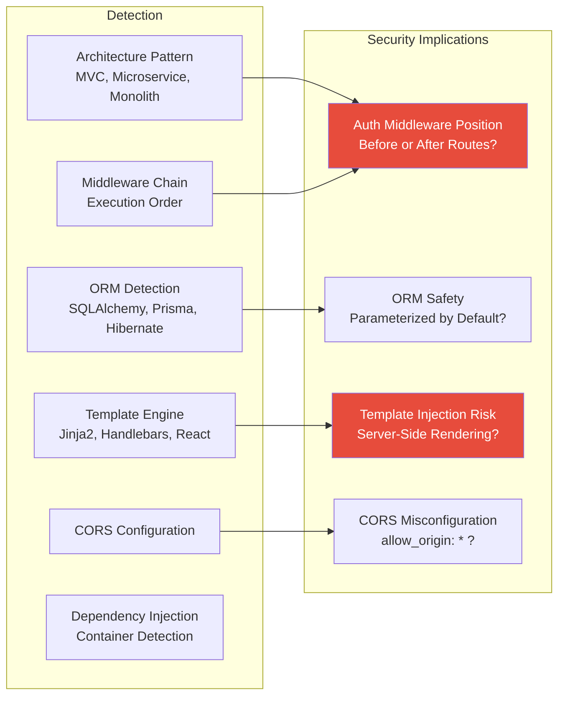

### ThreatModelAgent: Framework-Specific Threats

```mermaid
mindmap
  root((Threat Model))
    Stack Summary
      Language
      Framework
      Database
      Auth System
    High Priority Threats
      SQL Injection
        Priority: 0.9
        CWE-89
      Broken Auth
        Priority: 0.85
        CWE-287
      XSS
        Priority: 0.7
        CWE-79
    Framework Sinks
      Dangerous Functions
        eval(), exec()
        db.execute()
        render_template_string()
      Framework-Specific
        Flask: session, g
        Express: req.body
        Django: request.GET
    Known CVE Patterns
      CVE-2023-XXXXX
      Framework-specific
      Dependency-related
```

---

## Phase 2: Specialist Detection

Five specialist agents run **in parallel** using `asyncio.gather()`. All receive the same enriched context from pre-scan.

### Parallel Execution Architecture

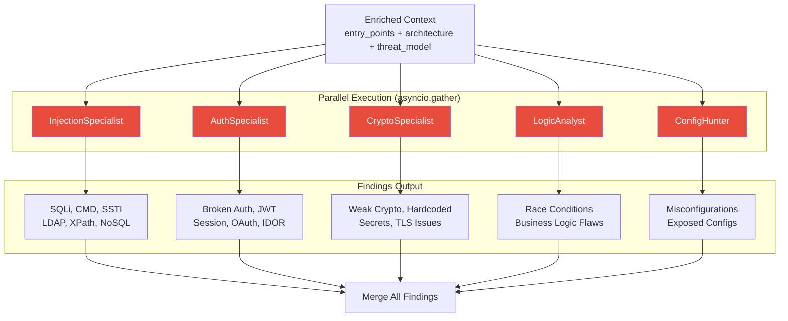

### Specialist Agent Coverage Matrix

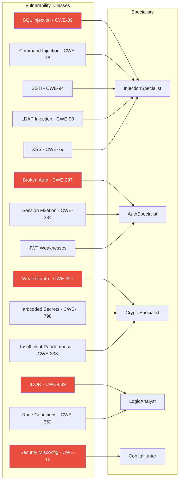

### Taint Analysis Flow (InjectionSpecialist)

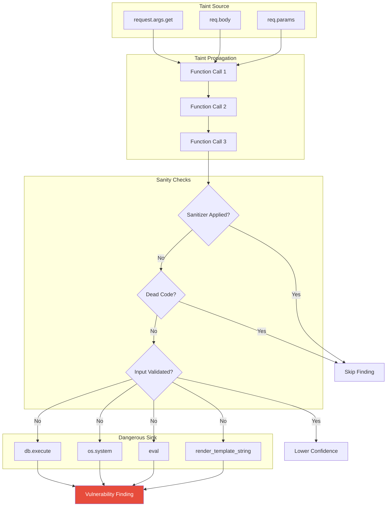

---

## Phase 3: Synthesis Pipeline

After specialists produce findings, the synthesis pipeline runs **sequentially** to process, link, and score findings.

### Synthesis Flow

```mermaid
flowchart LR
    subgraph Input
        RAW[Raw Findings<br/>From Specialists]
    end

    subgraph Step1["Step 1: Deduplication"]
        DEDUP[DeduplicationEngine]
        DEDUP_OUT[DeduplicatedFindings]
    end

    subgraph Step2["Step 2: Chain Building"]
        CHAIN[ChainCombiner]
        CHAINS[VulnerabilityChains]
    end

    subgraph Step3["Step 3: Path Simulation"]
        PATH[AttackPathSimulator]
        PATHS[AttackPaths]
    end

    subgraph Step4["Step 4: Consensus Scoring"]
        SCORE[ConsensusScorer]
        SCORED[Scored Findings]
    end

    RAW --> DEDUP
    DEDUP --> DEDUP_OUT
    DEDUP_OUT --> CHAIN
    CHAIN --> CHAINS
    CHAINS --> PATH
    PATH --> PATHS
    PATHS --> SCORE
    SCORE --> SCORED

    style DEDUP fill:#f39c12,color:#fff
    style CHAIN fill:#f39c12,color:#fff
    style PATH fill:#f39c12,color:#fff
    style SCORE fill:#f39c12,color:#fff
```

### Deduplication Logic

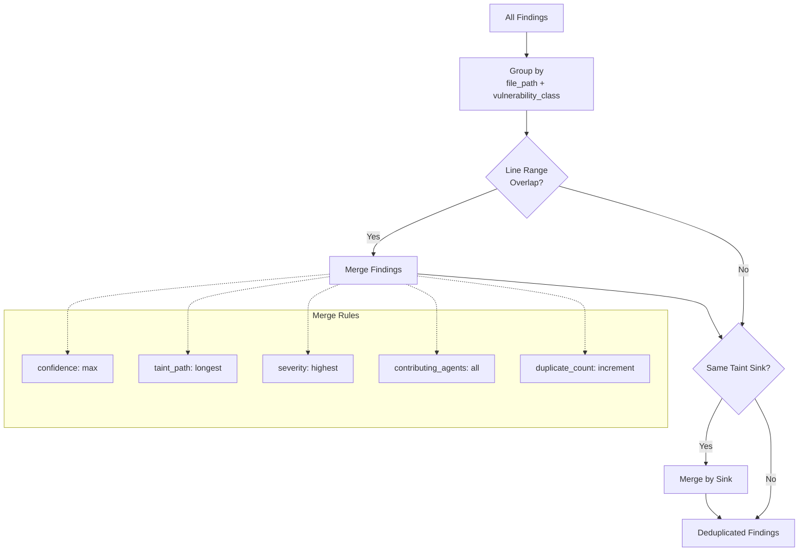

### Chain Building Heuristics

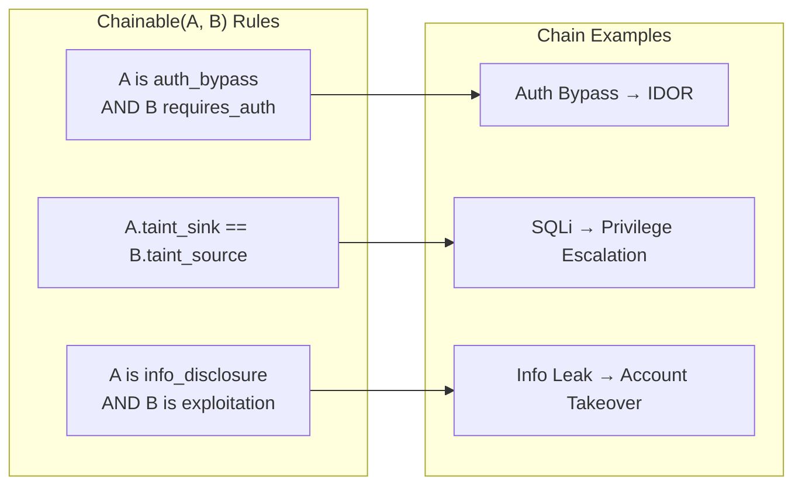

### Consensus Scoring Formula

```mermaid
graph TB
    subgraph Inputs
        BASE[Base Confidence<br/>from Agent]
        AGENTS[Number of<br/>Contributing Agents]
        CHAIN[Chain Membership]
        DEAD[Dead Code Location]
    end

    subgraph Calculation
        MULT[Multiplier Calculation]
        AGENT_MULT[Agent Count Multiplier<br/>1 agent: 1.0<br/>2 agents: 1.25<br/>3 agents: 1.50<br/>4+ agents: 1.75]
        CHAIN_BONUS[Chain Bonus<br/>+0.15]
        DEAD_PENALTY[Dead Code Penalty<br/>-0.40]
    end

    subgraph Output
        FINAL[Final Confidence<br/>min(base * multiplier, 1.0)]
    end

    BASE --> FINAL
    AGENTS --> AGENT_MULT --> MULT
    CHAIN --> CHAIN_BONUS --> MULT
    DEAD --> DEAD_PENALTY --> MULT
    MULT --> FINAL
```

---

## Phase 4: Validation & Output

### SkepticAgent: Adversarial Review

The SkepticAgent acts as a devil's advocate, challenging each finding to reduce false positives.

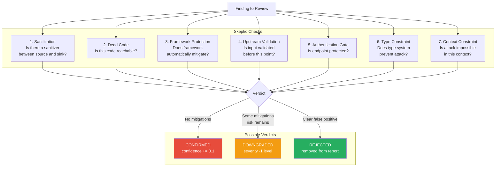

### RemediationAgent: Fix Generation

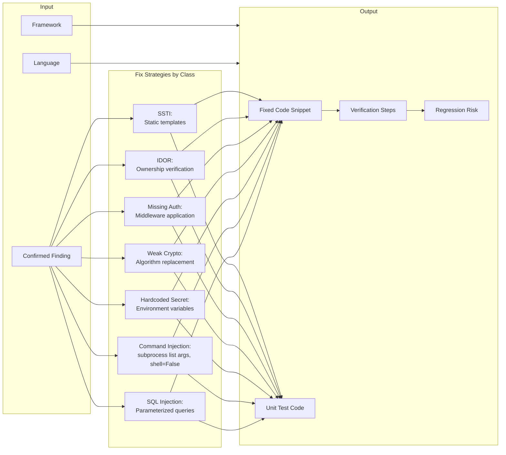

---

## Data Models & Interface Contracts

### Core Data Structures

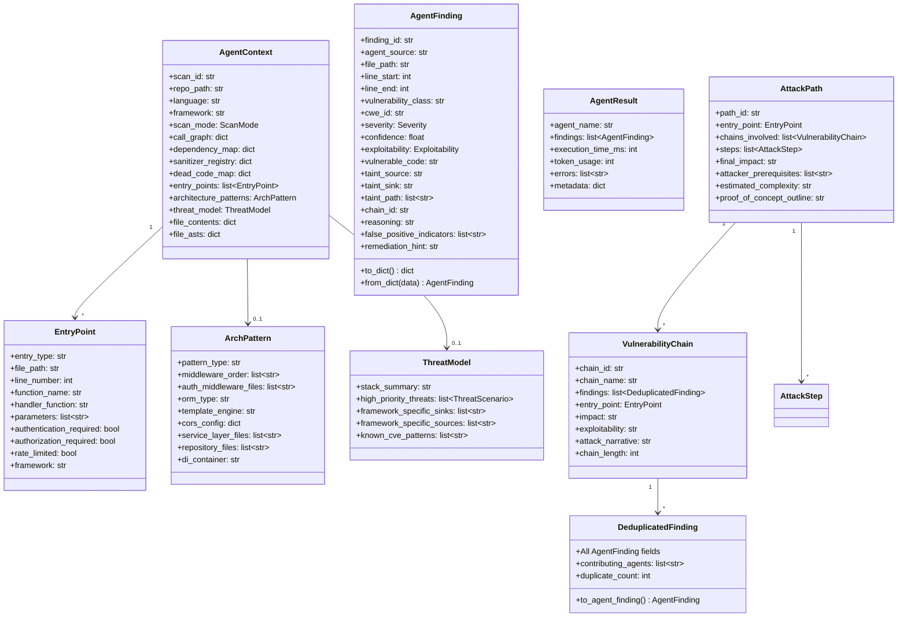

### Data Flow Through Pipeline

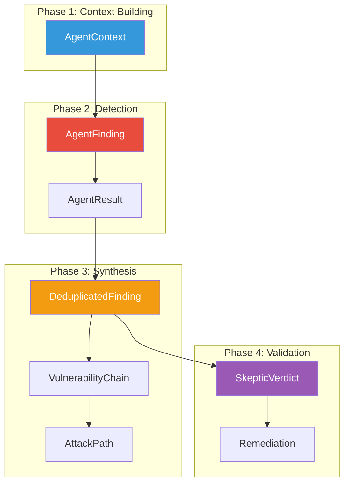

---

## Logging & Observability

### AgentLogger Event Types

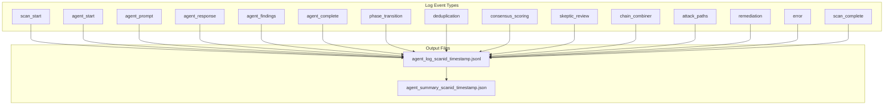

### Log Entry Structure

```
{
  "event_type": "agent_start",
  "seq": 5,
  "elapsed_ms": 1234,
  "agent_name": "InjectionSpecialist",
  "agent_type": "specialist",
  "context_summary": {
    "file_count": 42,
    "entry_points_count": 15,
    "language": "python",
    "framework": "flask"
  },
  "context_full": { ... },
  "config": {
    "max_retries": 3,
    "timeout_seconds": 120
  }
}
```

---

## Learning & Feedback

### LearningAgent Flow

```mermaid
flowchart LR
    subgraph Input["Analyst Feedback"]
        FB[Feedback Record]
        TP[True Positive]
        FP[False Positive]
        WF[Won't Fix]
    end

    subgraph Storage["Persistent Storage"]
        RECORDS[feedback_records.jsonl]
        SUPPRESS[suppression_patterns.json]
        CALIB[confidence_calibration.json]
    end

    subgraph Application["Applied in Future Scans"]
        SUPP[Suppress Known FP Patterns]
        ADJ[Adjust Confidence<br/>for Agent+VulnClass]
    end

    FB --> TP & FP & WF
    TP & FP & WF --> RECORDS
    RECORDS --> |rebuild_patterns| SUPPRESS & CALIB
    SUPPRESS --> SUPP
    CALIB --> ADJ

    style FP fill:#e74c3c,color:#fff
    style TP fill:#27ae60,color:#fff
```

### Feedback Record Structure

```json
{
  "finding_id": "RECON-abc12345",
  "scan_id": "scan-xyz",
  "analyst_verdict": "false_positive",
  "analyst_notes": "This is a test route, not production code",
  "codebase_fingerprint": "sha256:abc123...",
  "agent_source": "InjectionSpecialist",
  "vulnerability_class": "SQL Injection",
  "timestamp": "2024-01-15T10:30:00Z"
}
```

---

## Summary

The SentinAI v4 multi-agent architecture provides:

| Feature | Implementation |
|---------|---------------|
| **Context Enrichment** | Pre-scan agents build intelligence before detection |
| **Parallel Detection** | Five specialists run concurrently for speed |
| **Cross-File Analysis** | Call graphs and dependency maps enable taint tracking |
| **Chain Detection** | Findings linked into multi-hop attack scenarios |
| **False Positive Reduction** | SkepticAgent adversarial review + consensus scoring |
| **Actionable Output** | Remediation with fixed code and unit tests |
| **Observability** | Comprehensive logging of every agent interaction |
| **Continuous Learning** | Analyst feedback improves future scans |

The agentic loop — `build_prompt → LLM call → parse_response → validate` — is the foundation that enables consistent, structured output from every agent in the pipeline.
