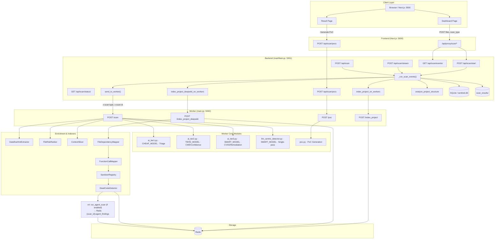
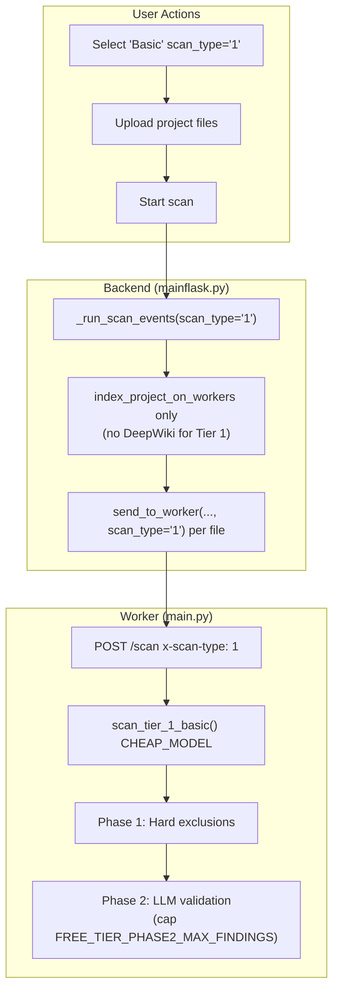
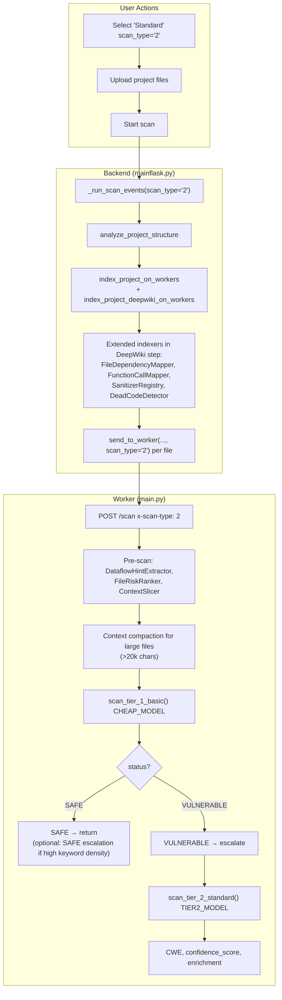
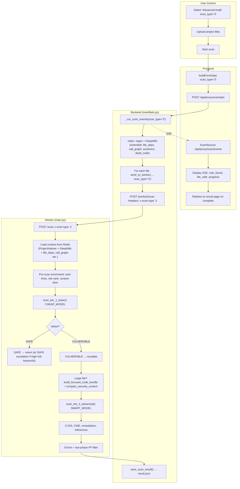
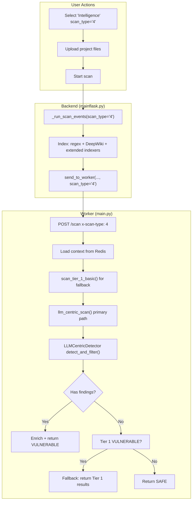
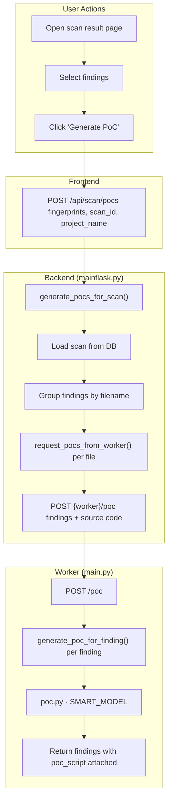

# SentinAI v4 — Architecture & User Flows

This document describes the project architecture and user flows for **Tier 1–4** scans and the **v4 multi-agent pipeline**. It is aligned with the current codebase: backend `mainflask.py`, worker `backend/worker/core/main.py`, config `backend/worker/core/config.py`.

# SentinAI v4 — Deep Dive (Full Explanation)

---

## Start Here: The Mental Model

Before anything else, burn this into your head.

v4 is not just "scan a file and ask an AI if it's vulnerable." It's more like hiring a team of specialists who each do their job before the AI even looks at the code. **The v4 multi-agent pipeline** runs at index time: Recon, Pattern, and Threat Model agents enrich context; five specialist agents (Injection, Auth, Crypto, Logic, Config) run in parallel; then deduplication, consensus scoring, and a Skeptic agent refine findings before they are merged into the per-file scan results. By the time the AI reads a file, it already has a full briefing document about the entire project, knows which functions are dangerous, knows which files talk to which other files, and knows which parts of the code are even reachable. The AI is the last step, not the first.

---

## Part 1 — The Three Buildings (Architecture)

You have three separate processes running.

**The Frontend (Next.js, port 5000)** is what you see in your browser. The dashboard, the upload form, the live progress feed, the results page. It never talks to the worker directly. It only talks to the backend through a proxy.

**The Backend (Flask, port 5001)** is the manager and coordinator. It handles your login, receives your uploaded files, creates scan IDs, decides what to index, dispatches files to the worker, streams progress back to your browser, and saves results to the database. It does not do any AI analysis itself.

**The Worker (FastAPI, port 5002)** is where all the actual intelligence lives. Every AI call, every indexing operation, every enrichment tool, every false positive filter runs here. The backend just tells it what to do.

The flow is always:

```
Your Browser → Frontend → Backend → Worker → AI Models
```

---

## Part 2 — What Happens The Moment You Click Scan

You pick a scan type, upload your files, and hit start. Here is exactly what happens in order.

The backend receives your files and saves them to a temporary folder. It generates a unique scan ID tied to your account, something like `scan_yourname_1234567890`. It then immediately returns that scan ID to your browser and starts the actual work in a background thread. This is why the page doesn't freeze. The response comes back instantly and the real work happens behind the scenes.

Your browser then opens an SSE connection (Server-Sent Events) to the backend. Think of SSE like a one-way live text feed. The backend keeps that connection open and pushes updates to your browser as things happen. Every time a file finishes scanning, you see it. Every time a vulnerability is found, you see it. You don't have to refresh anything.

---

## Part 3 — Indexing (The Briefing Phase)

This is the part that's most different from v1 and the part most people skip over. It's actually the foundation that makes everything else smarter.

Before a single file gets scanned, v4 builds a complete intelligence picture of your entire project. This is called indexing and it happens in two stages.

---

### Stage 1 — Regex Index (Basic Map)

The backend sends all your files to the worker's `/index_project` endpoint. The worker runs a fast pattern-matching pass over every file. It's looking for symbols, function names, class names, import statements, variable names. It builds a lookup table of everything it finds.

This gets stored in Redis under your scan ID. When a file gets scanned later, the AI can look up this index and understand references it sees in the code, even if those references are defined in a completely different file.

This runs for all scan tiers including Tier 1.

---

### Stage 2 — DeepWiki Index (Deep Map)

For Tier 2, 3, and 4, the backend also calls `/index_project_deepwiki`. This is a much more thorough pass that builds what's called a Project IR, meaning a structured internal representation of your entire codebase.

But the really important part is what runs inside this step. Four specialized indexers run in sequence, each one building a different map of your project.

---

#### FileDependencyMapper

This tool reads every import statement, require call, and include directive across all your files. It builds a graph of which files depend on which other files.

Why does this matter? Because if a vulnerability is found in `utils.py`, and `utils.py` is imported by `auth.py`, `payment.py`, and `api.py`, the AI now knows the blast radius. It knows this isn't an isolated issue. It's something that affects three critical parts of your application. Without this map, the AI would look at `utils.py` in isolation and might not understand how serious it is.

The result gets stored in Redis as `{scan_id}:file_deps`.

---

#### FunctionCallMapper

This tool goes deeper than file dependencies. It traces which functions call which other functions, across the entire project. It builds an inter-procedural call graph.

Why does this matter? Imagine there's a dangerous function called `execute_query()` that takes raw user input. The FunctionCallMapper tells the AI exactly which other functions in the codebase call `execute_query()`. So when the AI is analyzing a file and sees a call to `execute_query()`, it already knows the full chain of who calls what. It can trace a potential attack path from the entry point all the way down to the dangerous operation.

The result gets stored in Redis as `{scan_id}:call_graph`.

---

#### SanitizerRegistry

This is one of the most important ones for reducing false positives. A sanitizer is any function that cleans, validates, escapes, or checks user input before it gets used. Things like `escape_html()`, `validate_email()`, `sanitize_input()`, `parameterize_query()`.

The SanitizerRegistry scans your entire codebase and builds a list of every function that appears to be doing sanitization work. It looks at function names, what they do, what they return.

Why does this matter enormously? The classic false positive in security scanning is flagging code that looks dangerous but is actually safe because the input gets sanitized before it reaches the dangerous operation. If the AI doesn't know your codebase has a `sanitize_input()` function that wraps every user input, it might flag dozens of things as SQL injection risks when they're actually fine.

With the SanitizerRegistry, the AI knows which sanitizers exist in your project. When it sees user input flowing into a dangerous function, it can check whether a known sanitizer was applied first. This is the difference between a scanner that cries wolf constantly and one that gives you findings you can actually trust.

The result gets stored in Redis as `{scan_id}:sanitizer_registry`.

---

#### DeadCodeDetector

This tool identifies code that can never actually be executed. Functions that are defined but never called. Branches that can never be reached. Code behind conditions that are always false.

Why does this matter? Dead code cannot be exploited. If a vulnerable function exists but is completely unreachable from any entry point in the application, it's not a real risk in practice. Without dead code detection, a scanner would flag it as a critical vulnerability. With it, the AI knows to either skip it entirely or at minimum lower its severity.

The result gets stored in Redis as `{scan_id}:dead_code_map`.

---

All four of these maps get built before any file is scanned. They sit in Redis waiting. When the worker picks up a file to scan, it loads all four maps and uses them as context. The AI doesn't just see the file. It sees the file plus a complete picture of the project it lives in.

**v4 addition:** Right after the four indexers complete (still during `index_project_deepwiki`), the worker may run the **multi-agent scan** if `AGENT_SCAN_ENABLED` and `OPENROUTER_API_KEY` are set. The agents use **Minimax M2.5** via OpenRouter (configured via `MINIMAX_MODEL`). That pipeline is described in **Part 3a** below. Its findings are stored in Redis at `{scan_id}:agent_findings` and later **merged** into each scan's result before the two-phase false positive filter (see Part 6 and Part 8).

---

## Part 3a — Multi-Agent Scan (v4)

When **Tier 2, 3, or 4** indexing runs (DeepWiki + extended indexers), the worker can also run a **multi-agent security scan** over the whole project. This is the v4 pipeline. It runs **once per scan**, after FileDependencyMapper, FunctionCallMapper, SanitizerRegistry, and DeadCodeDetector have finished. It uses the same `call_graph`, `sanitizer_registry`, and `dead_code_map` just built, plus a `file_contents` map built by reading all files from the temporary project directory.

**LLM Selection:** Agents use Minimax M2.5 via OpenRouter when `OPENROUTER_API_KEY` is set (configured via `MINIMAX_MODEL`). Otherwise the agent scan is disabled.

**When it runs:** Only if `AGENT_SCAN_ENABLED` is true and `OPENROUTER_API_KEY` is available.

**What it does:**

1. **Build context** — `AgentContext` with `call_graph`, `dependency_map`, `sanitizer_registry`, `dead_code_map`, `file_contents`, and scan metadata.

2. **Coordinator run** (`AgentCoordinator.run_scan`):
   - **Pre-scan (sequential):** ReconAgent → populates `entry_points`; PatternAgent → populates `architecture_patterns` (e.g. middleware order); ThreatModelAgent → populates `threat_model`.
   - **Detection (parallel):** Specialist agents run over the same enriched context. By default: InjectionSpecialist, AuthSpecialist, CryptoSpecialist, LogicAnalyst, ConfigHunter. If `AGENT_LLM_SECURITY_ENABLED` is true, **LLMSecurityAgent** (Phase 5) also runs — it detects prompt injection, insecure LLM output handling, sensitive data in prompts, and insecure tool use.

3. **Phase 2 synthesis (in worker, after coordinator):**
   - **DeduplicationEngine** — Merges findings that refer to the same vulnerability (same file + overlapping lines + same vuln class; or same `taint_sink`). Produces `DeduplicatedFinding` with `contributing_agents` and `duplicate_count`.
   - **ConsensusScorer** — Adjusts confidence by multi-agent agreement (1→1.0×, 2→1.25×, 3→1.5×, 4+→1.75×), chain membership (+0.15), and dead-code penalty (−0.40); score capped at 1.0.
   - **SkepticAgent** — Adversarial review per finding (sanitization, dead code, framework protection, auth, type/context). Verdicts: **confirmed** (confidence +0.1), **downgraded** (severity reduced one level), **rejected** (removed). High rejection rate (>20%) logs a warning.

4. **Optional Phase 3 (configurable):** When enabled via env, the worker runs after Skeptic:
   - **AGENT_CHAIN_COMBINER_ENABLED** — ChainCombiner links findings into multi-hop attack chains (taint flow, auth bypass → IDOR); produces `VulnerabilityChain` with attack narrative. Result stored in Redis at `{scan_id}:agent_chains`.
   - **AGENT_ATTACK_PATH_SIMULATOR_ENABLED** — AttackPathSimulator turns chains into step-by-step `AttackPath` (prerequisites, complexity, PoC outline). Result stored at `{scan_id}:agent_attack_paths`.
   - **AGENT_REMEDIATION_ENABLED** — RemediationAgent generates fix description, fixed code snippet, unit test, and regression risk per finding. Result stored at `{scan_id}:agent_remediations`.

5. **Output** — The resulting list is converted to the same dict shape as tier findings and stored in Redis at `{scan_id}:agent_findings` with `SCAN_TTL`.

**Additional v4 components:**

- **ChainCombiner, AttackPathSimulator, RemediationAgent** — When enabled (`AGENT_CHAIN_COMBINER_ENABLED`, `AGENT_ATTACK_PATH_SIMULATOR_ENABLED`, `AGENT_REMEDIATION_ENABLED`), they run after Skeptic; chains, attack paths, and remediations are stored in Redis (`{scan_id}:agent_chains`, `{scan_id}:agent_attack_paths`, `{scan_id}:agent_remediations`) for UI or downstream use.
- **LearningAgent** — Append-only feedback in `backend/worker/data/learning/feedback_records.jsonl`; opt-in `rebuild_patterns()` to refresh suppression patterns and confidence calibration. Never auto-modifies scan behavior.

**Where agent findings go:** When the worker handles a **per-file** `POST /scan` request, after building `final_result` from the tier pipeline and applying enrichment (keywords, code context, graph context), it loads `{scan_id}:agent_findings` from Redis (if present) and **merges** them into `final_result["findings"]`. If the result was not already `VULNERABLE`, it is set to `VULNERABLE`. The combined list then goes through **STEP 5** (two-phase false positive filter) and the rest of the validation/scoring pipeline like any other finding.

---

## Part 3b — Phase 4 & 5 Extensions (Optional)

The following modules are implemented and can be enabled or used independently:

**Scan Diff Mode** (`backend/worker/core/scan_diff.py`) — For CI/CD, only analyze changed files plus dependents. `expand_changed_files(changed_files, dependency_map, call_graph, depth)` expands the set using import/call graph; `build_diff_context()` produces a reduced file set and trimmed dependency/call_graph. Enable with `SCAN_DIFF_ENABLED=true`; expansion depth via `SCAN_DIFF_EXPAND_DEPTH` (default 2). Target: ~80% token reduction on typical PRs.

**Dependency Scanner** (`backend/worker/core/dependency_scanner.py`) — Parses `package.json`, `requirements.txt`, `go.mod`, `Cargo.toml`, Pipfile; queries OSV API for CVEs; correlates with source files that import vulnerable packages. Enable with `DEPENDENCY_SCANNER_ENABLED=true`. `OSV_API_URL` defaults to `https://api.osv.dev/v1/query`.

**Git Context** (`backend/worker/core/git_context.py`) — Uses git history: high-churn files (e.g. changed >10× in 90 days), recently changed files (e.g. last 30 days), security-relevant commit messages. `get_git_context(repo_path)` returns `GitContext`; `confidence_boost_for_file(file_path, git_ctx)` can be used to prioritize findings. Enable with `GIT_CONTEXT_ENABLED=true`.

**Fuzzing Hint Generator** (`backend/worker/core/fuzzing_hint_generator.py`) — From attack paths or findings, produces `FuzzingHint` (entry point, HTTP method, payload templates, boundary values, auth setup). Used to feed fuzzers or manual testing. `generate_hints_from_attack_path(path)` and `generate_hints_from_findings(findings)`.

**LLM Security Specialist** (`backend/worker/core/agents/specialists/llm_security_agent.py`) — When `AGENT_LLM_SECURITY_ENABLED=true`, runs as a sixth specialist in the agent pipeline. Detects direct/indirect prompt injection, insecure LLM output handling, sensitive data in prompts, insecure tool use (Phase 5).

**Benchmark & Ground Truth** — `backend/worker/tests/benchmarks/` contains `BenchmarkRunner`, `BaselineRecorder`, and ground truth manifests under `ground_truth/` (e.g. `juice_shop.json`, `dvga.json`, `vampi.json`, `webgoat.json`, `cloudgoat.json`). Success criteria per phase are in `success_criteria.md`.

---

## Part 4 — Pre-Scan Enrichment (The File Briefing)

After indexing is done, files start getting sent to the worker for scanning. But before the AI reads a file, **hard detection rules** and **pre-scan enrichment** run.

**Hard detection rules** (`apply_hard_detection_rules` in `findings_filter.py`): Deterministic, rule-based checks (e.g. hardcoded secrets, known dangerous patterns) run first. Any findings are merged into the final result for the file alongside tier/agent findings.

Then three enrichment tools run on the file:

---

### DataflowHintExtractor

This tool reads the file and traces how data flows through it. It's specifically looking for taint sources and entry points.

A taint source is anywhere that untrusted user input enters your code. Things like HTTP request parameters, form fields, URL query strings, file uploads, environment variables read from user-controlled sources. The DataflowHintExtractor finds all of these in the file.

It then tries to trace where that input flows. Does it go into a database query? Does it go into a shell command? Does it get written to a file? Does it get reflected back in an HTTP response?

This gives the AI a pre-built map of the dangerous data flows in the file before it even starts reading. Instead of the AI having to figure this out from scratch, it gets handed a briefing that says "user input enters here, flows through these functions, and ends up here."

---

### FileRiskRanker

This tool gives the file a risk score before the AI sees it. It looks at things like what the file is named, what directory it's in, what keywords appear in it, what functions it defines, what it imports.

Files named things like `auth.py`, `payment.py`, `crypto.py`, `admin.py` get higher risk scores. Files that import database libraries, cryptography libraries, or network libraries get higher scores. Files in directories called `security`, `auth`, or `api` get higher scores.

The risk score does two things. First it tells the AI upfront that this is a high-risk file and to be extra thorough. Second, **risk-based tier override**: if the risk score is high enough, the worker can automatically escalate the file to a deeper scan tier than you originally requested.

So if you ran a Tier 1 basic scan but `payment_processor.py` scores extremely high risk, the worker might automatically run it through Tier 2 or Tier 3 analysis instead. You get deeper coverage on the files that actually matter without paying for deep analysis on every file.

---

### ContextSlicer

This tool cuts the file into function-level slices. Instead of handing the AI a 2000-line file and saying "find vulnerabilities in here," it carves out individual functions and their immediate context.

Why does this matter? AI models have context windows. If you dump an entire large file into the prompt, the model might miss things buried in the middle, or waste its attention on irrelevant boilerplate code. By slicing the file into focused chunks, each function gets the AI's full attention.

The ContextSlicer is also what makes the large file handling work. For files over 20,000 characters, v4 runs `compact_security_context()` which uses the ContextSlicer output to build a focused bundle of only the suspicious-looking functions rather than the whole file. This is the same smart bundling concept from earlier versions but more sophisticated.

---

## Part 5 — The Four Scan Tiers (What Actually Runs)

Now the file is ready to be scanned. It has enrichment data attached to it. The worker loads the Redis context. Now the AI runs.

---

### Tier 1 — Basic

The Tier 1 model (`CHEAP_MODEL` in `backend/worker/core/config.py`) reads the file plus the regex index context. It's running in what v1 called paranoid mode, meaning it's told to flag anything that looks even slightly suspicious. High recall, meaning it would rather flag too much than miss something real.

After Tier 1 returns its findings, two filter phases run.

Phase 1 is a hard rules-based filter. Things like "if the finding is in a comment, remove it," "if the finding is in a test file, remove it," "if the finding matches these known false positive patterns, remove it." Fast and cheap.

Phase 2 is an LLM validation pass. The remaining findings after Phase 1 get sent back to an AI which looks at each one and decides whether it's a real finding or a false positive. This phase is capped at a maximum number of findings to control cost.

What comes out the other side is a cleaned-up list of findings that have survived two rounds of scrutiny.

---

### Tier 2 — Standard

Everything from Tier 1 runs first. Tier 1 does the triage. If Tier 1 says safe, the file is done and the result is returned immediately. No point spending more money.

If Tier 1 says vulnerable, the findings get passed to the Tier 2 model (`TIER2_MODEL`). That model is a more powerful reasoning step. It reads the file, the enrichment context, the call graph, the sanitizer registry, and the Tier 1 findings. It then produces a deeper analysis.

The new things Tier 2 adds are CWE classification and confidence scoring. CWE stands for Common Weakness Enumeration. It's a standardized catalog of software vulnerability types. CWE-89 is SQL injection. CWE-79 is cross-site scripting. CWE-22 is path traversal. By labeling each finding with a CWE, the results become standardized and comparable across projects. The confidence score tells you how certain the AI is that this is a real vulnerability, expressed as a number.

There's also a special edge case called SAFE escalation. If Tier 1 says the file is safe, but the file contains a very high density of security-sensitive keywords, the worker can override the SAFE result and escalate to Tier 2/3 anyway. This is a safety net for cases where Tier 1 might have been too lenient.

---

### Tier 3 — Advanced Audit

Same flow as Tier 2 up until the Tier 2/3 model call. But Tier 3 uses `SMART_MODEL` with a different prompt and produces a much more detailed output.

At Tier 3, the smart model produces a full CVSS score. CVSS stands for Common Vulnerability Scoring System. It's a number from 0 to 10 that represents the severity of a vulnerability, calculated from factors like how easy it is to exploit, what privileges are required, whether it requires user interaction, and what the impact is on confidentiality, integrity, and availability. A CVSS of 9.8 is critical. A CVSS of 3.1 is low.

The smart model also produces remediation advice at Tier 3. Not just "this is vulnerable" but "here is specifically how to fix it, here is the safe pattern to use instead." And it adds references to external vulnerability databases like CVE entries or OWASP guidelines that are relevant to the finding.

After Tier 3 returns its results, the same two-phase false positive filter from Tier 1 runs again on the Tier 3 findings before they're returned to you.

---

### Tier 4 — Intelligence

This tier flips the entire approach. In Tiers 1 through 3, Tier 1 always goes first. In Tier 4, `SMART_MODEL` leads.

The smart model runs a single comprehensive pass over the file using its full reasoning capability. It's not just pattern matching. It's actually reasoning about the code, thinking about attack scenarios, considering the context from the call graph and sanitizer registry, and producing high-confidence findings with detailed reasoning attached to each one.

Simultaneously, Tier 1 runs in the background as a fallback.

If the smart model finds anything, those results are returned.

If the smart model finds nothing, the worker checks whether Tier 1 found anything. If Tier 1 found something, those results are returned as a fallback. If Tier 1 also found nothing, the file is marked safe.

The reason for the fallback is that the smart model, being precision-focused, might occasionally miss something that Tier 1's paranoid wide-net approach would catch. The fallback ensures you don't lose coverage.

---

## Part 6 — The Validation Layers

This is the part that makes v4 fundamentally more trustworthy than a naive single-pass scan. Findings go through **multiple** layers of scrutiny:

- a **two-phase per-finding validator** (hard rules + LLM) that runs after Tier 1 and again after Tier 2/3, and
- an optional **post-scan validation layer** for high‑severity findings.

---

### Two‑Phase Validator (Static + Agentic)

The core of the validation story lives in `backend/worker/core/findings_validator.py` and is used via `apply_two_phase_validation()`:

- **Phase 1 — Hard rules:** fast exclusions implemented in `FindingsFilter` (comments, tests, known noisy patterns).
- **Phase 2 — LLM validator:** each remaining finding gets its own validation sub‑task with a 1–10 confidence score.

Phase 2 can run in two modes:

- **Static mode** (`FindingsValidator`): a single JSON‑constrained LLM call that returns `{ keep_finding, confidence_score, justification, exclusion_reason }`. This is what the worker uses today for Tier 1–3.
- **Agentic mode** (`AgenticFindingsValidator`): a ReAct‑style validator that can call tools before deciding, with strict per‑finding and per‑scan budgets. The tools are:
  - `fetch_file(path)` — load full source for a project file.
  - `fetch_function(path, function_name)` — load just one function.
  - `trace_callers(function_name)` / `trace_callees(function_name)` — walk the call graph from Redis.
  - `lookup_sanitizers()` — inspect the sanitizer registry.
  - `check_dead_code(path, function_name)` — see if a function is marked unreachable.
  - `fetch_context_slice(path, line, window)` — pull a wider context window around a line.

High‑confidence findings (already ≥ a configurable ceiling) skip the agentic path; low/medium‑confidence ones may use tools to confirm or discard them. If the model response is malformed or tooling fails, the validator **fails open** (keeps the finding but downgrades confidence and clearly flags `validation_status` and a warning).

---

### SkepticPass

This takes each high‑severity finding (based on CVSS) and runs it through a skeptical re‑examination. It's essentially asking "is this actually real?" It looks at the finding in context, checks whether the evidence actually supports the conclusion, and removes or downgrades findings that don't hold up under scrutiny. If SkepticPass crashes, those findings are marked as `unvalidated` but kept (fail‑open).

---

### MultiSignalConfidenceScorer

This takes all the signals from the entire pipeline and combines them into a final confidence score for each finding.

The signals it combines include the Tier 1 triage result, the Tier 2/3 model confidence, the SkepticPass result, the risk score from `FileRiskRanker`, whether the code is dead code or not, and whether sanitizers are present in the call path.

Each signal votes for or against the finding being real. The scorer weighs them and produces a final number. High confidence means multiple independent signals all agree the finding is real. Low confidence means the signals are mixed and you should look at it manually.

---

## Part 7 — PoC Generation (On Demand)

After the scan, you're on the results page looking at findings. For any finding you want, you can click Generate PoC.

This sends the finding details and the original source code back to the worker's `/poc` endpoint. `poc.py` calls OpenRouter with `SMART_MODEL` to write an actual proof-of-concept exploit script. A real piece of code that demonstrates how an attacker would abuse the vulnerability.

This serves two purposes. First it helps you verify the finding is real. If the generated PoC is coherent and runnable, the vulnerability is easier to confirm. Second it's useful for convincing developers to fix something. Showing a developer a working exploit script is much more persuasive than showing them a finding description.

In v1 this was automatic and came with every scan. In v3 it's on demand because generating PoC scripts is expensive and you might not need them for every finding.

---

## Part 8 — How It All Fits Together

Here is the complete flow from click to result in plain English.

You click scan. The backend saves your files and creates a scan ID. Your browser opens a live feed. The backend starts a background thread.

The background thread first builds the regex index of all your files. For Tier 2, 3, and 4 it then builds the deep index which runs FileDependencyMapper, FunctionCallMapper, SanitizerRegistry, and DeadCodeDetector. All four maps go into Redis.

**v4:** If agent scan is enabled, the worker then runs the multi-agent pipeline (Recon, Pattern, ThreatModel → five specialists in parallel → DeduplicationEngine → ConsensusScorer → SkepticAgent) over the full project and stores the result in Redis at `{scan_id}:agent_findings`.

Then for each file, the worker loads the Redis context, runs DataflowHintExtractor to map data flows, runs FileRiskRanker to score the file's risk, runs ContextSlicer to prepare focused chunks, and checks if the file needs to be escalated to a higher tier.

Then the AI runs. Tier 1 (`CHEAP_MODEL`) for triage, `TIER2_MODEL` / `SMART_MODEL` for deep analysis if needed, or the LLM-centric path with `SMART_MODEL` leading for Tier 4.

After findings come back, **agent findings** for this scan (if any) are loaded from Redis and **merged** into the result list. Then the validation layer runs: two-phase filter (hard rules + LLM), SkepticPass on high-severity findings, and MultiSignalConfidenceScorer to produce a final confidence rating. A separate `CrossFileConsistencyChecker` exists for future cross-file passes but is not yet wired into the main worker pipeline.

Results stream back to your browser in real time. When everything is done, results are saved to the database. You can then request PoC scripts for any findings you want to verify.

---

## The Honest Summary of What Makes v3 Different

v1 was smart about cost. Cheap model first, expensive model only if needed. That was the key insight.

v3 kept that insight and added three more layers on top of it.

It made the AI smarter by giving it a complete picture of the project before it reads any file. Call graphs, dependency maps, sanitizer registries, dead code maps. The AI in v3 is not reading code blind.

It made the findings more reliable by adding a validation layer that questions the AI's conclusions instead of trusting them blindly. Multiple independent checks before a finding reaches you.

It made the scanning adaptive by adding risk-based tier override so high-risk files automatically get deeper analysis even if you picked a basic scan.

**v4** adds a **project-level multi-agent scan** at index time: specialist agents (Injection, Auth, Crypto, Logic, Config) run in parallel with full project context; findings are deduplicated, consensus-scored, and skeptic-reviewed before being merged into each file's result and passed through the same two-phase filter and validation as tier findings. Optional components (ChainCombiner, AttackPathSimulator, RemediationAgent, LearningAgent) support attack narratives, remediation hints, and feedback-driven tuning.

---

## 1. Project Architecture

```
Browser (Next.js :5000)
  └─ /api/proxy/*  →  Flask Gateway (:5001)  →  FastAPI Worker (:5002)
```

| Component | Path | Port | Role |
|-----------|------|------|------|
| **Frontend** | `src/` (Next.js) | 5000 | Dashboard, upload, SSE progress, scan results |
| **API Gateway** | `backend/mainflask.py` (Flask) | 5001 | Auth, uploads, scan dispatch, SSE, storage |
| **Worker** | `backend/worker/core/main.py` (FastAPI) | 5002 | Indexing, Tier 1–4 scan, PoC |



---

## 2. Scan Tiers Overview

| Tier | UI Label | scan_type | Pipeline | Primary Module | Detection Model | Agent Model |
|------|----------|-----------|----------|----------------|-----------------|-------------|
| **1** | Basic | `"1"` | Tier 1 only → two-phase FP filter | `ai_tier1.py` | Cheap model (OpenRouter) | — |
| **2** | Standard | `"2"` | Tier 1 → Tier 2 (if VULNERABLE) | `ai_tier2.py` | CHEAP_MODEL + TIER2_MODEL (OpenRouter) | AGENT_MODEL (OpenRouter, optional) |
| **3** | Advanced Audit | `"3"` | Tier 1 → Tier 3 (if VULNERABLE) | `ai_tier3.py` | CHEAP_MODEL + SMART_MODEL (OpenRouter) | AGENT_MODEL (OpenRouter, optional) |
| **4** | Intelligence | `"4"` | LLM-centric single pass + Tier 1 fallback | `llm_centric_detector.py` | SMART_MODEL (+ CHEAP_MODEL filter) | AGENT_MODEL (OpenRouter, optional) |

**LLM Providers:**
- **Detection:** Tier 1 uses `CHEAP_MODEL` (default `qwen/qwen3.5-9b`) via OpenRouter. Tier 2/3/4 use `SMART_MODEL` / `TIER2_MODEL` (default `z-ai/glm-5`) via OpenRouter. DeepWiki indexer uses `INDEXER_MODEL` (default `openai/gpt-oss-120b`).
- **Agents:** Use `AGENT_MODEL` (defaults to `MINIMAX_MODEL`, e.g. `minimax/minimax-m2.7`) via OpenRouter when `OPENROUTER_API_KEY` is set.

---

## 3. Tier 1 User Flow — Basic Scan

Tier 1 is high-recall triage only, with two-phase false-positive filtering.



---

## 4. Tier 2 User Flow — Standard (CWE/Confidence)

Tier 2 uses Tier 1 triage → escalates to `TIER2_MODEL` for CWE and confidence scoring when VULNERABLE.



---

## 5. Tier 3 User Flow — Advanced Audit

Tier 3 uses Tier 1 triage → escalates to `SMART_MODEL` for CVSS, remediation, and references when VULNERABLE.



### Tier 3 Call Chain (Concise)

```
Dashboard (scan_type=3)
  → POST /api/scan/start (scan_type=3)
  → mainflask._run_scan_events(scan_type="3")
  → analyze_project_structure
  → index_project_on_workers + index_project_deepwiki_on_workers (parallel)
  → Extended indexers run in DeepWiki: FileDependencyMapper → FunctionCallMapper → SanitizerRegistry → DeadCodeDetector
  → send_to_worker(..., scan_type="3") per file
  → Worker POST /scan (x-scan-type: 3)
  → Enrichment: DataflowHintExtractor, FileRiskRanker, ContextSlicer
  → scan_tier_1_basic() [always]
  → if VULNERABLE: scan_tier_3_advanced()
  → ai_tier3.scan_tier_3_advanced() [SMART_MODEL via OpenRouter, CVSS/remediation]
  → save_scan_result() → scan_results/{scan_id}/result.json
```

---

## 6. Tier 4 User Flow — Intelligence (LLM-Centric Scan)

Tier 4 uses a **single-pass LLM-centric** detection path, with Tier 1 fallback if the LLM returns 0 findings.



### Tier 4 Scan Call Chain (Concise)

```
Dashboard (scan_type=4)
  → POST /api/scan/start (scan_type=4)
  → mainflask._run_scan_events(scan_type="4")
  → index_project_on_workers + index_project_deepwiki_on_workers
  → send_to_worker(..., scan_type="4")
  → Worker POST /scan (x-scan-type: 4)
  → scan_tier_1_basic() [for fallback]
  → llm_centric_scan() [primary]
  → llm_centric_detector.llm_centric_scan()
  → SMART_MODEL single pass (detection + CHEAP_MODEL batch filter)
  → if 0 findings && Tier1 VULNERABLE → fallback Tier 1
```

---

## 7. Tier 4 PoC Generation Flow (Post-Scan)

PoC generation runs **after** a scan. The user selects findings and requests PoC scripts.



---

## 8. Enrichment Pipeline (Worker)

For scan types 2, 3, and 4, the worker applies:

1. **Extended indexing** (during `index_project_deepwiki`):
   - `FileDependencyMapper` → Redis `{scan_id}:file_deps`
   - `FunctionCallMapper` → Redis `{scan_id}:call_graph`
   - `SanitizerRegistry` → Redis `{scan_id}:sanitizer_registry`
   - `DeadCodeDetector` → Redis `{scan_id}:dead_code_map`
   - **v4:** If `AGENT_SCAN_ENABLED` and `OPENROUTER_API_KEY`: build `file_contents` from tmpdir, run `run_agent_scan()` using Minimax M2.5 (via OpenRouter), store result → Redis `{scan_id}:agent_findings`

2. **Pre-scan enrichment** (per file on `/scan`):
   - `DataflowHintExtractor` — taint sources, entry points
   - `FileRiskRanker` — risk score, optional tier override
   - `ContextSlicer` — slice by function for focused context
   - Load `sanitizer_registry`, `dead_code_map` from Redis

3. **Context compaction** — for files >20k chars, `compact_security_context()` reduces context before Tier 2/3 LLM calls.

4. **Risk-based tier override** — if `FileRiskRanker` recommends a higher tier than requested, the worker escalates.

5. **SAFE escalation** — for Tier 2/3, if Tier 1 says SAFE but keyword density is high, the worker may still escalate to Tier 2/3.

6. **v4 agent findings merge** — After enrichment (STEP 4), before the two-phase filter (STEP 5): load `{scan_id}:agent_findings` from Redis and extend `final_result["findings"]`; set status to VULNERABLE if needed. The combined list then goes through Phase 1 and Phase 2 filtering like tier findings.

---

## 9. Validation Modules

Validation and scoring live in two places:

- **Two‑phase validator** — `backend/worker/core/findings_validator.py`
  - `FindingsValidator` — static JSON‑only Phase 2 (used today for Tier 1–3).
  - `AgenticFindingsValidator` — ReAct‑style Phase 2 that can call tools (`fetch_file`, `fetch_function`, `trace_callers`, `trace_callees`, `lookup_sanitizers`, `check_dead_code`, `fetch_context_slice`) against the scan’s Redis context and in‑memory file store. Currently wired as an opt‑in mode on top of the same two‑phase API.
- **Post‑scan validation & scoring** — `backend/worker/core/validation/`
  - **SkepticPass** — skeptical re‑check of high‑severity findings (CVSS ≥ threshold), with fail‑open semantics if it crashes.
  - **MultiSignalConfidenceScorer** — multi‑signal confidence scoring across Tier 1/Tier 2/3, SkepticPass, risk rank, sanitizers, dead‑code.

**v4:** Agent findings (already deduped, consensus-scored, and skeptic-reviewed in `run_agent_scan`) are loaded from Redis and merged into `final_result["findings"]` before the two‑phase validator runs. So agent findings go through the same Phase 1 (hard rules) and Phase 2 (LLM or agentic) filter as tier findings, then SkepticPass and MultiSignalConfidenceScorer when applicable.

---

## 10. Tier Comparison

| Aspect | Tier 1 | Tier 2 | Tier 3 | Tier 4 (Scan) |
|--------|--------|--------|--------|---------------|
| **UI Label** | Basic | Standard | Advanced Audit | Intelligence |
| **Entry** | `scan_type: "1"` | `scan_type: "2"` | `scan_type: "3"` | `scan_type: "4"` |
| **Pipeline** | T1 only + FP filter | T1 → T2 (if VULNERABLE) | T1 → T3 (if VULNERABLE) | LLM-centric + T1 fallback |
| **Primary Module** | `ai_tier1.py` | `ai_tier2.py` | `ai_tier3.py` | `llm_centric_detector.py` |
| **Detection Model** | Cheap (OpenRouter) | Cheap + smart (OpenRouter) | Cheap + smart (OpenRouter) | Smart (OpenRouter) |
| **Agent Model** | — | Minimax M2.5 (OpenRouter) | Minimax M2.5 (OpenRouter) | Minimax M2.5 (OpenRouter) |
| **Output** | Basic findings | CWE, confidence | CVSS, CWE, remediation | Reasoning, high-confidence |
| **Indexing** | Regex only | Regex + DeepWiki + extended | Regex + DeepWiki + extended | Regex + DeepWiki + extended |

---

## 11. API Endpoints

### Flask (mainflask.py)

| Method | Path | Description |
|--------|------|-------------|
| GET | `/api/csrf-token` | Get CSRF token for auth |
| POST | `/auth/login` | Session login |
| POST | `/api/scan/start` | Start scan; returns `scan_id` |
| POST | `/api/scan/stream` | Upload + stream (SSE) |
| POST | `/api/scan` | Upload + single JSON response (no SSE) |
| GET | `/api/scan/events/<scan_id>` | SSE stream |
| GET | `/api/scan/status/<scan_id>` | Poll progress |
| POST | `/api/scan/pocs` | Generate PoCs for findings |
| GET | `/api/health` | Health check |

### Worker (main.py)

| Method | Path | Description |
|--------|------|-------------|
| POST | `/scan` | Full scan (x-scan-type, x-secret) |
| POST | `/index_project` | Build regex/symbol index |
| POST | `/index_project_deepwiki` | Build DeepWiki + extended indexers (+ v4 agent scan if enabled) |
| POST | `/poc` | PoC generation |
| GET | `/health` | Health check |

**v4 agent scan (worker env):** `AGENT_SCAN_ENABLED` (default true), `OPENROUTER_API_KEY`, `MINIMAX_MODEL` (default `minimax/minimax-m2.5`), `AGENT_PARALLEL_TIMEOUT_SECONDS`, `AGENT_MAX_FILE_TOKENS`.

**Optional agent pipeline:** `AGENT_CHAIN_COMBINER_ENABLED`, `AGENT_ATTACK_PATH_SIMULATOR_ENABLED`, `AGENT_REMEDIATION_ENABLED` (default false). When true, chains, attack paths, and remediations are written to Redis (`{scan_id}:agent_chains`, `{scan_id}:agent_attack_paths`, `{scan_id}:agent_remediations`).

**Phase 4/5:** `SCAN_DIFF_ENABLED`, `SCAN_DIFF_EXPAND_DEPTH`; `DEPENDENCY_SCANNER_ENABLED`, `OSV_API_URL`; `GIT_CONTEXT_ENABLED`; `AGENT_LLM_SECURITY_ENABLED` (adds LLM Security specialist).

---

## 12. Benchmark

The benchmark (`benchmark/run_benchmark.py`) runs against the Flask gateway (`mainflask.py`):

- Auth: `SENTINEL_EMAIL`, `SENTINEL_PASSWORD`, session + CSRF
- **Default:** Non-streaming `POST /api/scan` (single JSON response)
- **Optional:** `USE_STREAMING=1` for `POST /api/scan/stream` (SSE)
- Writes `benchmark/results.json` with true/false positive rates
