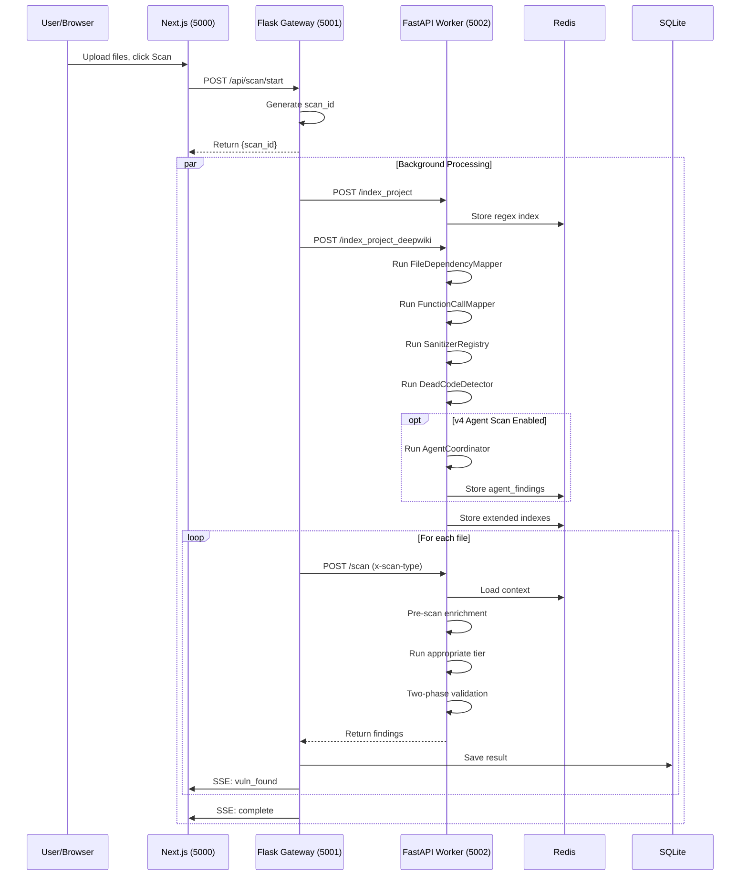

# SentinAI v4 — Backend Architecture

This document describes the backend architecture for SentinAI v4, covering the Flask API Gateway (`mainflask.py`), the FastAPI Worker (`worker/core/main.py`), authentication, database models, and the multi-agent pipeline.

---

## Table of Contents

1. [Overview](#1-overview)
2. [Flask API Gateway (mainflask.py)](#2-flask-api-gateway-mainflaskpy)
3. [FastAPI Worker (worker/core/main.py)](#3-fastapi-worker-workercoremainpy)
4. [Authentication System](#4-authentication-system)
5. [Database Models](#5-database-models)
6. [Scan Tiers (1-4)](#6-scan-tiers-1-4)
7. [Multi-Agent Pipeline (v4)](#7-multi-agent-pipeline-v4)
8. [Indexing & Enrichment](#8-indexing--enrichment)
9. [Validation & Filtering](#9-validation--filtering)
10. [Configuration](#10-configuration)

---

## 1. Overview

The SentinAI backend consists of two main services:

```
┌─────────────────┐      ┌─────────────────┐      ┌─────────────────┐
│   Next.js       │──────▶│  Flask Gateway  │──────▶│  FastAPI Worker │
│  (Port 5000)    │      │  (Port 5001)    │      │  (Port 5002)    │
└─────────────────┘      └─────────────────┘      └─────────────────┘
                              │
                              ▼
                        ┌─────────────────┐
                        │   SQLite DB     │
                        │  (sentinel.db)  │
                        └─────────────────┘
                              │
                              ▼
                        ┌─────────────────┐
                        │     Redis       │
                        │  (Temp Storage) │
                        └─────────────────┘
```

| Component | File | Port | Purpose |
|-----------|------|------|---------|
| **Frontend** | `src/` (Next.js) | 5000 | Dashboard, upload, results UI |
| **Flask Gateway** | `backend/mainflask.py` | 5001 | Auth, uploads, scan dispatch, SSE streaming |
| **FastAPI Worker** | `backend/worker/core/main.py` | 5002 | AI analysis, indexing, PoC generation |
| **Database** | `backend/sentinel.db` | - | SQLite with SQLAlchemy models |
| **Cache** | Redis (optional) | 6379 | Scan progress, file indexes, call graphs |

---

## 2. Flask API Gateway (mainflask.py)

The Flask gateway is the central coordinator. It handles HTTP requests from the frontend, manages user sessions, dispatches work to the worker, and streams progress back via Server-Sent Events (SSE).

### 2.1 Key Routes

| Method | Route | Description |
|--------|-------|-------------|
| `POST` | `/api/scan/start` | Start a new scan, returns `scan_id` |
| `POST` | `/api/scan/stream` | Upload + stream progress (SSE) |
| `POST` | `/api/scan` | Upload + single JSON response (no SSE) |
| `GET`  | `/api/scan/events/<scan_id>` | SSE event stream |
| `GET`  | `/api/scan/status/<scan_id>` | Poll scan progress |
| `POST` | `/api/scan/pocs` | Generate PoC scripts for findings |
| `POST` | `/auth/login` | Email/password login |
| `POST` | `/auth/register` | User registration |
| `GET`  | `/auth/google` | Google OAuth login |
| `GET`  | `/auth/me` | Get current user from session |

### 2.2 Scan Flow (mainflask.py)

```python
# Simplified flow when user clicks "Start Scan"
1. Receive files via multipart upload
2. Generate scan_id: f"scan_{user_id}_{timestamp}"
3. Save files to temp directory
4. Start background thread: _run_scan_events()
5. Return scan_id immediately (non-blocking)

# Background thread (_run_scan_events)
1. Analyze project structure (detect language/framework)
2. Build regex index: index_project_on_workers()
3. Build DeepWiki index: index_project_deepwiki_on_workers()
   - FileDependencyMapper
   - FunctionCallMapper
   - SanitizerRegistry
   - DeadCodeDetector
4. For each file: send_to_worker() with scan_type
5. Stream progress via SSE (Redis or in-memory queue)
6. Save results to DB
7. Cleanup temp directory
```

### 2.3 Worker Communication

```python
# The gateway communicates with worker nodes via HTTP
def send_to_worker(file_data, scan_type, scan_id):
    headers = {
        "x-scan-type": scan_type,  # "1", "2", "3", or "4"
        "x-secret": WORKER_SECRET, # Shared secret auth
    }
    response = requests.post(
        f"{WORKER_URL}/scan",
        json=file_data,
        headers=headers
    )
    return response.json()
```

---

## 3. FastAPI Worker (worker/core/main.py)

The worker is where all AI analysis happens. It receives files from the gateway, runs the appropriate scan tier, and returns findings.

### 3.1 Main Endpoints

| Method | Route | Description |
|--------|-------|-------------|
| `POST` | `/scan` | Full scan (headers: `x-scan-type`, `x-secret`) |
| `POST` | `/index_project` | Build regex/symbol index |
| `POST` | `/index_project_deepwiki` | Build DeepWiki + extended indexers |
| `POST` | `/poc` | PoC generation for findings |
| `GET`  | `/health` | Health check |

### 3.2 Scan Entry Point

```python
@app.post("/scan")
async def scan_endpoint(
    request: ScanRequest,
    x_scan_type: str = Header(...),
    x_secret: str = Header(...),
):
    # 1. Validate secret
    # 2. Load context from Redis (call_graph, sanitizer_registry, etc.)
    # 3. Run pre-scan enrichment (DataflowHintExtractor, FileRiskRanker, ContextSlicer)
    # 4. Run appropriate tier scan
    # 5. Merge agent findings (if available)
    # 6. Apply two-phase validation
    # 7. Run SkepticPass on high-severity findings
    # 8. Return results
```

### 3.3 Tier Selection Logic

```python
if scan_type == "1":
    # Tier 1: CHEAP_MODEL only + two-phase filter
    result = await scan_tier_1_basic(file_content, filename, ...)
elif scan_type in ("2", "3"):
    # Tier 2/3: CHEAP_MODEL triage → SMART_MODEL if vulnerable
    tier1_result = await scan_tier_1_basic(...)
    if tier1_result["status"] == "VULNERABLE":
        if scan_type == "2":
            result = await scan_tier_2_standard(...)
        else:
            result = await scan_tier_3_advanced(...)
elif scan_type == "4":
    # Tier 4: LLM-centric single pass + Tier 1 fallback
    result = await llm_centric_scan(...)
```

---

## 4. Authentication System

Authentication is handled in `backend/auth.py` with server-side sessions.

### 4.1 Auth Methods

| Method | Route | Description |
|--------|-------|-------------|
| Password | `POST /auth/register` | Email + password registration |
| Password | `POST /auth/login` | Email + password login |
| OAuth | `GET /auth/google` | Google OAuth (PKCE + signed state) |
| Session | `GET /auth/me` | Get current user from session |
| Logout | `POST /auth/logout` | Clear session |

### 4.2 User Database

Users are stored in SQLite (`sentinel.db`) via `backend/user_db.py`:

```python
class User(Base):
    __tablename__ = 'users'

    id = Column(Integer, primary_key=True)
    email = Column(String, unique=True, nullable=False)
    password_hash = Column(String)  # Werkzeug scrypt
    name = Column(String)
    auth_methods = Column(JSON)  # ["password", "google"]
    created_at = Column(DateTime)
    updated_at = Column(DateTime)
```

### 4.3 Session Security

- Server-side sessions (Flask `session`)
- `session.permanent = True` for persistent login
- `FLASK_SECRET_KEY` required in production
- OAuth uses PKCE (Proof Key for Code Exchange)
- State parameter is HMAC-signed to prevent CSRF

---

## 5. Database Models

Database models are defined in `backend/database/models.py` using SQLAlchemy.

### 5.1 Entity Relationship

```
User (scan_users)
  └── Project
        └── Scan
              ├── Vulnerability
              │     └── Issue
              │           ├── KeywordDetected
              │           └── PoCScript
              └── ProjectAnalysis
                    ├── ExternalApi
                    └── TopConcern
```

### 5.2 Key Tables

| Table | Purpose |
|-------|---------|
| `scan_users` | Scan ownership (referenced by scan_id) |
| `projects` | Projects belonging to users |
| `scans` | Individual scan records with `result_json` |
| `vulnerabilities` | Files with security issues |
| `issues` | Individual security findings |
| `poc_scripts` | Generated PoC scripts per issue |
| `users` | Authentication users (password, OAuth) |

### 5.3 Scan Storage

```python
class Scan(Base):
    __tablename__ = 'scans'

    id = Column(String(100), primary_key=True)
    project_id = Column(String(50), ForeignKey('projects.id'))
    scan_type = Column(String(10))  # "1", "2", "3", "4"
    timestamp = Column(DateTime)
    result_json = Column(Text)  # Full scan result as JSON
    deepwiki_doc = Column(Text)  # DeepWiki markdown
    files_scanned = Column(Integer)
    vulnerabilities_count = Column(Integer)
    elapsed_seconds = Column(Float)
```

---

## 6. Scan Tiers (1-4)

Scan tiers define the depth of analysis. Each tier builds on the previous one.

### 6.1 Tier Comparison

| Aspect | Tier 1 (Basic) | Tier 2 (Standard) | Tier 3 (Advanced) | Tier 4 (Intelligence) |
|--------|---------------|-------------------|-------------------|----------------------|
| **UI Label** | Basic | Standard | Advanced Audit | Intelligence |
| **scan_type** | `"1"` | `"2"` | `"3"` | `"4"` |
| **Models** | CHEAP_MODEL | CHEAP_MODEL + TIER2_MODEL | CHEAP_MODEL + SMART_MODEL | SMART_MODEL (+ Tier 1 fallback) |
| **Output** | Basic findings | CWE, confidence | CVSS, remediation | Reasoning, high-confidence |
| **CVSS** | No | No | Yes | Yes |
| **PoC** | Manual | Manual | Manual | On-demand |

### 6.2 Tier 1 — ai_tier1.py

**Model:** CHEAP_MODEL via OpenRouter

```python
# Key features:
- High-recall triage (paranoid mode)
- Line-numbered code chunks
- Confidence scoring (1-10)
- Filters findings below DETECTOR_MIN_CONFIDENCE (default: 6.0)
- Frontend SQLi hallucination filter

# Process:
1. Chunk file into ~32k char segments with overlap
2. Send each chunk to Tier 1 with security-focused system prompt
3. Parse JSON response for findings
4. Filter by confidence threshold
5. Return findings for Tier 2/3 escalation
```

### 6.3 Tier 2 — ai_tier2.py

**Model:** SMART_MODEL via OpenRouter

```python
# Key features:
- CWE classification (e.g., CWE-89 for SQLi)
- Confidence scoring (0-10)
- Context from call_graph, sanitizer_registry
- SAFE escalation (if Tier 1 says SAFE but high keyword density)

# Process:
1. Receive Tier 1 findings
2. Build enriched context (code + call graph + sanitizers)
3. Send to smart model for validation
4. Return validated findings with CWE IDs
```

### 6.4 Tier 3 — ai_tier3.py

**Model:** SMART_MODEL via OpenRouter

```python
# Key features:
- Full CVSS scoring (0-10)
- Remediation advice with code examples
- External references (OWASP, CVEs)
- Streaming response for large files

# CVSS factors calculated:
- Attack vector (network, adjacent, local, physical)
- Attack complexity (low, high)
- Privileges required (none, low, high)
- User interaction (none, required)
- Impact on confidentiality, integrity, availability
```

### 6.5 Tier 4 — llm_centric_detector.py

**Model:** SMART_MODEL

```python
# Key features:
- Single-pass detection + filtering
- No separate validation phase
- Tier 1 fallback if no findings
- Agentic validation available

# Process:
1. Run Tier 1 in background for fallback
2. Run SMART_MODEL for comprehensive single-pass analysis
3. If SMART_MODEL finds nothing → return Tier 1 results
4. Return Tier 4 primary findings
```

---

## 7. Multi-Agent Pipeline (v4)

The v4 multi-agent pipeline runs during DeepWiki indexing and provides project-level security analysis.

### 7.1 Pipeline Architecture

```
┌─────────────────────────────────────────────────────────────┐
│                    AgentCoordinator                         │
└─────────────────────────────────────────────────────────────┘
                              │
        ┌─────────────────────┼─────────────────────┐
        ▼                     ▼                     ▼
┌──────────────┐    ┌──────────────┐    ┌──────────────┐
│  ReconAgent  │───▶│ PatternAgent │───▶│ ThreatModel  │
│  (sequential)│    │ (sequential) │    │   Agent      │
└──────────────┘    └──────────────┘    └──────────────┘
                              │
                              ▼
        ┌─────────────────────┼─────────────────────┐
        ▼                     ▼                     ▼
┌──────────────┐    ┌──────────────┐    ┌──────────────┐
│   Injection  │    │    Auth      │    │    Crypto    │
│  Specialist  │    │  Specialist  │    │  Specialist  │
└──────────────┘    └──────────────┘    └──────────────┘
        │                     │                     │
        └─────────────────────┼─────────────────────┘
                              ▼
              ┌───────────────────────────┐
              │      DeduplicationEngine  │
              │      ConsensusScorer      │
              │      SkepticAgent         │
              └───────────────────────────┘
                              │
              ┌───────────────┼───────────────┐
              ▼               ▼               ▼
        ┌──────────┐   ┌──────────┐   ┌──────────┐
        │  Chain   │   │  Attack  │   │ Remedia- │
        │ Combiner │   │   Path   │   │  tion    │
        │ (opt)    │   │ Simulator│   │  Agent   │
        └──────────┘   │ (opt)    │   │ (opt)    │
                       └──────────┘   └──────────┘
```

### 7.2 Agents

| Agent | Purpose | Location |
|-------|---------|----------|
| **ReconAgent** | Map entry points (routes, handlers) | `agents/recon_agent.py` |
| **PatternAgent** | Detect architecture patterns | `agents/pattern_agent.py` |
| **ThreatModelAgent** | Framework-specific threat modeling | `agents/threat_model_agent.py` |
| **InjectionSpecialist** | SQLi, NoSQLi, Command Injection | `agents/specialists/injection_specialist.py` |
| **AuthSpecialist** | Auth bypass, session issues | `agents/specialists/auth_specialist.py` |
| **CryptoSpecialist** | Weak crypto, key management | `agents/specialists/crypto_specialist.py` |
| **LogicAnalyst** | Business logic flaws | `agents/specialists/logic_analyst.py` |
| **ConfigHunter** | Misconfigurations, secrets | `agents/specialists/config_hunter.py` |
| **LLMSecurityAgent** | Prompt injection, LLM vulnerabilities | `agents/specialists/llm_security_agent.py` |

### 7.3 Post-Processing

| Component | Purpose |
|-----------|---------|
| **DeduplicationEngine** | Merge findings referring to same vulnerability |
| **ConsensusScorer** | Adjust confidence by multi-agent agreement |
| **SkepticAgent** | Adversarial review, reject/downgrade false positives |
| **ChainCombiner** | Link findings into multi-hop attack chains |
| **AttackPathSimulator** | Generate step-by-step attack paths |
| **RemediationAgent** | Generate fixes, unit tests, regression risk |

### 7.4 Configuration

```python
# In backend/worker/core/config.py

AGENT_SCAN_ENABLED = True              # Enable multi-agent pipeline
OPENROUTER_API_KEY = os.getenv(...)    # Required for agents (Minimax via OpenRouter)
AGENT_PARALLEL_TIMEOUT_SECONDS = 120   # Timeout for parallel specialists
AGENT_MAX_FILE_TOKENS = 50000          # Max tokens per file

# Optional components
AGENT_CHAIN_COMBINER_ENABLED = True
AGENT_ATTACK_PATH_SIMULATOR_ENABLED = True
AGENT_REMEDIATION_ENABLED = True
AGENT_LLM_SECURITY_ENABLED = True      # Phase 5 specialist
```

---

## 8. Indexing & Enrichment

### 8.1 Indexing Pipeline

```
┌─────────────────────────────────────────────────────────────┐
│                    INDEXING PHASES                          │
├─────────────────────────────────────────────────────────────┤
│  Phase 1: Regex Index (Tier 1)                              │
│    - Symbol extraction (functions, classes, variables)      │
│    - Import/require tracking                                │
│    - Stored in Redis as {scan_id}:index                     │
├─────────────────────────────────────────────────────────────┤
│  Phase 2: DeepWiki Index (Tier 2,3,4)                       │
│    - FileDependencyMapper → {scan_id}:file_deps            │
│    - FunctionCallMapper → {scan_id}:call_graph             │
│    - SanitizerRegistry → {scan_id}:sanitizer_registry      │
│    - DeadCodeDetector → {scan_id}:dead_code_map            │
│    - v4: run_agent_scan() → {scan_id}:agent_findings       │
└─────────────────────────────────────────────────────────────┘
```

### 8.2 Indexers

| Indexer | Output | Purpose |
|---------|--------|---------|
| **FileDependencyMapper** | `file_deps` | Import graph for blast radius analysis |
| **FunctionCallMapper** | `call_graph` | Inter-procedural call graph |
| **SanitizerRegistry** | `sanitizer_registry` | Known input sanitizers to reduce FPs |
| **DeadCodeDetector** | `dead_code_map` | Unreachable functions to de-prioritize |

### 8.3 Pre-Scan Enrichment

Enrichment runs per-file before AI analysis:

| Enricher | Location | Purpose |
|----------|----------|---------|
| **DataflowHintExtractor** | `enrichment/dataflow_hint_extractor.py` | Taint sources, entry points |
| **FileRiskRanker** | `enrichment/file_risk_ranker.py` | Risk score, tier override |
| **ContextSlicer** | `enrichment/context_slicer.py` | Function-level code chunks |

### 8.4 Context Compaction

For large files (>20k chars):

```python
from backend.worker.core.context_compactor import compact_security_context

# Reduces token count while preserving security-relevant code
# Uses cheap LLM to identify suspicious snippets
# Returns focused bundle of only relevant functions
```

---

## 9. Validation & Filtering

### 9.1 Two-Phase Validation

```python
from backend.worker.core.findings_validator import apply_two_phase_validation

# Phase 1: Hard rules (fast, cheap)
#   - Exclude findings in comments
#   - Exclude findings in test files
#   - Exclude known false positive patterns

# Phase 2: LLM validation (slower, more accurate)
#   - Each finding validated individually
#   - Returns: keep_finding, confidence_score, justification
#   - Capped at FREE_TIER_PHASE2_MAX_FINDINGS
```

### 9.2 SkepticPass

```python
from backend.worker.core.validation.skeptic_pass import SkepticPass

# Post-scan adversarial validation for high-severity findings
# Verdict: confirmed, downgraded, or rejected
# Fail-open: if SkepticPass crashes, findings are kept as "unvalidated"
```

### 9.3 MultiSignalConfidenceScorer

Combines signals from entire pipeline:

```python
scorer = MultiSignalConfidenceScorer()
final_score = scorer.score(finding, signals={
    "tier1_result": tier1_result,
    "tier2_confidence": tier2_confidence,
    "skeptic_result": skeptic_result,
    "risk_score": risk_score,
    "is_dead_code": is_dead_code,
    "has_sanitizer": has_sanitizer,
})
```

---

## 10. Configuration

### 10.1 Environment Variables

| Variable | Default | Description |
|----------|---------|-------------|
| `DEEPINFRA_API_KEY` | - | Superseded: use OPENROUTER_API_KEY |
| `OPENROUTER_API_KEY` | - | Required for Tier 2/3/4 / agents |
| `OPENROUTER_API_KEY` | - | Required for v4 multi-agent pipeline (Minimax via OpenRouter) |
| `WORKER_SECRET` | - | Shared secret (gateway ↔ worker) |
| `FLASK_SECRET_KEY` | - | Required in production for sessions |
| `REDIS_HOST` | `localhost` | Redis server host |
| `REDIS_PORT` | `6379` | Redis server port |
| `REDIS_OPTIONAL` | `0` | Allow MockRedis fallback |

### 10.2 Worker Configuration (config.py)

```python
# Detection thresholds
DETECTOR_MIN_CONFIDENCE = 6.0
PHASE1_CONFIDENCE_THRESHOLD = 6.0
PHASE2_CONFIDENCE_THRESHOLD = 6.0

# Limits
MAX_WORKERS = 25
FREE_TIER_PHASE2_MAX_FINDINGS = 8
PHASE2_VALIDATION_MAX_PARALLEL = 20

# Context compaction
COMPACTION_MIN_CHARS = 20000
ENABLE_CONTEXT_COMPACTION = True

# SkepticPass
SKEPTIC_PASS_ENABLED = True
SKEPTIC_CVSS_THRESHOLD = 7.0

# Agent pipeline
AGENT_SCAN_ENABLED = True
AGENT_PARALLEL_TIMEOUT_SECONDS = 120
AGENT_MAX_FILE_TOKENS = 50000
```

### 10.3 File Locations

| Path | Purpose |
|------|---------|
| `backend/sentinel.db` | SQLite database |
| `backend/scan_results/` | Per-scan result JSONs |
| `backend/worker/data/learning/` | Learning agent feedback |
| `deepwiki_docs/` | Generated DeepWiki markdown |

---

## Appendix: API Flow Diagram



---

*Last updated: 2026-03-12*
