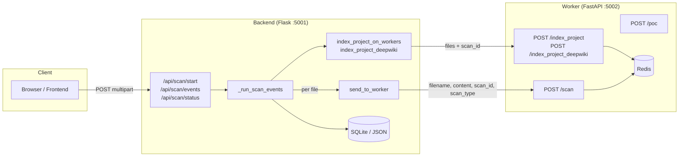
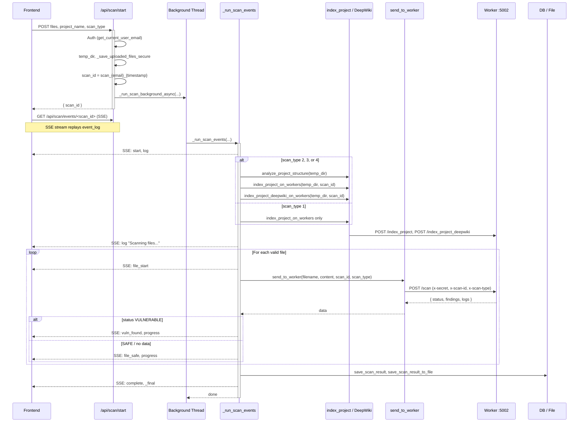
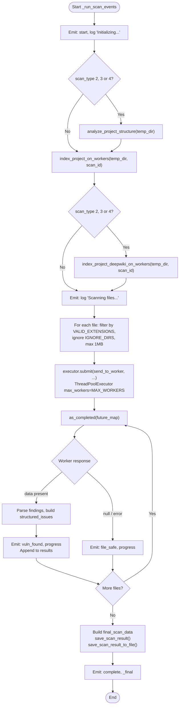
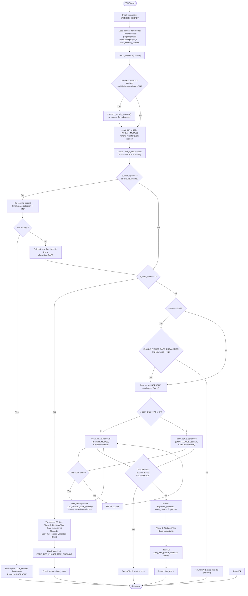
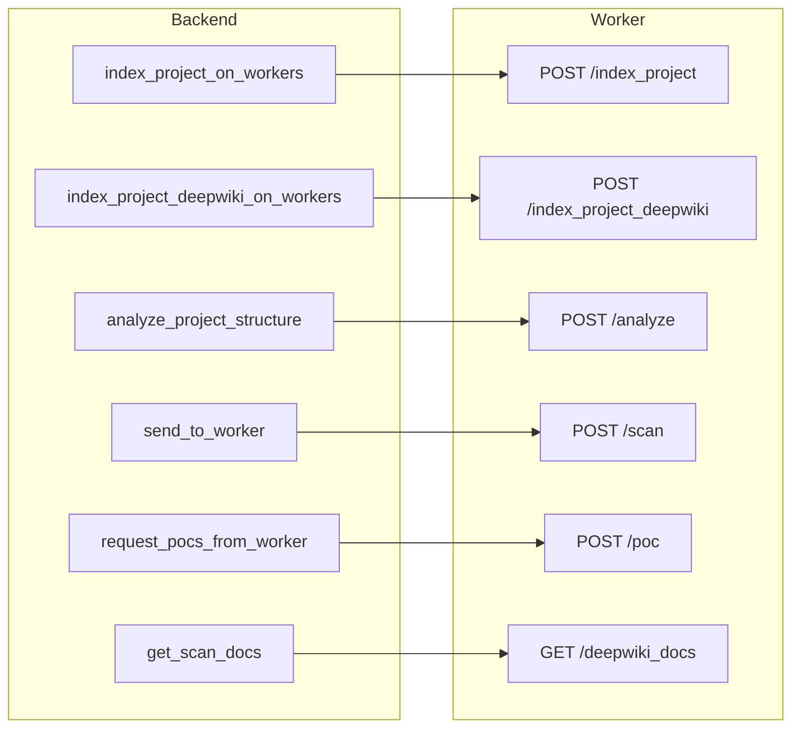
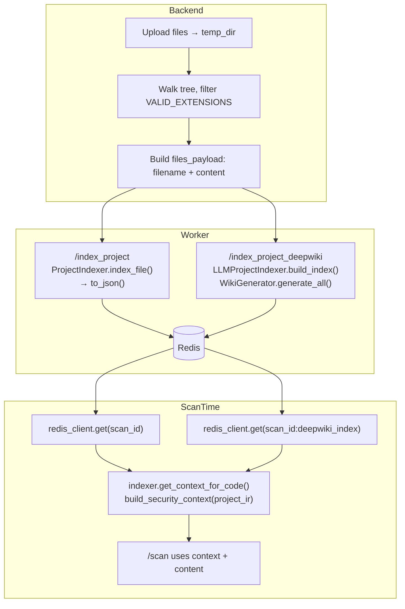
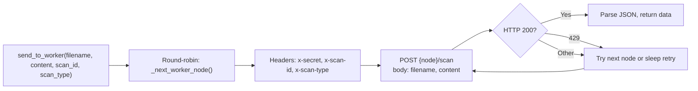

# Sentinel AI Scan Flow: Backend + Worker

This document describes how a security scan flows from the Flask backend (`backend/main_integrated.py`) to the FastAPI worker (`backend/worker/core/main.py`) and back.

---

## 1. High-Level Architecture

---

## 2. Backend: Scan Lifecycle (main_integrated.py)

---

## 3. Backend: _run_scan_events Flow (Simplified)

---

## 4. Worker: POST /scan Pipeline (main.py)

---

## 5. Worker: Tier Summary

| Tier | Name        | Model        | Purpose |
|------|-------------|-------------|---------|
| 1    | Basic       | CHEAP_MODEL | High-recall triage; two-phase FP filter (hard exclusions + capped LLM validation) |
| 2    | Standard    | SMART_MODEL   | CWE, confidence; focused bundle for large files |
| 3    | Advanced    | SMART_MODEL   | CVSS, remediation, consequences; focused bundle for large files |
| 4    | LLM-Centric | SMART_MODEL   | Single-pass detection + filtering; fallback to Tier 1 if 0 findings |

---

## 6. Worker Endpoints Used by Backend

---

## 7. Data Flow: Index → Scan

---

## 8. SSE Events (Frontend ↔ Backend)

| Event Type   | Direction   | Meaning |
|-------------|-------------|---------|
| `start`     | Backend→FE  | Scan phase started; `msg` describes phase |
| `log`       | Backend→FE  | Log line; `filename`, `msg` |
| `file_start`| Backend→FE  | Started scanning a file |
| `vuln_found`| Backend→FE  | File has issues; `filename`, `count`, `issues` |
| `file_safe` | Backend→FE  | File has no (remaining) findings |
| `progress`  | Backend→FE  | `files_scanned`, `total_files` |
| `complete`  | Backend→FE  | Scan done; `scan_id` |
| `_final`    | Internal    | Not sent to client; carries final `data` or `error` |

---

## 9. send_to_worker (Backend → Worker)

- Retries: up to 3 global attempts; on 429, rotate nodes and optionally sleep.
- Response: `{ status, findings, logs }` or `null` on failure.

---

*Generated from `backend/main_integrated.py` and `backend/worker/core/main.py`.*
