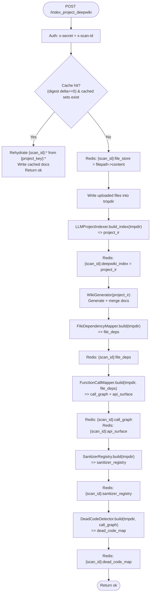

# SentinAI v3 — Upload → Indexing Flow (DeepWiki + 4 Indexers)

This document explains what happens from the moment a user uploads files until the project is fully **indexed** for scanning, with a specific focus on how the **LLM (DeepWiki) indexer** “connects” to the **four deterministic indexers**.

Scope:
- Frontend upload → backend `POST /api/scan/start`
- Backend background scan loop up to and including worker indexing calls:
  - `POST /index_project` (regex/symbol index)
  - `POST /index_project_deepwiki` (LLM `project_ir` + 4 deterministic indexers)
- The data handoff via **Redis keys** under a shared `scan_id`

---

## Start Here: The Connection (LLM Indexer ↔ 4 Indexers)

There is **no direct function call or data-structure dependency** where the four indexers consume `project_ir`.

Instead, the connection is:
- **Same project snapshot**: both the LLM indexer and the 4 indexers read the same temporary on-disk project folder (`tmpdir`).
- **Same scan namespace**: everything is written under the same `scan_id` keyspace in Redis (`{scan_id}:...`).
- **Same consumer**: later, `POST /scan` pulls **both** the DeepWiki summary (`{scan_id}:deepwiki_index`) and the deterministic maps (`{scan_id}:call_graph`, `{scan_id}:sanitizer_registry`, etc.) to build prompt context + validation signals.

In other words: **they are siblings in one indexing endpoint**, unified by `scan_id` + Redis, and merged downstream during scanning.

Worker entrypoint: `backend/worker/core/main.py`

---

## 1) Upload: Browser → Next.js Proxy → Backend

### Frontend (Next.js)
The UI builds a `FormData` payload containing:
- `project_name`
- `scan_type`
- `user_id`
- many `files` (often with `webkitRelativePath` when uploading a folder)

It POSTs via the Next.js proxy route:
- `src/app/api/proxy/scan/start/route.ts` → forwards to backend `POST /api/scan/start`

### Backend (Flask)
The backend:
- saves files into a temporary directory (safe path handling)
- creates a `scan_id`
- starts a background thread that runs the scan lifecycle generator
- immediately returns `{ scan_id }` so the UI can open SSE and show progress

Backend implementation (one of these depending on your run target):
- `backend/mainflask.py` (contains `_run_scan_events`, `index_project_on_workers`, `index_project_deepwiki_on_workers`)
- `backend/main_integrated.py` (documented as “production” in `md/ARCHITECTURE_AND_FLOWS.md`)

---

## 2) Backend: Indexing is called before scanning

Inside the backend scan loop (`_run_scan_events(...)`), indexing happens before any file is sent to `/scan`.

### Stage A — Always: Regex/Symbol Index
Backend calls worker indexing:
- `index_project_on_workers(temp_dir, scan_id, project_key)` → `POST {worker}/index_project`

### Stage B — Only Tier 2/3/4: DeepWiki + Deterministic Indexers
Backend calls worker deep indexing:
- `index_project_deepwiki_on_workers(temp_dir, scan_id, project_key)` → `POST {worker}/index_project_deepwiki`

The backend also runs `analyze_project_structure(temp_dir)` for Tier 2/3/4, but that is separate from the DeepWiki index build itself.

---

## 3) Worker Stage A: `POST /index_project` (Regex/Symbol Index)

Worker endpoint: `backend/worker/core/main.py` → `@app.post("/index_project")`

### What it does
Uses `ProjectIndexer` (`backend/worker/core/project_indexer.py`) to build a fast regex-based index:
- `symbol_table`: symbol → `{ file, code (snippet), dependencies }`
- `file_symbols`: file → `[symbols...]`
- a lightweight inferred `call_graph` (symbol reference adjacency)

### Where it’s stored
Redis keys:
- `{scan_id}`: the regex index JSON (string)
- `{scan_id}:indexing_meta`: metadata (including incremental cache stats)

Optional project-level cache (when `project_key` exists):
- `{project_key}:regex_index`
- `{project_key}:file_digests`

---

## 4) Worker Stage B: `POST /index_project_deepwiki` (LLM + 4 Indexers)

Worker endpoint: `backend/worker/core/main.py` → `@app.post("/index_project_deepwiki")`

This endpoint builds **multiple maps** of the same project snapshot:
- LLM semantic index (`project_ir`)
- deepwiki docs (generated from `project_ir`)
- 4 deterministic maps (deps/calls/sanitizers/dead code)

### The pipeline (in order)
1) Store `{scan_id}:file_store` (filepath → content) for later use by slicers/validators.
2) Write all files into a temporary folder (`tmpdir`).
3) Build DeepWiki semantic `project_ir` via `LLMProjectIndexer` (in `LLMindexer.py`).
4) Store `project_ir` in Redis under `{scan_id}:deepwiki_index`.
5) Generate/merge DeepWiki docs via `WikiGenerator(project_ir, ...)`.
6) Run the four deterministic indexers:
   - `FileDependencyMapper` → `{scan_id}:file_deps`
   - `FunctionCallMapper` → `{scan_id}:call_graph` (+ `{scan_id}:api_surface`)
   - `SanitizerRegistry` → `{scan_id}:sanitizer_registry`
   - `DeadCodeDetector` → `{scan_id}:dead_code_map`

### Indexer dependency chain (inside Stage B)
The four deterministic indexers are layered:
- `FileDependencyMapper` produces `file_dep_map`
- `FunctionCallMapper` consumes `file_dep_map` to resolve cross-file calls and build a call graph
- `DeadCodeDetector` consumes `call_graph` to mark dead/test-only functions
- `SanitizerRegistry` is mostly independent (pattern-based discovery), but it’s consumed later together with the call graph

---

## 5) Redis keys written during indexing

All artifacts are tied together by `scan_id`.

### Stage A keys
- `{scan_id}`: regex index JSON (ProjectIndexer)
- `{scan_id}:indexing_meta`: metadata

### Stage B keys (Tier 2/3/4)
- `{scan_id}:file_store`: file contents map used later by `ContextSlicer`
- `{scan_id}:deepwiki_index`: DeepWiki semantic `project_ir` JSON
- `{scan_id}:file_deps`: dependency graph
- `{scan_id}:call_graph`: function call graph
- `{scan_id}:api_surface`: list of detected entry points (derived from call graph)
- `{scan_id}:sanitizer_registry`: sanitizer/auth/parameterized-query registry
- `{scan_id}:dead_code_map`: dead/test-only map
- `{scan_id}:progress`: progress feed for indexing (backend reads via BLPOP for SSE logs)

Optional per-project cache keys (when `project_key` exists) mirror these with a `{project_key}:...` prefix.

---

## 6) Mermaid: Upload → Indexing (Sequence)

```mermaid
sequenceDiagram
  autonumber
  participant UI as Browser UI (Next.js)
  participant NX as Next.js API Proxy
  participant BE as Backend (Flask :5001)
  participant BG as Background Thread (_run_scan_events)
  participant W as Worker (FastAPI :5002)
  participant R as Redis

  UI->>NX: POST /api/proxy/scan/start (FormData files, scan_type)
  NX->>BE: POST /api/scan/start (FormData)
  BE->>BE: Save files to temp_dir; create scan_id
  BE->>BG: Start background scan loop
  BE-->>UI: { scan_id }

  UI->>BE: GET /api/scan/events/<scan_id> (SSE)
  Note over UI,BE: Backend streams indexing logs + scan progress

  BG->>W: POST /index_project (files, x-scan-id, x-secret)
  W->>W: ProjectIndexer builds regex/symbol index
  W->>R: SETEX {scan_id} = regex index JSON
  W->>R: SETEX {scan_id}:indexing_meta = meta
  W-->>BG: 200 OK

  alt scan_type in (2,3,4)
    BG->>W: POST /index_project_deepwiki (files, x-scan-id, x-secret)
    W->>R: SETEX {scan_id}:file_store = filepath->content
    W->>W: Write all files into tmpdir
    W->>W: LLMProjectIndexer.build_index(tmpdir) => project_ir
    W->>R: SETEX {scan_id}:deepwiki_index = project_ir JSON
    W->>W: WikiGenerator(project_ir) => DeepWiki docs
    W->>W: FileDependencyMapper(tmpdir) => file_deps
    W->>R: SETEX {scan_id}:file_deps
    W->>W: FunctionCallMapper(tmpdir, file_deps) => call_graph + api_surface
    W->>R: SETEX {scan_id}:call_graph
    W->>R: SETEX {scan_id}:api_surface
    W->>W: SanitizerRegistry(tmpdir) => sanitizer_registry
    W->>R: SETEX {scan_id}:sanitizer_registry
    W->>W: DeadCodeDetector(tmpdir, call_graph) => dead_code_map
    W->>R: SETEX {scan_id}:dead_code_map
    W-->>BG: 200 OK
  end

  Note over BG: Only after indexing completes do files get sent to POST /scan
```

---

## 7) Mermaid: Worker Internal `/index_project_deepwiki` (LLM + 4 Indexers)



---

## 8) Where the “merge” happens later (for context)

When a specific file is scanned (`POST /scan` in `backend/worker/core/main.py`), the worker loads and combines:
- regex context from `{scan_id}` (ProjectIndexer)
- DeepWiki project overview from `{scan_id}:deepwiki_index` (converted to text via `build_security_context`)
- deterministic maps like `{scan_id}:call_graph`, `{scan_id}:sanitizer_registry`, `{scan_id}:dead_code_map`, `{scan_id}:api_surface`

That’s when the LLM semantic view and the deterministic graph signals become one “briefing” for the model and the validation layers.

